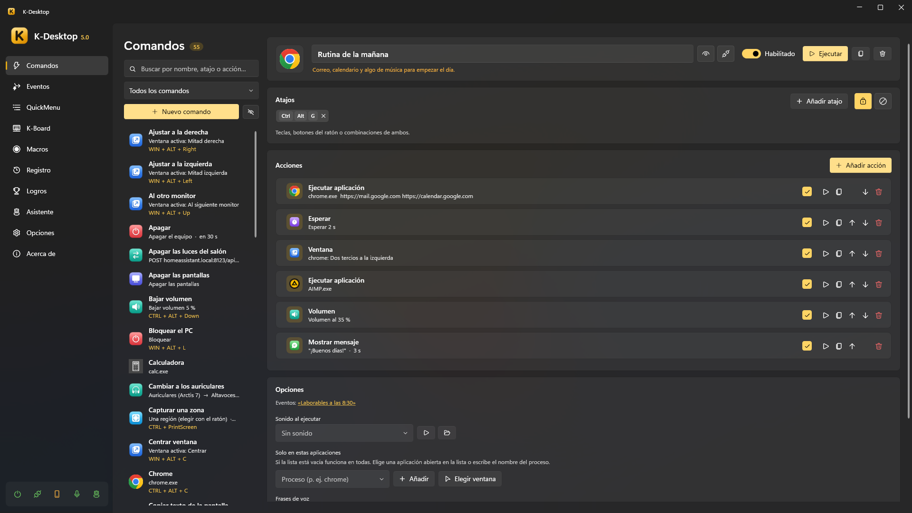

<p align="center">
  
</p>

<h1 align="center">K-Desktop 5</h1>

<p align="center">
  <b>Atajos de teclado y ratón, QuickMenus, macros, eventos, control por voz y mando desde el móvil para Windows,<br>
  con asistentes de escritorio opcionales que funcionan con IA local.</b>
</p>

<p align="center">
  
  
  
  
  
</p>

<p align="center">
  <a href="README.md">English</a> · <b>Español</b> · <a href="https://kobayashi82.github.io/K-Desktop/es/">Documentación</a>
</p>

> [!WARNING]
> **En desarrollo.** K-Desktop 5 se usa a diario, pero sigue en desarrollo activo: las versiones publicadas son
> preliminares, las cosas cambian de una versión a otra y el módulo Asistente aún se está terminando. Si lo pruebas,
> cuenta con que habrá cosas por pulir.

<p align="center">
  
</p>

K-Desktop convierte cualquier tecla, botón del ratón o combinación en una secuencia de acciones: abrir programas,
colocar ventanas, cambiar el volumen, hacer capturas, llamar a Home Assistant, escribir texto, leer el texto de la
pantalla… Los mismos comandos se lanzan desde un menú en el ratón, una caja de búsqueda, la voz, el móvil, la red o
solos cuando pasa algo en el equipo.

Además, el **módulo Asistente** (opcional) pone en el escritorio personajes a los que se les habla. Piensan con un
modelo de IA local, usan tus comandos con gestos que se ven y tienen herramientas para archivos, la web, la pantalla,
la música, temporizadores, notas y tus propios documentos.

K-Desktop 5 es la reescritura completa de K-Desktop 4 (VB.NET / WinForms) en **C# / WPF / .NET 10**. La primera vez
que se ejecuta importa los comandos, QuickMenus e iconos de la versión anterior.

## Vídeo

https://github.com/user-attachments/assets/1b2e6c1e-cccf-4956-9942-88c14eba4420

<p align="center">
  <a href="docs/videos/K-Desktop-es.srt">Subtítulos (.srt)</a>
</p>

## Contenido

- [Funciones](#funciones)
- [Acciones](#acciones)
- [Privacidad](#privacidad)
- [Requisitos](#requisitos)
- [Instalación](#instalación)
- [Primeros pasos](#primeros-pasos)
- [Asistentes](#asistentes)
- [Línea de comandos](#línea-de-comandos)
- [Compilar](#compilar)
- [Estructura del proyecto](#estructura-del-proyecto)
- [Licencias de terceros](#licencias-de-terceros)
- [Licencia](#licencia)

## Funciones

### Automatización

- **Comandos**: secuencias de acciones con atajos de teclado o ratón (`CTRL + ALT + O`, `Mouse 5`,
  `Mouse 4 + Mouse 1`, `CTRL + Wheel Up`…). Un comando puede limitarse a ciertas aplicaciones; si un atajo existe a la
  vez para todas y para una concreta, en esa aplicación gana el específico. Las acciones **Si…** añaden condiciones.
- **QuickMenu**: menú en cascada en la posición del ratón, con fondo acrílico, iconos y navegación con teclado. Clic
  izquierdo ejecuta y cierra, clic derecho ejecuta y lo deja abierto, clic central edita el elemento.
- **Lanzador**: caja de búsqueda con su propio atajo. Encuentra comandos y programas del menú Inicio con unas pocas
  letras, busca en la web y hace cuentas. Los más usados salen primero.
- **Eventos**: «cuando pase X, ejecuta estos comandos». A una hora o cada N minutos, al abrir, cerrar o traer delante
  un programa, tras un rato sin usar el PC, al bloquear o suspender, con batería, con un archivo nuevo en una carpeta,
  al conectar un mando, una unidad USB o un dispositivo de audio, al cambiar de red, según el uso de CPU/GPU/memoria o
  cuando otro equipo (o Home Assistant) lo llama por su nombre. Con condiciones, tiempo mínimo entre ejecuciones y
  protección contra bucles.
- **Macros**: graba teclado y ratón con sus tiempos, edita los pasos y reprodúcelas con repeticiones, en bucle o a otra
  velocidad. El modo para juegos envía movimiento relativo en bruto.
- **K-Board**: perfiles que reasignan teclas, botones del ratón y la rueda a otras teclas, combinaciones, textos o
  comandos, en todas las aplicaciones o solo en algunas, con capas por modificadores, editados sobre un teclado y un
  ratón dibujados.
- **Con o sin administrador**: K-Desktop corre elevado para que sus atajos funcionen también sobre ventanas elevadas,
  y cada acción decide si su programa arranca como administrador o como usuario normal.

### Voz

- **Palabras de activación y tecla para hablar**: graba tu propia palabra en unos segundos desde Opciones, o mantén
  una tecla.
- **Reconocimiento local**: Parakeet (sherpa-onnx) transcribe y el comando se elige por su nombre o por su significado
  (EmbeddingGemma). Sin internet.
- **Órdenes de música** («pon música», «sube el volumen»…) y cancelación del eco de lo que está sonando.
- **Dictado**: mantén una tecla y habla; el texto se escribe donde está el cursor, con saltos de línea dichos y «borra
  eso».

### Control remoto

- **Móvil**: app web instalable (PWA) y app de Android con tus comandos y menús, touchpad y teclado, controles de
  audio, zoom, órdenes por voz y un chat con los asistentes. Cada dispositivo se empareja con un código QR y se puede
  revocar por separado.
- **Control por UDP**, compatible con el protocolo de K-Desktop 4 (puerto 2501).

### Día a día

- **Registro** de todo lo que se ha ejecutado, cuándo y desde dónde (atajo, menú, voz, web, evento, asistente…).
- **Logros y estadísticas**: más de 100 logros con notificación animada.
- **Iconos**: colección vectorial propia (cualquier símbolo de Windows 11 en 15 colores), las bibliotecas de iconos de
  Windows, cualquier imagen o el favicon de una web.
- **Interfaz moderna** con tema claro, oscuro o del sistema, y animaciones.
- **Seis idiomas** (español, inglés, francés, alemán, italiano y portugués) dentro del ejecutable. Para añadir otro o
  cambiar textos basta con dejar un JSON en `%APPDATA%\K-Desktop 5\Languages`.
- **Copias de seguridad**: diarias de la configuración, completas en `.zip` cada N días, exportar e importar.
- **Actualizaciones automáticas** del programa y de la app de Android.

## Acciones

| Abrir y ejecutar | Ventanas | Teclado y ratón | Sonido |
|---|---|---|---|
| Ejecutar aplicación | Controlar aplicación (activar, cerrar…) | Enviar pulsación / texto | Volumen (sistema, micrófono o una app) |
| Abrir carpeta o ubicación especial | Ventana (colocar, mover, minimizar…) | Portapapeles | Salida de audio |
| Abrir página web | Siempre visible | Reproducir macro | Reproducir sonido |
| Ejecutar script (CMD / PowerShell) | | Perfil de K-Board | Grabar audio |
| | | Dictar | |

| Pantalla | Red e internet | Sistema | K-Desktop y flujo |
|---|---|---|---|
| Captura de pantalla | Petición web (GET, POST…) | Archivos ocultos | Si… (condiciones) |
| Copiar texto de la pantalla (OCR) | Despertar equipo (Wake-on-LAN) | Plan de energía | Esperar |
| Lupa | Wi-Fi y Bluetooth | Energía (apagar, reiniciar, bloquear…) | Ejecutar comandos y eventos |
| Pantalla (brillo, proyección, apagar) | | | Abrir QuickMenu |
| Tema de Windows | | | Mostrar mensaje |

Con el módulo Asistente encendido hay cuatro más: **preguntar** a un asistente, hacer que **diga** algo, **cargar o
liberar su cerebro** y lanzar uno de sus **extras** (como el modo manual del Lander).

## Privacidad

El reconocimiento de voz, las palabras de activación, las voces y la IA de los asistentes funcionan **en tu PC**. Lo
que dices o escribes no se manda a ningún sitio. K-Desktop solo sale a internet para lo que le pides: las peticiones
web de tus comandos, las herramientas de web, tiempo y divisas de los asistentes, las herramientas y servidores MCP que
añadas tú, las actualizaciones y las descargas de voces o modelos. El móvil habla con el PC por tu red local y necesita
emparejarse, incluso desde el propio PC.

## Requisitos

- Windows 10 (1809 o posterior) u 11, de 64 bits.
- Para la IA de los asistentes (opcional): una gráfica con memoria suficiente para el modelo que elijas (un modelo de
  4B con visión ocupa unos 5 GB), u otro servidor de IA en tu red.
- Para el móvil: el PC y el móvil en la misma red. La app de Android necesita Android 5.0 o superior.

## Instalación

Descarga la última versión desde [Releases](https://github.com/Kobayashi82/K-Desktop/releases/latest):

- **[KDesktop.exe](https://github.com/Kobayashi82/K-Desktop/releases/latest/download/KDesktop.exe)**: el programa,
  un único ejecutable portátil. No hace falta instalar .NET.
- **[KDesktop.apk](https://github.com/Kobayashi82/K-Desktop/releases/latest/download/KDesktop.apk)**: la app de
  Android. También se descarga desde el propio K-Desktop, que la mantiene actualizada.

La primera vez que se abre, K-Desktop se registra para arrancar con Windows (se puede desactivar en Opciones). Los
datos se guardan en `%APPDATA%\K-Desktop 5`.

## Primeros pasos

1. **Crea un comando**: *Comandos → Nuevo comando*, añade un atajo y una o más acciones, y pulsa **Ejecutar** para
   probarlo.
2. **Ponlo en un menú**: en *QuickMenu* montas el menú que se abre en el ratón, con su propio atajo.
3. **Háblale**: *Opciones → Voz* descarga los modelos de voz y graba tu palabra de activación. Después di «K-Desktop,
   *nombre del comando*».
4. **Usa el móvil**: *Opciones → Aplicación web*, escanea el código QR con el móvil y ahí tienes tus comandos.
5. **Automatízalo**: *Eventos* ejecuta comandos a una hora, al abrir un programa, cuando dejas el PC…

## Asistentes

> [!NOTE]
> El módulo Asistente está en desarrollo. Mientras está apagado, K-Desktop no carga nada de él y funciona exactamente
> como siempre.

Un asistente es un personaje que vive sobre tus ventanas. Anda o vuela por ellas, reacciona a lo que pasa en el PC y
se le habla («Lander, minimiza el Chrome», «Kobii, ¿qué tiempo hará mañana?»). Cuando ejecuta uno de tus comandos,
cada paso se ve: el Lander vuela hasta el botón de minimizar, dispara y la ventana se minimiza justo en el impacto. Los
asistentes se instalan como paquetes `.kai`, cada uno corre en su propio proceso sin permisos de administrador y
K-Desktop nunca carga su código.

| Asistente | Qué es |
|---|---|
| **[Lander](https://github.com/Kobayashi82/K-Desktop-Assistants/tree/main/Lander)** | Un pequeño módulo lunar que vuela entre tus ventanas, aterriza en ellas, las remolca con un gancho y tiene su propio juego |
| **[Kobii](https://github.com/Kobayashi82/K-Desktop-Assistants/tree/main/Kobii)** | Una criaturita que anda, trepa por tus ventanas, juega, come, duerme y se deja acariciar, cepillar o chocar los cinco |
| **[Kumo](https://github.com/Kobayashi82/K-Desktop-Assistants/tree/main/Kumo)** | Una nube blandita que flota, envuelve las ventanas para llevarlas, llueve, hace arcoíris y baila con tu música |
| **[Pip](samples/CharacterAssistant)** | Un ejemplo sin código: solo imágenes y un JSON |
| **K-Desktop** | El asistente incluido, sin personaje, para tener respuestas sin nadie en el escritorio |

**Cerebro.** Los asistentes piensan con un modelo local. K-Desktop ejecuta modelos GGUF con `llama-server` por su
cuenta: los arranca cuando hacen falta, mantiene uno o varios cargados según la memoria de la gráfica, descarga
modelos de Hugging Face y libera la gráfica al empezar un juego a pantalla completa. También valen Ollama, llama-swap
y cualquier servidor compatible con OpenAI. Cada asistente puede pensar con un modelo distinto y se le puede pedir que
«lo piense bien» en las preguntas difíciles.

**Qué saben hacer.** Ejecutar tus comandos y controlar programas y ventanas; buscar, abrir, leer, mover y borrar
archivos; buscar y leer en internet (con un navegador interno para las páginas que se pintan con scripts); mirar la
pantalla (visión u OCR de Windows); decir y controlar lo que suena; poner temporizadores, tomar notas y recordar cosas
de ti; hacer cuentas, fechas y conversiones de unidades y divisas; decir el tiempo; contar cómo está el PC; cerrar un
programa colgado; avisarte cuando pase algo («avísame cuando acabe la descarga»), y traducir, corregir o resumir el
texto que tengas seleccionado.

**Tus propias herramientas.** Un `.json` en `%APPDATA%\K-Desktop 5\Assistant\Tools\` añade una herramienta sin
compilar: una petición a cualquier API (Home Assistant, un bot de Telegram), uno de tus comandos con frases propias, una
rutina de varios pasos o un script (`.ps1`, `.bat`, `.py`, `.js`). Los **servidores MCP** se añaden o se importan de
Claude Desktop o mcpo, y K-Desktop también puede compartir sus herramientas como servidor MCP. Los secretos se guardan
cifrados y el modelo nunca los ve. Cada herramienta tiene su interruptor y su propio ajuste de cuándo pregunta antes.

**Lo que sabe.** Elige carpetas o archivos con tus documentos (apuntes, manuales, contratos, facturas…). Se leen en el
PC (texto, Markdown, código, Word, PowerPoint, páginas web, PDF y, con OCR, imágenes y PDF escaneados), se mantienen al
día cuando cambian y se buscan por palabras y por significado. Las respuestas dicen de qué documento y página salen.

**Voz.** Cada asistente tiene su palabra de activación, su tecla para hablarle, su idioma, su personalidad y su voz.
Las respuestas se dicen frase a frase mientras la IA escribe, con **Kokoro** o **Piper** (voces naturales que
funcionan en el procesador) o con las voces de Windows, y con efectos de voz (robot, radio, 8 bits…) que se pueden
editar. Las respuestas largas se resumen en voz alta y se enseñan enteras en una hoja junto al asistente. También se le
pueden soltar archivos encima y elegir qué hacer con ellos.

### Instalar un asistente

1. *Opciones → Módulo Asistente → General →* **Activar el módulo Asistente**.
2. Abre un paquete `.kai` con un doble clic, o usa *Asistentes → Añadir asistente* o el *Catálogo*. La ficha del
   paquete enseña qué es, qué sabe hacer y quién lo firmó, y ofrece grabar su nombre como palabra de activación y crear
   comandos para sus atajos.
3. Pulsa **Instalar**. Desde su página en *Opciones → Módulo Asistente → Asistentes* lo pones en el escritorio o lo
   escondes, cambias su palabra y su tecla, el modelo con el que piensa, su personalidad y su voz, y ves sus
   animaciones en la pestaña **Probar**.

Una versión nueva instalada encima de la anterior se cambia en caliente y conserva los datos del asistente
(`%APPDATA%\K-Desktop 5\Assistants\Data\<id>`, que entran en las copias de seguridad).

Para crear tu propio asistente, mira [Crear asistentes](https://kobayashi82.github.io/K-Desktop/es/sdk/index.html)
o empieza con la plantilla de `dotnet new` en [`templates/kdassistant`](templates/kdassistant). Las herramientas
JSON se explican en [Herramientas](https://kobayashi82.github.io/K-Desktop/es/assistant/tools.html).

## Línea de comandos

```
KDesktop.exe --menu "Principal"     abre un QuickMenu (en la instancia en ejecución)
KDesktop.exe --run "Nombre"         ejecuta un comando
KDesktop.exe --event "Nombre"       ejecuta los comandos de un evento
KDesktop.exe --launcher             abre el lanzador
KDesktop.exe --show | --exit        muestra la ventana / cierra K-Desktop
KDesktop.exe --page macros          abre la ventana en una página (commands, quickmenus, events, macros, kboard, assistant,
                                    achievements, stats, settings, about)
KDesktop.exe --data "C:\Carpeta"    usa otra carpeta de datos (instancia independiente)
KDesktop.exe --no-hooks --no-udp --no-web --no-elevate   diagnóstico
```

## Compilar

Requiere el [SDK de .NET 10](https://dotnet.microsoft.com/download).

```powershell
dotnet build KDesktop.slnx                       # Debug
dotnet build KDesktop.slnx -c Release            # Release + portable en artifacts\portable\KDesktop.exe
dotnet test tests\KDesktop.Core.Tests            # pruebas del núcleo
dotnet test tests\KDesktop.Assistant.Tests       # pruebas del módulo Asistente (arrancan el proceso real)
```

La compilación en Release genera además el ejecutable portátil: un solo `.exe` ReadyToRun con idiomas, sonidos e
iconos dentro (para saltárselo: `-p:BuildPortable=false`). Si están el JDK 17 y el SDK de Android, también compila la
app de Android (`tools\android\build-apk.ps1`). La compilación no da ningún aviso, con los analizadores de .NET en
`latest-recommended`.

## Estructura del proyecto

```
src/KDesktop.Core             núcleo sin interfaz: modelo, almacenamiento, hooks, motor de acciones, eventos, voz, servidor web y UDP
src/KDesktop                  aplicación WPF: ventana principal, QuickMenu, lanzador, OSD, bandeja, temas
src/KDesktop.Assistant.Sdk    SDK de los asistentes (IAssistant y lo que les da el host) y empaquetado en .kai
src/KDesktop.Assistant.Host   el proceso de los asistentes (KDesktop.exe --assistant): capa de dibujo, mundo, sonido, escenario
src/KDesktop.Assistant.Brain  la IA de los asistentes: servidores de modelos, enrutado de las órdenes, memoria, banco de pruebas
src/KDesktop.Assistant.Tools  herramientas incluidas, herramientas JSON, cliente y servidor MCP, documentos, permisos
src/KDesktop.Assistant.Voice  su voz: Kokoro y Piper en el procesador, voces de Windows, efectos de voz
samples/CharacterAssistant    Pip, el asistente de ejemplo sin código
templates/kdassistant         plantilla de dotnet new para un asistente nuevo
android/                      app de Android (WebView de la app web del PC, con micrófono nativo)
tests/                        pruebas del núcleo, del módulo Asistente y Dot, el asistente de las pruebas
site/                         la web de la documentación (DocFX), publicada en GitHub Pages con site/publish.ps1
docs/assistant/               esquemas de los paquetes, protocolo de la tubería y sus ejemplos, notas internas
docs/tutorial/                el vídeo explicativo (Remotion) y sus capturas
tools/                        scripts de publicación, KaiSign, icono, APK, imágenes de Pip, capturas del tutorial
catalog.json                  el catálogo oficial de asistentes que lee K-Desktop
```

Los asistentes están en su propio repositorio,
[K-Desktop-Assistants](https://github.com/Kobayashi82/K-Desktop-Assistants).

## Licencias de terceros

Ver [docs/THIRD-PARTY-NOTICES.md](docs/THIRD-PARTY-NOTICES.md).

## Licencia

K-Desktop se publica con la [licencia MIT](LICENSE).
