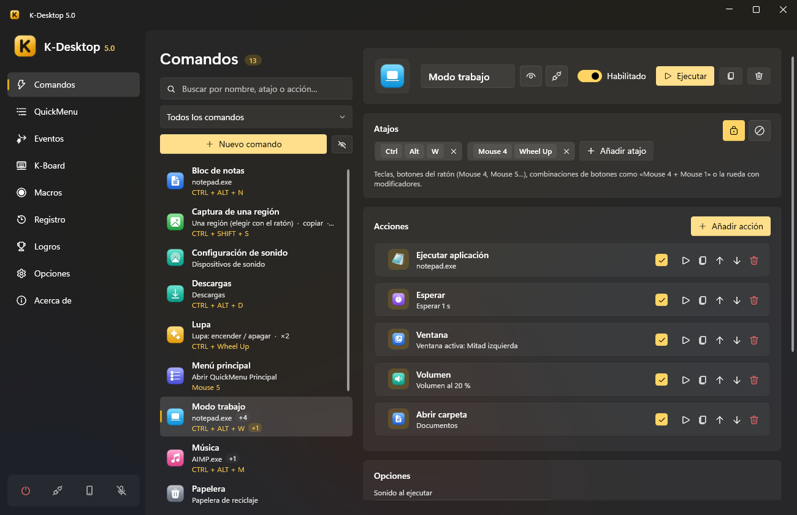

<p align="center">
  
</p>

<h1 align="center">K-Desktop 5.0</h1>

<p align="center">
  Atajos de teclado y ratón, QuickMenus, macros, eventos, control por voz y mando a distancia desde el móvil para Windows.
</p>

<p align="center">
  
  
  
  
</p>

<p align="center">
  
</p>

K-Desktop convierte cualquier tecla, botón del ratón o combinación en una secuencia de acciones: abrir programas,
colocar ventanas, cambiar el volumen, hacer capturas, lanzar peticiones a Home Assistant… Todo se puede lanzar
también desde un menú en el ratón, por voz, desde el móvil, por red o cuando pasa algo en el equipo.

Es la reescritura completa de K-Desktop 4 (VB.NET / WinForms) en **C# / WPF / .NET 10**, y la primera vez que se
ejecuta importa los comandos, QuickMenus e iconos de la versión anterior.

## Funciones

- **Comandos**: secuencias de acciones que se lanzan con atajos de teclado o ratón (`CTRL + ALT + O`, `Mouse 5`,
  `Mouse 4 + Mouse 1`, `CTRL + Wheel Up`…). Un comando puede limitarse a ciertas aplicaciones; si un atajo existe a la
  vez para todas y para una concreta, en esa aplicación gana el específico.
- **QuickMenu**: menú en cascada en la posición del ratón, con fondo acrílico, iconos y navegación con teclado. Clic
  izquierdo ejecuta y cierra, clic derecho ejecuta y lo deja abierto, clic central edita el elemento.
- **Lanzador**: caja de búsqueda con su propio atajo. Encuentra comandos y programas del menú Inicio con solo unas
  letras, busca en la web y hace cuentas. Los más usados salen primero.
- **Eventos**: «cuando pase X, ejecuta estos comandos». A una hora o cada N minutos, al abrir o cerrar un programa,
  con un programa en primer plano, tras un rato sin usar el PC, al bloquear o suspender, al pasar a batería, con un
  archivo nuevo en una carpeta, al conectar un mando, una unidad USB o un dispositivo de audio, al cambiar de red,
  según el uso de CPU/GPU/memoria o cuando otro equipo (o Home Assistant) lo llama por su nombre. Con condiciones,
  tiempo mínimo entre ejecuciones y protección contra bucles.
- **Voz**: palabra de activación propia (se graba en unos segundos desde Opciones) o tecla para hablar. Reconoce lo
  que dices con Parakeet (sherpa-onnx) y elige el comando por su nombre o por su significado (EmbeddingGemma), todo
  en local y sin conexión. Entiende órdenes de música («pon música», «sube el volumen»…) y cancela el eco de lo que
  está sonando.
- **Control remoto desde el móvil**: app web instalable (PWA) y app de Android con la lista de comandos y menús,
  touchpad y teclado, controles de audio, zoom y micrófono para dar órdenes por voz. Se empareja con un código QR y
  cada dispositivo se puede revocar.
- **Macros**: graba teclado y ratón con sus tiempos, edita los pasos y reprodúcelas con repeticiones, bucle o a otra
  velocidad. Tienen un modo para juegos (movimiento relativo en bruto).
- **K-Board**: perfiles que reasignan teclas, botones del ratón y la rueda a otras teclas, combinaciones, textos o
  comandos, en todas las aplicaciones o solo en algunas. Admiten capas con modificadores y se editan sobre un
  teclado y un ratón dibujados.
- **Ejecución con o sin administrador**: K-Desktop corre elevado para que sus atajos funcionen también sobre
  ventanas elevadas, pero cada acción decide si su programa arranca como administrador o como usuario normal.
- **Registro**: historial de lo que se ha ejecutado, cuándo y desde dónde (atajo, menú, voz, web, evento…).
- **Logros y estadísticas**: más de 100 logros con notificación animada y estadísticas de uso.
- **Iconos**: colección propia de iconos vectoriales (cualquier símbolo de Windows 11 en 15 colores), los de las
  bibliotecas de Windows, cualquier imagen o el favicon de la página web.
- **Interfaz moderna** con tema claro, oscuro o del sistema, y animaciones.
- **Seis idiomas** (español, inglés, francés, alemán, italiano y portugués) incluidos en el ejecutable. Para añadir
  otro o cambiar textos basta con dejar un JSON en `%APPDATA%\K-Desktop 5\Languages`.
- **Copias de seguridad** diarias de la configuración, copias completas en `.zip` cada N días y exportar/importar.
- **Actualizaciones automáticas** del programa y de la app de Android.
- **Control por UDP** compatible con el protocolo de K-Desktop 4 (puerto 2501).

## Acciones

| Aplicaciones | Entrada y sonido | Ventanas y sistema | K-Desktop |
|---|---|---|---|
| Ejecutar aplicación | Enviar pulsación / texto | Ventana (colocar, mover, minimizar…) | Si… (condiciones) |
| Abrir carpeta o ubicación especial | Portapapeles | Captura de pantalla | Abrir QuickMenu |
| Abrir página web | Volumen (sistema, micrófono o una app) | Lupa | Comandos y eventos |
| Controlar aplicación | Salida de audio | Siempre visible | Esperar |
| Ejecutar script (CMD / PowerShell) | Reproducir sonido | Pantalla (brillo, proyección, apagar) | |
| Petición web (GET, POST…) | Grabar audio | Tema de Windows | |
| Despertar equipo (Wake-on-LAN) | Reproducir macro | Wi-Fi y Bluetooth | |
| | K-Board | Archivos ocultos | |
| | | Mostrar mensaje | |
| | | Plan de energía | |
| | | Energía (apagar, reiniciar, bloquear…) | |

## Instalación

Descarga la última versión desde [Releases](https://github.com/Kobayashi82/K-Desktop-5.0/releases/latest):

- **[KDesktop.exe](https://github.com/Kobayashi82/K-Desktop-5.0/releases/latest/download/KDesktop.exe)**: el
  programa, un único ejecutable portátil que no necesita instalar .NET. Requiere Windows 10 u 11 de 64 bits.
- **[KDesktop.apk](https://github.com/Kobayashi82/K-Desktop-5.0/releases/latest/download/KDesktop.apk)**: la app de
  Android para controlar el PC desde el móvil (Android 5.0 o superior). También se puede descargar desde el propio
  K-Desktop, que la mantiene actualizada.

Al abrir K-Desktop por primera vez se registra para arrancar con Windows (se puede desactivar en Opciones). Los datos
se guardan en `%APPDATA%\K-Desktop 5`.

## Línea de comandos

```
KDesktop.exe --menu "Principal"     abre un QuickMenu (en la instancia en ejecución)
KDesktop.exe --run "Nombre"         ejecuta un comando
KDesktop.exe --event "Nombre"       ejecuta los comandos de un evento
KDesktop.exe --launcher             abre el lanzador
KDesktop.exe --show | --exit        muestra la ventana / cierra K-Desktop
KDesktop.exe --page macros          abre la ventana en una página (commands, quickmenus, events, macros, kboard, achievements, stats, settings, about)
KDesktop.exe --data "C:\Carpeta"    usa otra carpeta de datos (instancia independiente)
KDesktop.exe --no-hooks --no-udp --no-web --no-elevate   diagnóstico
```

## Compilar

Requiere el SDK de .NET 10.

```
dotnet build KDesktop.slnx                 # Debug
dotnet build KDesktop.slnx -c Release      # Release + portable en artifacts\portable\KDesktop.exe
dotnet test tests\KDesktop.Core.Tests      # pruebas
```

La compilación en Release genera además el ejecutable portátil (un solo `.exe` con idiomas, sonidos e iconos dentro).
Para saltárselo: `-p:BuildPortable=false`. Si están el JDK 17 y el SDK de Android, también compila la app de Android
(`tools\android\build-apk.ps1`).

## Estructura

```
src/KDesktop.Core           núcleo sin interfaz: modelo, almacenamiento, hooks, motor de acciones, eventos, voz, servidor web y UDP
src/KDesktop                aplicación WPF: ventana principal, QuickMenu, lanzador, OSD, bandeja, temas
android/                    app de Android (WebView de la app web del PC, con micrófono nativo)
tests/KDesktop.Core.Tests   pruebas del núcleo
tools/                      icono, APK y paquete de actualización
```

## Licencias de terceros

Ver [docs/THIRD-PARTY-NOTICES.md](docs/THIRD-PARTY-NOTICES.md).
