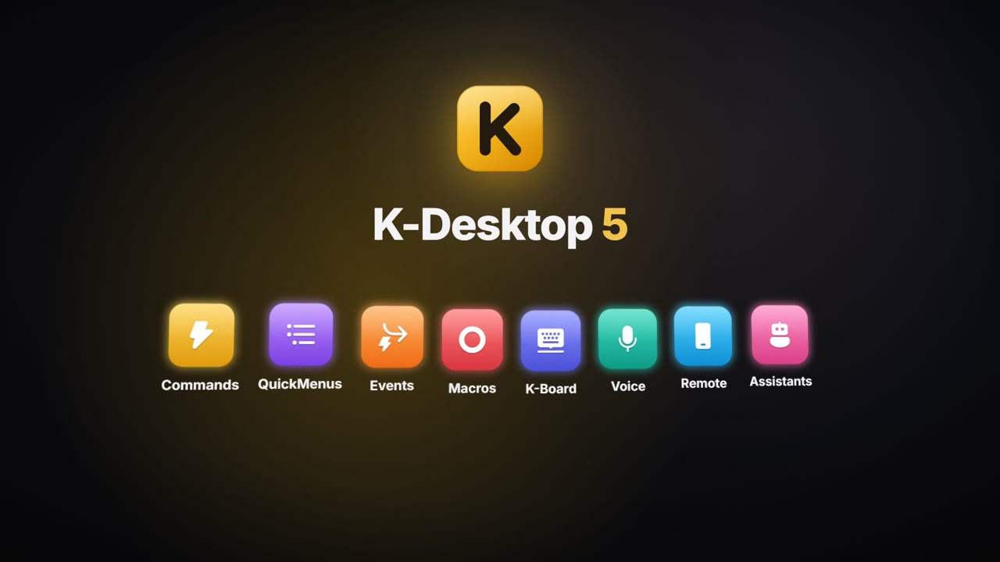

<p align="center">
  
</p>

<h1 align="center">K-Desktop 5.0</h1>

<p align="center">
  <b>English</b> · <a href="README.es.md">Español</a>
</p>

<p align="center">
  Keyboard and mouse shortcuts, QuickMenus, macros, events, voice control and a phone remote for Windows.
</p>

<p align="center">
  
  
  
  
</p>

<p align="center">
  
</p>

K-Desktop turns any key, mouse button or combination into a sequence of actions: open programs, arrange windows,
change the volume, take screenshots, send requests to Home Assistant… Everything can also be launched from a menu at
the mouse, by voice, from your phone, over the network or when something happens on the PC.

It is a full rewrite of K-Desktop 4 (VB.NET / WinForms) in **C# / WPF / .NET 10**. On its first run it imports the
commands, QuickMenus and icons from the previous version.

## Video

<p align="center">
  <a href="docs/videos/K-Desktop-en.mp4">
    
  </a>
</p>

<p align="center">
  <a href="docs/videos/K-Desktop-en.mp4">Watch the video (17 min)</a> ·
  <a href="docs/videos/K-Desktop-en.srt">Subtitles (.srt)</a>
</p>

## Features

- **Commands**: sequences of actions launched with keyboard or mouse shortcuts (`CTRL + ALT + O`, `Mouse 5`,
  `Mouse 4 + Mouse 1`, `CTRL + Wheel Up`…). A command can be limited to certain applications; if a shortcut exists both
  for all of them and for a specific one, the specific one wins in that application.
- **QuickMenu**: a cascading menu at the mouse position, with an acrylic background, icons and keyboard navigation.
  Left click runs and closes, right click runs and keeps it open, middle click edits the item.
- **Launcher**: a search box with its own shortcut. It finds commands and Start menu programs with just a few letters,
  searches the web and does maths. The most used come first.
- **Events**: "when X happens, run these commands". At a time or every N minutes, when a program opens or closes,
  with a program in the foreground, after the PC has been idle for a while, on lock or sleep, when switching to
  battery, with a new file in a folder, when a controller, USB drive or audio device is connected, when the network
  changes, depending on CPU/GPU/memory usage, or when another computer (or Home Assistant) calls it by name. With
  conditions, a minimum time between runs and loop protection.
- **Voice**: your own wake word (recorded in a few seconds from Settings) or push-to-talk. It recognises what you say
  with Parakeet (sherpa-onnx) and picks the command by its name or by its meaning (EmbeddingGemma), all locally and
  offline. It understands music orders ("play music", "turn the volume up"…) and cancels the echo of whatever is
  playing.
- **Phone remote**: an installable web app (PWA) and an Android app with the list of commands and menus, touchpad and
  keyboard, audio controls, zoom and a microphone for voice orders. It pairs with a QR code and each device can be
  revoked.
- **Macros**: record keyboard and mouse with their timings, edit the steps and play them back with repetitions, in a
  loop or at another speed. They have a game mode (raw relative movement).
- **K-Board**: profiles that remap keys, mouse buttons and the wheel to other keys, combinations, text or commands, in
  every application or only in some. They support layers with modifiers and are edited on a drawn keyboard and mouse.
- **With or without administrator rights**: K-Desktop runs elevated so its shortcuts also work over elevated windows,
  but each action decides whether its program starts as administrator or as a normal user.
- **Assistants** (in development): characters that live on top of your windows, like the
  [Lander](https://github.com/Kobayashi82/K-Desktop-Assistants/tree/main/Lander) with its game. They are installed as
  `.kai` packages and their actions can be launched from any command. See [Assistants](#assistants).
- **History**: a log of what has been run, when and from where (shortcut, menu, voice, web, event…).
- **Achievements and statistics**: over 100 achievements with an animated notification, and usage statistics.
- **Icons**: its own collection of vector icons (any Windows 11 symbol in 15 colours), the ones in Windows libraries,
  any image or the website's favicon.
- **Modern interface** with a light, dark or system theme, and animations.
- **Six languages** (English, Spanish, French, German, Italian and Portuguese) built into the executable. To add
  another one or change texts, just drop a JSON file in `%APPDATA%\K-Desktop 5\Languages`.
- **Backups**: daily backups of the settings, full `.zip` backups every N days, and export/import.
- **Automatic updates** of the program and the Android app.
- **UDP control** compatible with the K-Desktop 4 protocol (port 2501).

## Actions

| Applications | Input and sound | Windows and system | K-Desktop |
|---|---|---|---|
| Run application | Send keystroke / text | Window (snap, move, minimise…) | If… (conditions) |
| Open folder or special location | Clipboard | Screenshot | Open QuickMenu |
| Open web page | Volume (system, microphone or an app) | Magnifier | Commands and events |
| Control application | Audio output | Always on top | Wait |
| Run script (CMD / PowerShell) | Play sound | Display (brightness, projection, turn off) | |
| Web request (GET, POST…) | Record audio | Windows theme | |
| Wake computer (Wake-on-LAN) | Play macro | Wi-Fi and Bluetooth | |
| | K-Board | Hidden files | |
| | | Show message | |
| | | Power plan | |
| | | Power (shut down, restart, lock…) | |

## Installation

Download the latest version from [Releases](https://github.com/Kobayashi82/K-Desktop/releases/latest):

- **[KDesktop.exe](https://github.com/Kobayashi82/K-Desktop/releases/latest/download/KDesktop.exe)**: the program, a
  single portable executable that does not need .NET installed. Requires 64-bit Windows 10 or 11.
- **[KDesktop.apk](https://github.com/Kobayashi82/K-Desktop/releases/latest/download/KDesktop.apk)**: the Android app
  to control the PC from your phone (Android 5.0 or later). It can also be downloaded from K-Desktop itself, which
  keeps it up to date.

The first time K-Desktop opens, it registers itself to start with Windows (this can be turned off in Settings). Data
is stored in `%APPDATA%\K-Desktop 5`.

## Assistants

The Assistant module is in development. When it is off, K-Desktop is the same as always: it loads nothing new.

1. **Settings → Assistant module → General → "Turn on the Assistant module"**.
2. Get the assistant's package (`lander-<version>.kai`): it is built when you compile
   [K-Desktop-Assistants](https://github.com/Kobayashi82/K-Desktop-Assistants) (see its README).
3. Open it with a double click or from **Settings → Assistant module → Assistants → "Add assistant"**. The card shows
   what it is and what it can do and, if it has actions with a shortcut (the Lander's manual mode with
   `CTRL + ALT + L`), offers to create their commands. Press **Install** (with "Put on the desktop" ticked it appears
   right away).
4. In that list, **"Put on the desktop"** and **"Hide"** bring it out and put it away, and **Settings** opens its
   options; the **Assistant** page shows its status (for the Lander, its level, statistics and achievements). Right
   clicking the assistant opens its menu.
5. **Talking to it:** each assistant has its own wake word and its own key to talk to it (the card offers to record
   its name when you install it; both can be changed in the **General** tab of its settings). "Lander, what time is
   it?" goes to it; "K-Desktop, …" still runs your commands. K-Desktop is also an assistant, without a character, with
   its own word and key. The voice key works too: "Lander, …" at the start; holding the click on the assistant does
   the same. If it asks you something ("A or B?", "Can I…?"), answer out loud without calling it again.
6. **Its voice:** they answer out loud, sentence by sentence while the AI writes. In **Settings → Assistant module →
   Voice** you download the natural voice (Kokoro, about 310 MB for every language except German; it runs on the
   processor and offline) and choose its voice or a mix of two; without it they speak with the Windows voices, or with
   beeps. The other natural voice is **Piper**: one model per voice (20–115 MB), with voices in every language,
   German included, and several qualities; the one you pick is downloaded, and the ones you no longer use are deleted
   with a button. In English, French, Italian and Portuguese Kokoro also needs espeak-ng (GPL licence), and Piper
   always needs it: it is not inside K-Desktop, it is downloaded separately with the voice (9 MB). Speed, volume and
   "Try it" are there too.
7. **Your commands, with gestures:** when you ask it for a command ("Lander, minimise Chrome"), every step is visible:
   the Lander flies over and shoots the button, and the window minimises right on impact. In **General**,
   "Manoeuvres" (showy, normal or fast: none takes more than half a second), "Long commands" (with many actions, only
   the window ones are shown) and "Also show the commands you launch" (shortcuts, menus, the phone…: it decorates them
   without delaying them; off by default).
8. **Your own tools, without compiling:** a `.json` file in `%APPDATA%\K-Desktop 5\Assistant\Tools\` gives them
   something new to do: a request to any API (Home Assistant, a Telegram bot), one of your commands with its own
   phrases, a routine of several steps or a script of yours (`.ps1`, `.bat`, `.py`, `.js`). They reload on save;
   secrets (tokens, keys) are stored encrypted and the model never sees them. **MCP servers** too (Claude Desktop's
   or mcpo's: they are imported with their secrets). All in **Settings → Assistant module → Tools**: each tool with
   its switch, when it asks, and "Try it". Guide and examples (in Spanish) in
   [docs/assistant/herramientas.md](docs/assistant/herramientas.md).
9. **What it knows:** in **Settings → Assistant module → What it knows** you pick folders or single files with your
   documents (notes, manuals, contracts, invoices…; never a whole drive). They are read once on the PC —text,
   Markdown, code, Word, PowerPoint, web pages, PDF and, with Windows OCR, images and scanned PDFs—, watched, and only
   what changes is read again; reading pauses during a full-screen game. The assistants search there by words and by
   meaning ("what does my contract say about the deposit?") and tell you which document and page it comes from. You
   can ask while it is still reading, and try a search on the same page.

Installing a new version over the one on the desktop swaps it live, without losing its data (stored in
`%APPDATA%\K-Desktop 5\Assistants\Data\<id>` and included in backups). Each assistant runs in another process, without
administrator rights; its log is in `Logs\assistant.log`. To create one:
[docs/assistant/creating-an-assistant.md](docs/assistant/creating-an-assistant.md).

## Command line

```
KDesktop.exe --menu "Main"          opens a QuickMenu (in the running instance)
KDesktop.exe --run "Name"           runs a command
KDesktop.exe --event "Name"         runs an event's commands
KDesktop.exe --launcher             opens the launcher
KDesktop.exe --show | --exit        shows the window / closes K-Desktop
KDesktop.exe --page macros          opens the window on a page (commands, quickmenus, events, macros, kboard, achievements, stats, settings, about)
KDesktop.exe --data "C:\Folder"     uses another data folder (independent instance)
KDesktop.exe --no-hooks --no-udp --no-web --no-elevate   diagnostics
```

## Building

Requires the .NET 10 SDK.

```
dotnet build KDesktop.slnx                 # Debug
dotnet build KDesktop.slnx -c Release      # Release + portable in artifacts\portable\KDesktop.exe
dotnet test tests\KDesktop.Core.Tests      # tests
```

A Release build also produces the portable executable (a single `.exe` with languages, sounds and icons inside). To
skip it: `-p:BuildPortable=false`. If JDK 17 and the Android SDK are present, it also builds the Android app
(`tools\android\build-apk.ps1`).

## Structure

```
src/KDesktop.Core           core without UI: model, storage, hooks, action engine, events, voice, web and UDP server
src/KDesktop                WPF application: main window, QuickMenu, launcher, OSD, tray, themes
src/KDesktop.Assistant.Sdk  assistant SDK (IAssistant and what the host gives them) and .kai packaging
src/KDesktop.Assistant.Host the assistants' process (KDesktop.exe --assistant): drawing layer, world, sound
src/KDesktop.Assistant.Brain  the assistants' AI: providers, order routing, memory, test bench
src/KDesktop.Assistant.Tools  their tools (timers, notes, maths, your commands…) and permissions
src/KDesktop.Assistant.Voice  their voice: Kokoro and Piper on the processor (Kokoro in Spanish with its own rules), Windows voices and beeps
samples/CharacterAssistant  Pip, a sample no-code assistant (images and JSON)
templates/kdassistant       `dotnet new` template to start one (the sample with code)
android/                    Android app (WebView of the PC's web app, with a native microphone)
tests/KDesktop.Core.Tests   core tests
tests/KDesktop.Assistant.Tests  Assistant module tests (with the real process)
tests/DotAssistant          Dot, the test assistant
docs/assistant/             protocol, package schemas (schemas/) and guide to creating an assistant
tools/                      icon, APK and update package
```

## Third-party licences

See [docs/THIRD-PARTY-NOTICES.md](docs/THIRD-PARTY-NOTICES.md).
