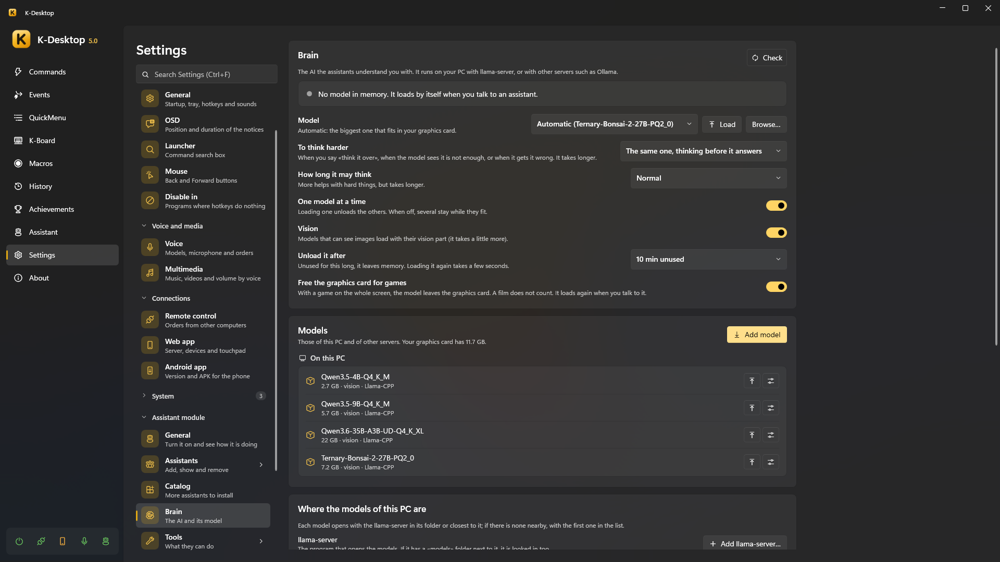

# Brain (the AI)

The assistants understand you with an AI model. It runs **on your PC** with `llama-server` (from llama.cpp), or on
another server you already have, such as Ollama, llama-swap or LM Studio. *Settings → Assistant → Brain*.

> [!NOTE]
> Without any model the assistants still work: fixed phrases (the time, timers, notes, «remember that…»), your commands
> and the rules for windows and programs need no AI. Choose **No AI (only rules and your commands)** to keep it that way.

## Where the answer is worked out

The page tells you where what you say goes:

| | |
|---|---|
| **On this PC** | What you say never leaves the computer |
| **On another computer of your network** | What you say stays at home |
| **On the internet** | What you say leaves your network |

## Models on this PC

1. **Where the models of this PC are → llama-server → Add llama-server…**: the `llama-server.exe` that opens the models.
   If it has a `models` folder next to it, it is looked in too. With several, each model opens with the one in its folder
   or closest to it; otherwise with the usual one (*Make it the usual one*).
2. **Folders with models**: the `.gguf` files inside them are listed. One of them is *where the ones you download go*
   (*Open*, or move it elsewhere).
3. **Add model**: paste the link of a Hugging Face model or type its name (`unsloth/Qwen3.5-9B-GGUF`, or
   `unsloth/Qwen3.5-9B-GGUF:Q4_K_M` for one quantization). Each file says whether it **fits** your graphics card, is
   **tight** or **doesn't fit (it will be slow)**; the biggest one that fits is already chosen. Models that can see images
   offer their vision part too.

The **Models** list shows those of this PC and of the other servers, the one in memory in green, with *Load*, *Free*,
*Delete* and **llama-server options** for that model only (for example `-c 32768` for more context).

## Other servers

*Other servers → Add*: Ollama, or any server compatible with OpenAI (llama-swap, LM Studio…), on this PC or another, with
its address and, only if it asks for one, an API key (stored encrypted for your user). *Test* says how many models it has.
Their models show up in the same list.

## Choosing the model

| Setting | |
|---|---|
| **Model** | *Automatic*: the biggest one that fits in your graphics card. Or a specific one, or *No AI* |
| **To think harder** | Used when you say «think it over», when the model sees it is not enough, or when you tell it it got it wrong. *The same one, thinking before it answers*, another model, or *Never* |
| | Both have **Browse…** (a `.gguf` from any folder) and **Load** when the chosen one is not in memory |
| **How long it may think** | A little, normal, a lot. More helps with hard things, but takes longer |
| **Unload it after** | Unused for this long, it leaves memory (or *Never*: only when you ask). Loading it again takes a few seconds |
| **One model at a time** | Loading one unloads the others. When off, several stay while they fit |
| **Vision** | Models that can see images load with their vision part (it takes a little more) |
| **Free the graphics card for games** | With a game on the whole screen, the model leaves the graphics card. A film does not count. It loads again when you talk to it |

Each assistant can think with **its own model** (*its card → Basics → Thinks with*, and its own one to think harder).
An assistant's package may suggest a model: the install card and its *Basics* tab offer to download it (never ticked by
default), only if it fits and you do not have it.

## Freeing the graphics card

The model is loaded by itself when you talk to an assistant, and while you are still saying the order. To take it out of
memory:

- **Free** next to it, at the top of the page;
- say or write «free the brain» / «unload the model» (and «load the brain» to have it ready);
- the **Assistant: brain** action in a command or an event (before a game, a render…).

## Thinking harder

Small models answer in a moment but can get a sum or a riddle wrong. Ask «think it over», «think it through» or «think
carefully» (before or after the question), or tell it «that's wrong»: it thinks it over and checks. A big model may also
decide to think harder on its own. It takes longer: up to half a minute.

## Test the model

At the end of the page, **Test the model** gives the model a list of test orders and tells you how many it gets right and
how long it takes on average. Nothing is really run. **Open the bench** opens `Assistant\bench.json`, to write your own
orders.
