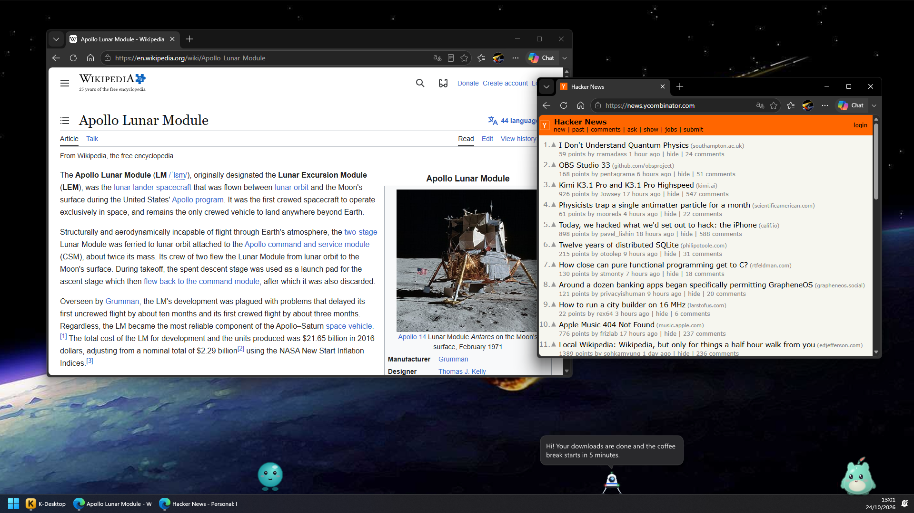
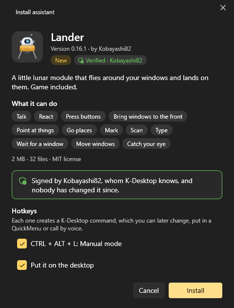
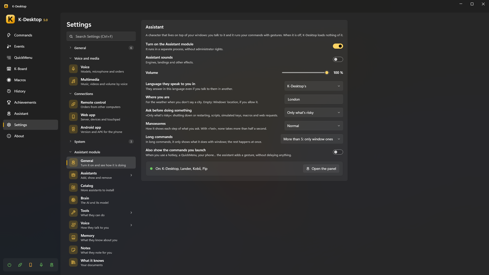
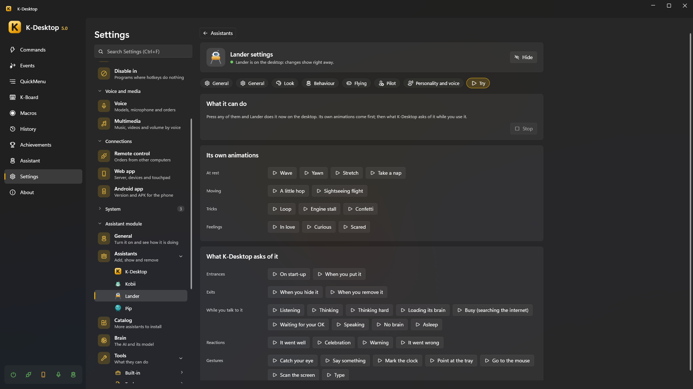
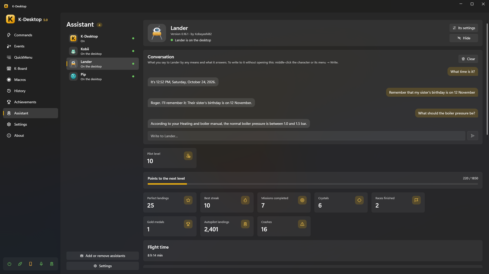

# Assistants

An assistant is a character that lives on top of your windows. It walks or flies around, reacts to what happens on the PC,
and you can talk to it: «Lander, minimise Chrome», «Kobii, what's the weather tomorrow?». When it runs one of your commands
every step can be seen: the Lander flies over and shoots the minimise button, and the window minimises right on impact.

> [!NOTE]
> The assistant module is optional. While it is off, K-Desktop loads nothing of it and behaves exactly as without it.

## The assistants

| Assistant | What it is |
|---|---|
| **Lander** | A small lunar module that flies between your windows, lands on them, tows them with a grappling hook, and has its own game (manual mode, missions, races) |
| **Kobii** | A little creature that walks, climbs your windows, plays, eats, sleeps and lets you pet, brush or high-five it |
| **Kumo** | A soft cloud that floats about, wraps windows to carry them, rains, makes rainbows and dances to your music |
| **K-Desktop** | The built-in assistant without a character, for when you want answers without anyone on the desktop |

Several can be on the desktop at the same time; each one has its own wake word, key to talk, language, personality, voice
and even its own AI model.

## Turning it on and installing one

1. *Settings → Assistant module → General →* **Turn on the assistant module**.
2. *Settings → Assistant module → Catalog*: each assistant with its clips, what it can do and **Install…**. You can also
   open a `.kai` package with a double click, or use *Assistants → Add assistant*.
3. The **install card** shows what it is, what it can do and who signed it, and offers to record its name as a wake word,
   to create commands for its shortcuts and to download the AI model it suggests.

   
4. Press **Install**.

A new version installs over the old one and is swapped in live, keeping the assistant's data
(`%APPDATA%\K-Desktop 5\Assistants\Data\<id>`, included in backups). Installed assistants tell you when there is a new
version (*Settings → Updates*): it is always offered, never installed without asking.

### Signed packages

The card says who signed a package:

| It shows | Meaning |
|---|---|
| **Verified · name** | Signed with a key K-Desktop knows (K-Desktop's own assistants) |
| **Signed by «name»** | Signed with another key: the name is only what the package says, but updates must come with the same key |
| **Not signed** | No signature: it installs, with the usual warning |
| *(not installed)* | The signature does not match: something in the package changed after it was signed |

If an update is signed by someone else than the version you have, the card warns in red.

## Its card

In *Settings → Assistant module → Assistants*, each assistant has its page:

- **Put on the desktop / Hide** (Activate / Deactivate for K-Desktop).
- **Basics**: its wake word, its key to talk, the model it thinks with (and the one to think harder), and the settings
  every assistant shares —**size**, **volume**, **liveliness** (how much it moves on its own), and whether it can be
  **picked up** with the mouse— plus «Always use K-Desktop's bubble».
- Its own pages (from its package): the Lander's game options, Kobii's colour…
- **Personality and voice**: another personality, language and voice for this assistant.
- **Try**: the assistant on a small pretend desktop of its own, doing each thing it can show (its animations, entrances
  and exits, states, reactions, gestures, what it does to a window). Nothing of it touches your desktop.

  

*Panel → Assistant* shows each assistant's state, its panel (scores, achievements, buttons), its activity (what it did, with
undo) and the chat.

## Talking to it

| How | |
|---|---|
| **Its wake word** | «Lander, …». Recorded in its card; each assistant has its own |
| **Its key to talk** | Hold it and speak (each assistant can have one) |
| **Long click** | Hold the left button on it for half a second and speak |
| **Writing** | Middle click on it, or *Write to …* in its right-click menu, opens a box; or the chat in *Panel → Assistant* |
| **Phone** | The *Assistant* tab of the web app, written or spoken |
| **Commands** | *Assistant: ask* sends it a text (or opens the box to write) |

Its **right-click menu** has *Write to …*, its own actions (extras), its panel, its settings and *Hide*.

**Dropping files** on it (from the Explorer) opens a small window: «What do I do with "file"?», with suggestions by type
(summarise or read a document, describe an image or read its text, see what is in a folder, open it…) or your own words.

## What happens when you ask

1. **Fixed phrases** go first, without AI: «what time is it?», «set a timer for 10 minutes», «remember that…», «open
   youtube.com», «what's playing?», «weather tomorrow», «free the brain»… They answer in a moment.
2. **Your commands**: if what you said names one of your commands clearly, it runs (with its gestures).
3. Otherwise **the AI** answers, choosing among its [tools](tools.md) the ones that fit.

Risky things (closing programs, deleting files, shutting down) ask first with a small window, by voice too («yes» / «no» /
«yes, and don't ask again»). *Settings → Assistant module → General → Ask before doing something* sets it: never, only
risky things, or the first time.

## Gestures and speed

*Settings → Assistant module → General*:

- **Manoeuvres**: *Showy*, *Normal* or *Fast* (under half a second).
- **Animate up to N actions** of a command (the rest run without gestures, except window ones).
- **Also show the commands you run yourself**: commands launched by hotkey, menu or voice are also shown as gestures, as
  decoration.
