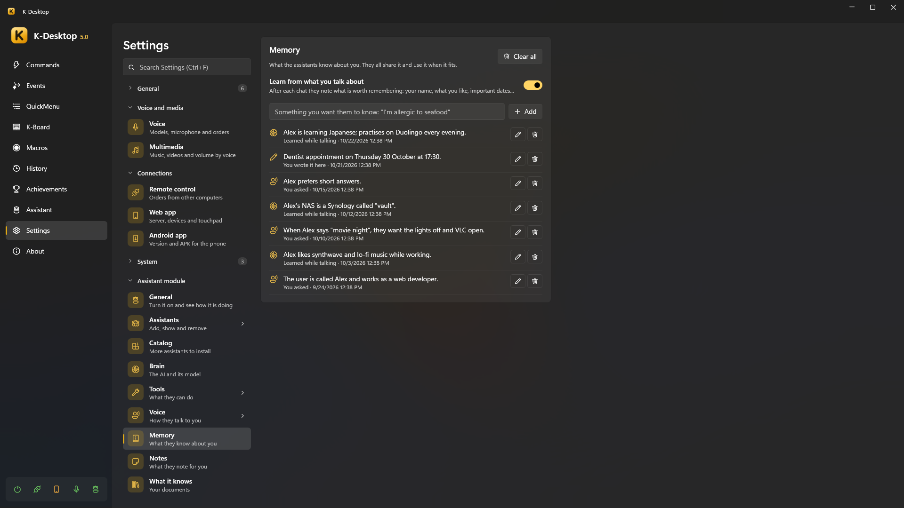
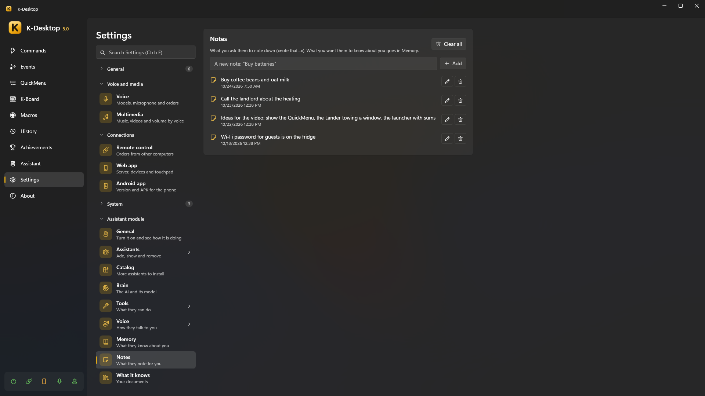
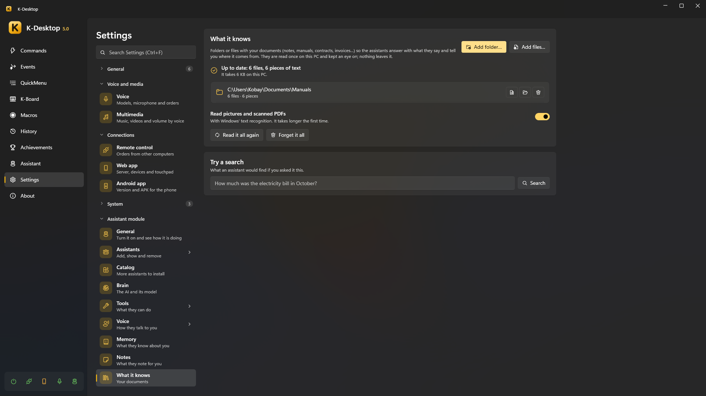

# Memory, notes and documents

The assistants keep three different things, each with its page in *Settings → Assistant module*:

| | What it is | You say |
|---|---|---|
| **Memory** | What they know about **you**: your name, what you like, important dates | «remember that my boss is called Luis» |
| **Notes** | What you ask them to **note down** for you | «note that I have to buy milk» |
| **What it knows** | Your **documents**: folders and files they read so they can answer with what they say | «what does my contract say about the deposit?» |

All of it stays on your PC, and all the assistants share it.

## Memory

- «Remember that…», «keep in mind that…», «don't forget that…» saves it at once, without depending on the AI.
- «What do you know about me?» / «What do you remember about me?» tells you the most important things.
- «Forget that…» / «forget about…» removes it (and can be undone).
- **Learn from what you talk about**: after each chat they note what is worth remembering. Each memory says where it came
  from: *You asked*, *Learned while talking* or *You wrote it here*.

On the page you can **Add** something you want them to know, **Edit** or **Delete** each memory, or **Clear all**.
When an order fits something they remember, they use it: «when I say "the usual", I mean my *Work* command».

## Notes

«Note that…», «write down…», «make a note to…» saves a note; «what did I write down?» or «read me the shopping list» finds
them. On the page you can add, edit and delete them. A long answer on the reading sheet can be kept as a note with *Save
as a note* (see [Long answers](voice.md#long-answers)).

## What it knows (your documents)

Add **folders** (*Add folder…*) or single **files** (*Add files…*) with your documents —notes, manuals, contracts,
invoices…— and the assistants answer with what they say and tell you where it comes from. They are read once on this PC
and kept an eye on: a new or changed file is read again by itself. Nothing leaves the computer.

- **What is read**: text and Markdown, PDF, Word (`.docx`), PowerPoint (`.pptx`), web pages, subtitles and e-mails (`.eml`),
  and code or data files that are not too big. With **Read pictures and scanned PDFs** on, also pictures and PDF pages
  without text, with Windows' text recognition (it takes longer the first time).
- **What is not allowed**: a whole drive, or folders of Windows or of programs. Hidden folders are skipped, and so are a project's
  library and build folders (`third_party`, `vendor`, `build`, `dist`…), the folder of styles and scripts of a saved web
  page (`Page_files`) and package version lists (`package-lock.json`…); minified code is left with *No text*.
- **While it reads** the page shows «Reading: 412 of 1,300 files», roughly how long is left and the file it is on (in a big one, also which piece). It reads
  gently and **pauses** while a full-screen game is on, while K-Desktop is paused and while an assistant is answering.
  **Reading speed**: *Gentle*, *Normal* or *Fast* (faster uses more of the PC). **Pause reading** stops it until you press **Resume reading** (what was already read is still used).
- Each folder or file has **Open the folder** and **Remove**; folders also have **See the files**: the list, in its own
  scroll, with each file and its pieces, pages, or why it could not be read. You can **search** by name or folder and
  **filter** (*Read*, *Not read yet*, *No text or unreadable*, *Taken out*). Each file can be **opened**, **shown in its
  folder** or **taken out of what it knows** (not read, and what was read is forgotten; *Put back* brings it back). A folder
  on a drive that is not connected keeps what was read.
- **Try a search**: what an assistant would find if you asked it this, and how long it took.
- **Read it all again** and **Forget it all** (your files are never touched).

It searches **by words and by meaning**: «how much did I pay for electricity in October» finds the October bill even if it
says «power supply». The meaning part uses EmbeddingGemma, downloaded with the voice models (*Settings → Voice*); without
it, it only finds what you ask with the same words as the document.

When nothing in your documents answers, the assistant says so instead of making something up.

## Files you give it

Dropping files on an assistant (or asking about one) is different: they are read just for that order, without adding
them to *What it knows*. See [Dropping files](index.md#talking-to-it).
