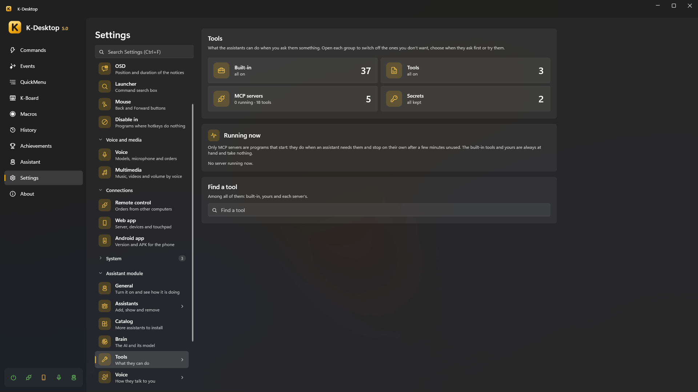
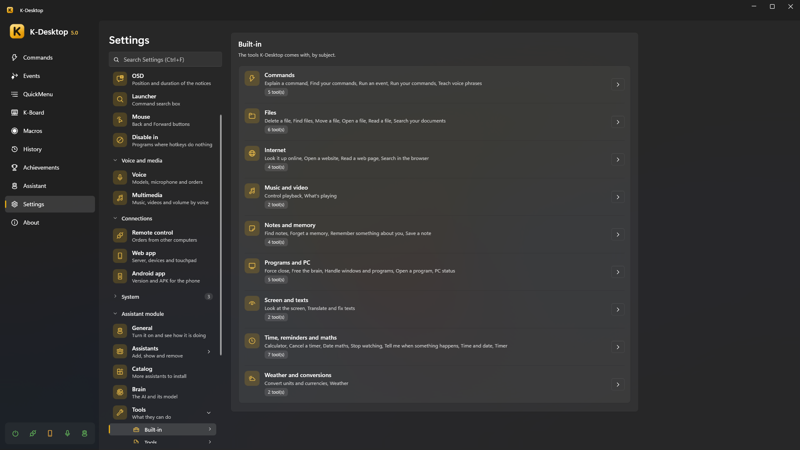
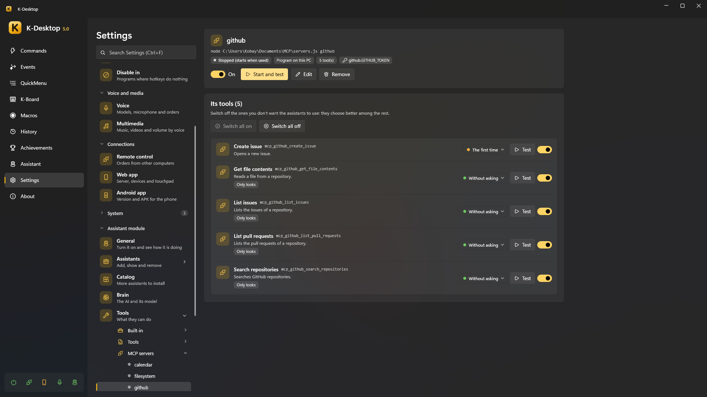

# Tools

Tools are what the assistants can *do* when you ask them something: set a timer, find a file, read a web page, close a
program… For each order only the few tools that fit reach the AI, so it chooses well even with hundreds of them.

*Settings → Assistant → Tools* shows all of them —built-in, yours and each MCP server's— with a search box. Open
each group to switch off the ones you don't want, choose **when it asks** before doing it (*Without asking*, *The first
time*, *Always*) or **Test** it with a small form.



Everything an assistant does shows in *Panel → Assistant → Activity*: what, how (rule, command, AI, memory…) and whether it
worked. What can be undone has an **Undo** button (or say «undo that»).

## Built-in tools



| Subject | Tools | For example |
|---|---|---|
| **Commands** | Run your commands · Find your commands · Explain a command · Teach voice phrases · Run an event | «turn on game mode», «what does the backup command do?», «when I say telly run my TV command» |
| **Time, reminders and maths** | Time and date · Timer · Cancel a timer · Tell me when something happens · Stop watching · Date maths · Calculator | «remind me in half an hour», «tell me when the download finishes», «how many days until christmas» |
| **Notes and memory** | Save a note · Find notes · Remember something about you · Forget a memory | «note that I have to buy milk», «remember that my boss is called Luis» |
| **Files** | Find files · Open a file · Read a file · Delete a file · Move a file · Search your documents | «find the electricity bill pdf», «open the last thing I downloaded» |
| **Internet** | Open a website · Search in the browser · Look it up online · Read a web page | «how much is an RTX 5080», «summarise this page» |
| **Screen and texts** | Look at the screen · Translate and fix texts | «what is this error», «translate what I copied into French» |
| **Programs and PC** | Open a program · Handle windows and programs · Force close · PC status · Free the brain | «minimize Steam», «Chrome is not responding, force it closed», «why is the computer slow» |
| **Music and video** | What's playing · Control playback | «what song is this», «pause the video» |
| **Weather and conversions** | Weather · Convert units and currencies | «will it rain tomorrow», «how much is 50 dollars in euros» |

Some details:

- **Tell me when something happens** watches for a program closing or a window appearing, the processor or the graphics
  card calming down, a download finishing or a folder that stops changing. The assistant that set it says it when it
  happens.
- **Look at the screen** reads text with Windows' text recognition (also «copy the text of this window»); to understand
  a picture it needs a model with vision.
- **Translate and fix texts** works on what you have selected or copied (translate, correct, summarise, more formal,
  a list, shorter…) and pastes it back in the same window or leaves it copied. Your clipboard is put back as it was.
- **Look it up online** searches the web and reads the first useful result; **Search in the browser** only opens the
  search in your browser.
- **Weather** uses Open-Meteo and **currencies** the European Central Bank's rates (no account needed). Without a city it
  uses *Settings → Assistant → General → Where you are*, or Windows' location if you allow it.
- **Delete a file** sends it to the recycle bin; it and **Move a file** always ask first (a move can be undone).

## Your own tools (JSON)

A JSON tool gives the assistants something new to do without compiling anything: switch on a Home Assistant light, send
you a Telegram message, run one of your commands with phrases of its own, chain several steps or launch a script.

- They are in `%APPDATA%\K-Desktop 5\Assistant\Tools\`, one `.json` per tool (*Tools → Custom → Open folder*, or **New**
  from a template). They reload a moment after you save, add or remove one.
- Schema: [`tool.schema.json`](https://github.com/Kobayashi82/K-Desktop/blob/main/docs/assistant/schemas/tool.schema.json).
  With `"$schema"` pointing to it your editor shows the mistakes as you type. A file with errors is not loaded and
  K-Desktop tells you why.
- [Examples](https://github.com/Kobayashi82/K-Desktop/tree/main/docs/assistant/herramientas) of every type.

```jsonc
{
  "name": "living_room_light",               // lower case, numbers and _ (mcp_ is reserved)
  "type": "http",                            // http · kdesktop · routine · script
  "description": "Turns the living room light on or off.",   // for the model
  "examples": ["turn on the living room light", "living room off"],
  "parameters": {
    "state": { "type": "string", "enum": ["on", "off"], "description": "on or off" }
  },
  "intent": "turn the living room light {{state}}",          // what you see in the activity and when it asks
  "say": { "ok": "Living room light: {{state}}.", "error": "The hub is not answering." },
  "risk": "safe",                            // safe · askOnce · askAlways
  "readsOnly": false,
  "gesture": "waitForWindow",                // optional: waitForWindow · tray · clock · typing
  "timeout": 15,
  "request": {
    "method": "POST",
    "url": "http://homeassistant.local:8123/api/services/light/turn_{{state}}",
    "headers": { "Authorization": "Bearer {{secret:ha_token}}" },
    "body": { "entity_id": "light.living_room" }
  }
}
```

- **`description`** is for the model: what it does and when to use it. Models follow English best, but any language works.
- **`examples`**: phrases that ask for it. They decide which tools reach the model for each order. If you say **exactly**
  one of them and the tool needs nothing from the model, it is done at once without the AI («good night» → a routine).
- **`parameters`**: what the model has to give it (`string`, `number`, `integer`, `boolean`, with `enum`, `default`,
  `minimum`, `maximum`). Those without `default` are required unless `required` says otherwise. A wrong value is
  explained to the model, which can fix it.
- **`say`**: what the assistant says when it is done. Without it, the model says it in its own words.
- **`readsOnly`**: it only looks something up (a temperature, a state); the model answers with what it returns.
- **`risk`**: `safe` never asks; `askOnce` asks until you say «Yes, and don't ask again»; `askAlways` always asks.
- **`gesture`** (optional): what the character does meanwhile —wait for the window it opens, go to the tray, leave a mark by
  the clock, type in the window in front—. Only decoration: the tool does not wait for it.

### Placeholders

| Placeholder | What it is | Where |
|---|---|---|
| `{{parameter}}` | The value the model gave | Everywhere |
| `{{secret:name}}` | A secret (see below) | URL, headers, body, a script's arguments and environment |
| `{{result}}` | The answer (or the part chosen with `pick`) | `say` |
| `{{result.field}}` | A field of the JSON answer (`attributes.temperature`, `items.0.name`) | `say` |
| `{{status}}` | HTTP status or the script's exit code | `say` |

In a JSON `body`, a text that is **only** `"{{parameter}}"` keeps its type: a number stays a number.

### Types

| Type | What it does |
|---|---|
| **`http`** | Any web API: `request` with `method` (GET by default), `url`, `headers`, `query`, `body` (or `bodyText` with `contentType`) and `pick` (the part of the answer given to the model). An error status (4xx, 5xx) is a failure |
| **`kdesktop`** | One of your commands with phrases of its own: `"command": "Cinema mode"`, by its exact name (never a similar one). Risky commands ask as always |
| **`routine`** | Several `steps`: another tool (built-in or JSON, never another routine) with its `arguments`, one of your commands (`"command"`), or a wait (`"wait": 1`, up to 30 s). A failing step stops the routine unless it has `continueOnError` |
| **`script`** | One of your scripts: `"script": { "file": "check.ps1", "args": ["{{host}}"], "env": { "API_KEY": "{{secret:my_key}}" } }`. `.ps1` (Windows PowerShell), `.bat`/`.cmd`, `.py` (with `uv run --script` if you have uv, otherwise `py` or `python`), `.js` (Node.js) or `.exe`. They run as your normal user (never as administrator), without a window, 30 s at most; what they print is the answer and an exit code other than 0 is a failure |

> [!IMPORTANT]
> A script **always asks before its first run**, even with *Ask before doing something* set to *Never*. With «Yes, and
> don't ask again» it is approved; if the script or its `.json` changes, it asks again. A script that turns up in the folder
> without you knowing never runs unseen.

## Secrets

Passwords, tokens and keys your tools and servers use: *Tools → Secrets*, or in
`%APPDATA%\K-Desktop 5\Assistant\secrets.json`. Written in plain text there, each value is encrypted with your Windows
user the first time it is read. **The model never sees a secret**: it is only put in when the request is sent, and hidden
as `•••` if an answer contains it. A backup restored on another PC cannot read them: write them again.

## MCP servers

An MCP server is a program (or an address) that gives several tools at once: the same ones Claude Desktop, VS Code or Open
WebUI with mcpo use. *Tools → MCP servers*:



- **Import…** reads another program's file (mcpo's `config.json`, Claude Desktop's) and lets you choose. **Paste** takes the
  JSON block you copied from a server's instructions. Variables that look secret (`*_TOKEN`, `*_KEY`, `*_SECRET`,
  `*PASSWORD*`, `CHAT_ID`…) become encrypted secrets. Servers for things the assistants already do (files, screen, clipboard,
  memory, time, the web) come unticked, with the reason.
- **Add server**: a program (`node`, `npx`, `uvx`, an `.exe`…, its arguments and folder) or an HTTP address; its variables
  or headers, each normal or secret; the longest wait per call and after how long unused it stops.
- Each server has its own page with its state, **Start and test**, and its tools to switch on or off (the assistants choose
  better among fewer).

They are started by the assistant process, **as your normal user**, only when one of their tools is needed, and stop on
their own after some minutes unused; *Tools → Running now* shows which are running. Their tools are remembered, so
choosing among them never starts a server. By default they ask the first time, except those the server says only read.
What a server writes to stderr goes to `Logs\mcp-<server>.log`.

## Sharing with other programs

The other way round: *Tools → Share* turns the assistants into an MCP server for Claude Desktop, VS Code, Open WebUI or any
program with MCP. Switch on **Share the tools** and **Copy the configuration**, then paste it into the program's MCP
settings (`claude_desktop_config.json`, VS Code's `mcp.json`, mcpo's `config.json`):

```json
{
  "mcpServers": {
    "k-desktop": {
      "command": "C:\\…\\KDesktop.exe",
      "args": ["--mcp"],
      "env": { "KDESKTOP_MCP_KEY": "…" }
    }
  }
}
```

- **What they can use**: *Only what looks things up* (the time, sums, the weather, finding files or searching the internet,
  reading the screen… nothing that changes anything), *Everything, asking you first*: what changes something asks **on
  this PC** with the usual window, even if you set the assistants not to ask, or *Everything, without asking*: only what you
  set to *Always* asks (and a new script, the first time).
- With **Ask for the key** (the default) only the programs with the key get in; **Change the key** leaves out those that
  had the old one. Off, any program of yours on this PC gets in (never from another PC or user) and the copied
  configuration carries no key.
- K-Desktop must be open with the assistant module on. Each call shows in the activity with the program's name, and the
  page shows who is connected. Tools you switched off, and those of your own MCP servers, are not shared.
