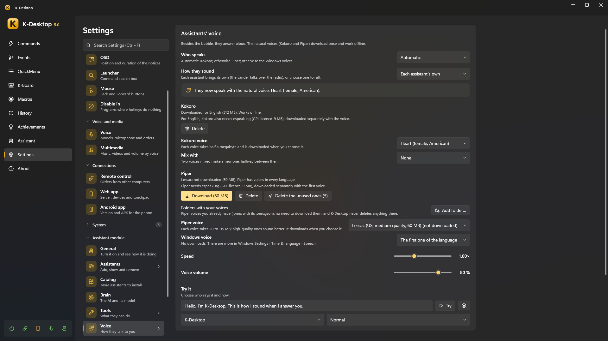

# Voice and conversation

Besides the bubble, the assistants answer **aloud**, each with its own voice. The natural voices download once and work
without internet. *Settings → Assistant → Voice*.

To *talk to* them you use K-Desktop's speech recognition (wake words, a key to talk…): see [Voice](../k-desktop/voice.md)
and [Talking to it](index.md#talking-to-it).

## Who speaks

**Language they speak to you in**: they answer in that language even if you talk to them in another one, and the voices
offered are of that language (*K-Desktop's*, or one of the six).

| Engine | |
|---|---|
| **Automatic** | Kokoro; otherwise Piper; otherwise the Windows voices |
| **Natural voice (Kokoro)** | The most natural one. English, Spanish, French, Italian and Portuguese (not German yet). About 325 MB, plus half a megabyte per voice |
| **Natural voice (Piper)** | Voices in every language, from 20 to 115 MB each; high-quality ones sound better (low-quality ones are not offered) |
| **Windows voices** | No downloads. There are more in *Windows Settings → Time & language → Speech* |
| **Beeps only** | |
| **Don't speak (bubble only)** | |

**Speed** and **Voice volume** are on the same page. The voices of each engine (downloading and choosing them) are in
*Voice → Voices*:

- Kokoro **Folders with your voices**: voices you already have (`.pt` or `.bin`, with their Kokoro name, like `af_bella`;
  the language comes from the first letter) are used from there without downloading them, marked as *yours*. One that is
  also in the list shows only once. K-Desktop never deletes anything there.
- **Kokoro voice** and **Mix with**: two voices mixed make a new one, halfway between them (*How much of …*).
- **Piper voice** and its **Variant** (some voices have several people or ways of speaking). **Folders with your voices**:
  Piper voices you already have (`.onnx` with its `.onnx.json`) are used from there without downloading them, and
  K-Desktop never deletes anything there. **Delete the unused ones** frees space.
- For some languages Kokoro, and Piper always, need **espeak-ng** (GPL licence, 9 MB), downloaded separately with the voice.
- **Windows voice**: which of the ones Windows has.
- **Try this voice**, under each one: the test sentence with that voice, as it is (no effects).

## How they sound

**How they sound**: each assistant brings its own profile (the Lander talks over the radio, from the Moon), or choose one
for all: *Natural*, *Classic robot*, *Martian*, *Mission control*, *8-bit*, *Beeps*, or one of yours.

**Try it**: choose *who says it* and *how it says it* (normal, happy, after a failure) and press *Try*.

### Voice profiles

*Voice → Voice profiles* is the list: the built-in ones and yours, with **New at random** and **Import…**. Pressing one opens
its editor on the same page (**← Voice profiles** goes back to the list), with **Duplicate**, **Export** and, if it is
yours, **Delete**. The built-in ones stay as they are: **Duplicate** one to make yours. The **Use for everyone** icon (in the list and in the editor) puts that profile in *How they
sound* (lit while everyone uses it; pressed again, or if you delete it, each assistant goes back to its own). The profile's **Voice** only counts if *Who speaks*
is *Automatic*. A
profile has a voice (engine), speed and volume, and a chain of **effects** its voice always goes through, in order (drag
them by the dots to change it):

| Effect | |
|---|---|
| **Pitch** | Higher or lower |
| **Formants** | The size of the mouth, without changing the pitch |
| **Ring modulator** | Classic robot |
| **Vocoder** | Synthesizer robot, on one note |
| **Bitcrusher** | 8-bit robot |
| **Radio** | Narrow band and static, with a beep at the end and a click when opening and closing |
| **Chorus** | Metallic, wavering voice (martian) |
| **Flanger** | Like chorus, faster and deeper: jet plane |
| **Echo** | From a cockpit (short) to space (long) |
| **Glitch** | Cuts and repeats, as if broken |

Besides *Always*, a profile can add effects for some moments, such as when the assistant is **happy** or **after a
crash**.
*Try it when something changes* lets you hear each change as you make it. Profiles can be **exported** and **imported**
(`.json`).

## When they speak aloud

- **Keep quiet with something full screen**: with a film or a game in full screen, only the bubble.
- **Quieter at night**: from 22:00 to 8:00, the voice at half the volume.
- **They sound from where they are**: louder from the speaker on the side where the assistant is.

While an assistant thinks and answers, the volume of the other programs stays down (with *Turn the volume down while you
speak*), and it does not take its own voice for an order.

## Each assistant its own

On each assistant's card, **Personality** and **Voice**:

- **Language**: the one it answers and speaks in. By default the one in *Settings → Assistant → General → Language
  they speak to you in* (they answer in it even if you talk to them in another).
- **Personality**: what tells the AI who it is and how it talks. Change it as you like (*Reset* brings back the one of its
  package).
- **Voice**: engine, voice (only the chosen engine's), profile, and speed and volume of its own, or «Global». *Try its voice*.

K-Desktop itself (the assistant without a character) has the same pages.

## The conversation

- **Fixed phrases** need no AI: «stop» / «never mind» cancels what it is doing; «repeat that»; «undo that»; «repeat the last
  command».
- **Questions back**: if it asks you something («Chrome or Edge?») after a spoken order, it listens a few seconds for your
  answer, without the wake word.
- **Permission by voice**: when something asks first, answer «yes», «no» or «yes, and don't ask again».
- **«Think it over»** makes it think harder; **«that's wrong»** makes it check again (see [Brain](brain.md#thinking-harder)).
- **While it thinks** it may say «One moment» if the answer takes a little.
- **«Write what I say»** starts dictation: what you say next is typed where the cursor is.
- **Everything is in the chat** of *Panel → Assistant*, whichever way you said it, and a *Stop* button.

## Long answers

When you ask for something long («explain it in detail», «make me a list», «write me an email», «summarise…») or the answer
does not fit a bubble, it **says only a short summary** and writes the whole text on a **reading sheet** next to it. There
you can **Copy** it, **Save as a note**, or have it **read to you** (*Read it to me* / *Stop*). In the chat, *Read it all*
opens it again.

## The «Assistant: say» action

In a command or an event, **Assistant: say** makes an assistant say something in its bubble and aloud, without the AI
(«The backup has finished»). Before saying something on its own —a timer, a «tell me when»— an assistant first catches
your eye (the Lander flies to the mouse, Kobii walks up to it).
