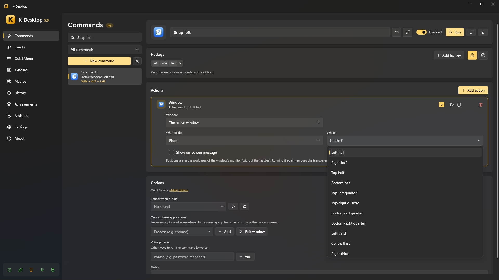
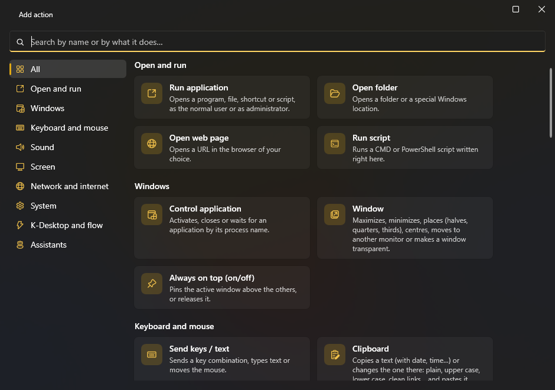
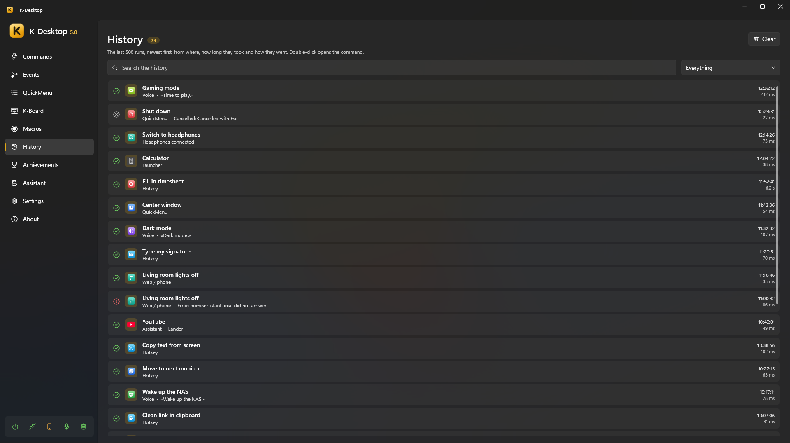

# Commands

A **command** is a list of actions with a name. It can be run by a hotkey, from a QuickMenu, the launcher, your voice,
your phone, the network, an event, another command or an assistant.

## Hotkeys

A hotkey is any combination of keys, mouse buttons and the wheel: `CTRL + ALT + O`, `F13`, `Mouse 5`,
`Mouse 4 + Mouse 1`, `CTRL + Wheel Up`… To record one, click the hotkey box and press it. A command can have several.

- **For one program only**: limit the command to some programs (by their process name). When the same hotkey exists
  globally and for one program, the specific one wins inside that program and the global one everywhere else.
- **Disable in**: in *Settings → Disable in* you list programs (games, remote desktops…) where K-Desktop's hotkeys do
  nothing. The action *Disable in current app* toggles it for the program in front.
- K-Desktop warns you when a hotkey is already used by another command, by K-Desktop itself or by an assistant.

### Hot corners and mouse gestures

Next to **Add hotkey** there are two more buttons:

- **Screen corner**: choose one of the four (↖ ↗ ↙ ↘) and the command runs when you rest the mouse there for a moment.
  Any corner where the cursor stops counts, also the one left loose by a taller or shifted screen; where two screens meet
  there is no corner. It never fires with a button held or in full screen.
- **Mouse gesture**: a drawing of one stroke (←, →, ↑, ↓, C, L, N, S, U, V, Λ, W, M, Z or a circle) made holding the
  right button (or the middle one, Mouse 4 or Mouse 5). If you click without moving, or hold it still, the button works as always; Esc while
  drawing cancels it. The gesture window has a box to try the drawings with the left button, and **Draw your own**: give
  it a name and draw it three times.

The wait in the corner, the gesture button, showing the stroke and the programs without gestures are in
*Settings → Mouse*.

## Actions

Each command has a list of actions that run in order: open a program, place a window, send keys, change the volume, wait,
run another command… See the [complete list of actions](actions.md).

- Each action can be switched off without deleting it, and its order changed by dragging.
- **Run** in the editor tries the command at once.
- A command that takes a while (a wait, a macro, a script it waits for…) shows a ▶ in the list while it is running, and
  next to the number of commands you see how many are running: click it to see them or **stop them all**. **Run** turns
  into **Stop** while that command is still running.
- Two commands cannot have the same name (nor two events, QuickMenus, macros or K-Board profiles): if you type one that
  already exists, the previous name stays.
- An action that opens something chooses whether it runs **as administrator or as a normal user**.

## If… (conditions)

The **If…** action checks something and, if it is not so, stops the command, skips the next actions or **runs another command instead** (chosen from the list; it gets the same [variables](actions.md#variables-passing-data-from-one-action-to-another)). It can check:

| Condition | Example |
|---|---|
| A program is open / is in front | «If Steam is open» |
| A time and days | «If it's Monday to Friday from 9:00 to 18:00» |
| A device is connected | «If the Xbox controller is connected» |
| The sound plays through a device / something is playing | «If sound plays through the headphones» |
| A network | «If connected to HomeWiFi», «If there's no network» |
| Battery or mains | «If running on battery» |
| A host answers | «If 192.168.1.10 answers» |
| A file exists | «If D:\backup.lock exists» |
| The clipboard | «If the clipboard contains "http"» |
| CPU, GPU or memory use | «If the processor is above 80 %» |
| Battery below a % | «If the battery is below 20 %» |
| Screens plugged in | «If there are 2 screens or more» |
| It is daytime | «If it is daytime», «If it is night» (between sunrise and sunset where you are) |
| A text or variable: has something, contains, is equal to, is greater or less than | «If {result} contains "error"», «If {result} is greater than 80» |

Every condition can be turned around with **The opposite** («isn't», «doesn't»…). When comparing, numbers are compared as numbers
(«7» is less than «10»; «2,5» and «2.5» are the same) and text without minding upper or lower case.

## History

*History* lists everything that ran: which command, when, from where (hotkey, menu, launcher, voice, phone, network,
event, assistant, MCP server, command line…) and whether it went well.

## Organising

- **Search** by name, hotkey or action, and **filter** the list: all commands, those in no QuickMenu, or those of one
  QuickMenu.
- **Enable or disable** a command, **hide** it from the list (it still works), **duplicate** it or delete it (it also leaves
  the QuickMenus it was in).
- **Available for remote control**: whether the phone and the network can see and run it.
- **Icon**: automatic (from its first action), a built-in vector icon in any colour, a Windows icon library, any image or a
  website's favicon.
- In the editor, **Test only this action** runs one action alone.
