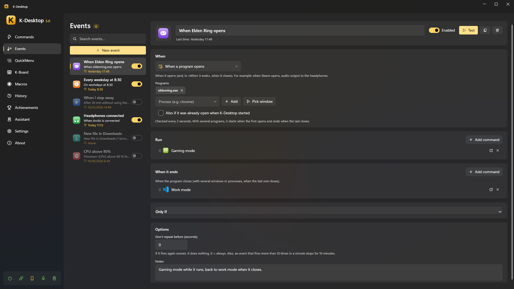

# Events

An event is «when this happens, run these commands». Each event has a trigger, optional conditions and the commands it
runs; many triggers also have a **«When it ends»** part (the program closes, you come back to the PC, the device is
removed…) with its own commands.



## Triggers

| Trigger | When |
|---|---|
| When K-Desktop starts / exits | What used to be «Run on startup / on exit» in each command |
| At a time | Every day or on some days of the week, at the time you say; or on one day only, if you give it a *Day* |
| Every so often | Every N minutes while K-Desktop runs |
| When a program opens | When it opens; «When it ends», when it closes. *When Steam opens, audio to the headphones* |
| Program in front | When its window comes to the front, and when it stops being there |
| PC not in use | After some minutes without keyboard or mouse; «When it ends», when you come back |
| Lock, sleep… | When the session is locked or unlocked, or the PC sleeps or wakes up |
| Battery or mains | When a laptop goes on battery or back on mains power |
| New file in a folder | When a file appears (created, copied, downloaded…), as soon as it stops growing |
| Call from outside | When another computer, Home Assistant or a script asks for it by name, over UDP or the web |
| Drive connected | When a USB stick, disk or card is connected (and removed) |
| Network | When connecting to a network (or any), or when left without network |
| Device connected | When a controller, keyboard, headset or USB gadget is connected (and disconnected) |
| PC usage | When the CPU, the graphics card, the memory or the graphics memory (VRAM) goes above (or below) a % for a while |
| Audio device | When headphones, a speaker or a microphone are connected, or one becomes the default output or input |

## Options

- **Commands**: *Add command* picks commands you already have; *New command* creates a hidden one named after the event,
  adds it and opens it so you can put its actions in.
- **Ask an assistant**: after the commands, it asks an assistant for something as if you said it (*Check the weather and
  send it to me on Telegram*). If the assistant is not on the desktop, nothing happens.
- **Only once**: the event is deleted after it runs (if it has commands in *When it ends*, after those).
  With *At a time* and a *Day*, it is «on Friday at 9, just once».
- **Programmed by an assistant**: what you ask for later («at 7 empty the recycle bin», see
  [Tools](../assistant/tools.md)) shows here as one more event, with who programmed it and what you approved when you
  asked. You can change or delete it like any other.
- **Conditions** (*Only if*): a list with the same conditions as the [If… action](commands.md#if-conditions) (schedule,
  a program open, the network, the battery, PC usage…), each with *The opposite*. With several you choose whether **all of
  them** must be met or **any of them** is enough. Each one can be switched off without deleting it and tested (▶) to see
  whether it is met now. With none, the event always fires.
- **Don't repeat before**: if it fires again sooner (in seconds), it does nothing.
- **Loop protection**: an event that fires more than 10 times in a minute stops for 10 minutes, and K-Desktop tells you.
- Each event can be switched off, and run by hand to try it (*Test*, or `KDesktop.exe --event "Name"`). The lightning
  button creates a command that runs it (to give it a hotkey or a voice phrase).
- *When*, *Only if* and *Options* fold; *Only if* opens by itself when it has something. Times and dates are set with the arrows,
  the wheel or by typing them (the date also with its calendar).

## Calling an event from outside

The trigger *Call from outside* runs when a call with its name arrives. Case and accents do not matter.

```
UDP:   event door                      (port 2501, «Remote control» on)
HTTP:  POST http://<PC>:2502/api/event
       X-KD: 1
       Authorization: Bearer <token>
       {"name": "door"}
```

Over UDP it needs *Settings → Remote control* on with *Events* allowed (and the key, if there is one, from another
computer); over the web, the device needs to be paired (see [Phone and remote control](remote.md)).
