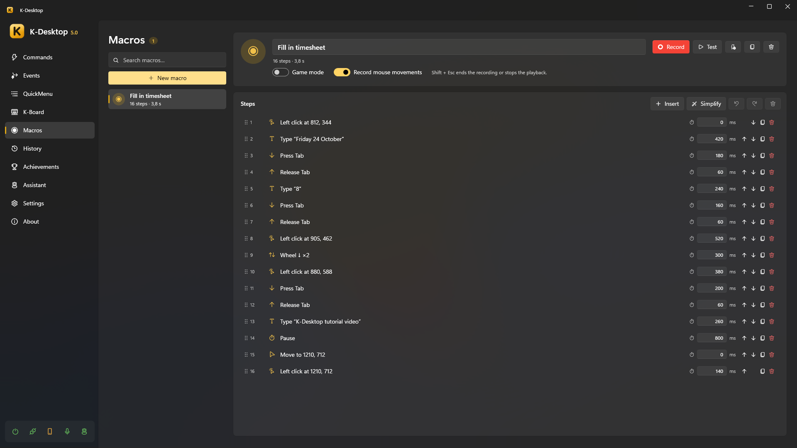
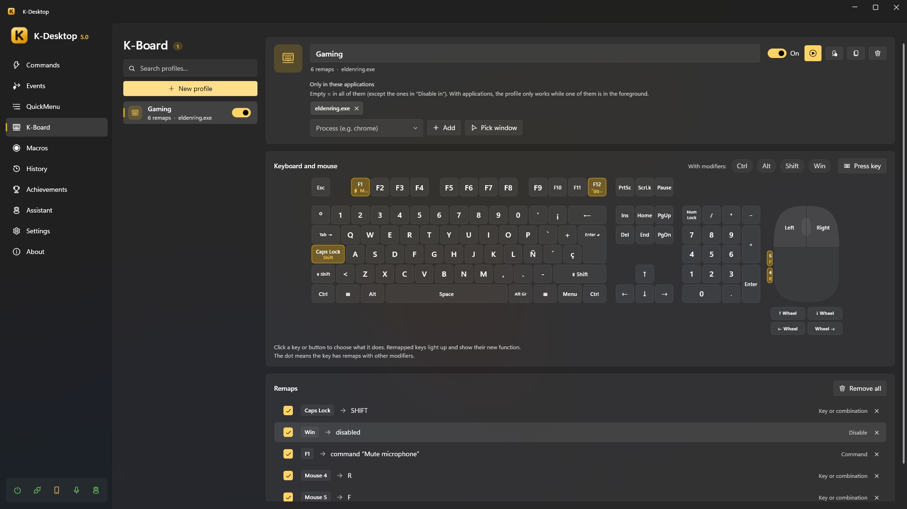

# Macros and K-Board

## Macros

A macro stores your keyboard and mouse input with its timing, to repeat it.

1. *Macros → New macro*, then **Record**.
2. Do what you want to repeat. **Shift + Esc** ends the recording (and stops a playback).
3. Edit the steps if you want: press or release a key, type a text, click, move the mouse, turn the wheel, pause… each one
   with its time.
4. **Test** plays it once after 3 seconds. **Create a command that plays it** gives you a command ready to bind to a
   hotkey.

Options:

- **Record mouse movements**: when off, only clicks (with their position), the wheel and the keyboard are recorded.
- **Game mode**: for games. Clicks do not move the pointer, the mouse is recorded as relative movement (what games read
  even when they lock the pointer) and keys and clicks are held for a moment so the game sees them. Games with
  anti-cheat may ignore any simulated input.
- The *Play macro* action plays it once or several times, in a loop or at another speed.

## K-Board

K-Board changes what keys, mouse buttons and the wheel do, everywhere or only in the programs you choose: Caps Lock as
Ctrl, the Windows key off in games, side buttons that copy and paste…

- A **profile** is a set of remaps. Several can be on at the same time.
- Click a key or button on the drawn keyboard and mouse (or **Press key** to pick it) and choose what it does:
  - **another key, button or the wheel**, held down while you hold the original one (it works for modifiers and in
    games);
  - **a text** to type, with any keyboard layout (line breaks press Enter);
  - **a command** (the key no longer reaches the program);
  - **nothing** (the key is disabled while the profile is on).
- **With modifiers**: tick Ctrl, Alt, Shift or Win to remap a combination (Ctrl + J) instead of the key itself.
- **Only in these applications**: empty = everywhere; with programs, the profile only works while one of them is in front.
- **Always run**: also in the programs of *Disable in* (a game), where the command hotkeys stay off but the keys are still
  changed.
- Switch a profile on and off here, from the tray, or from a command with the *K-Board* action (**Create a command that
  switches this profile on and off**).
