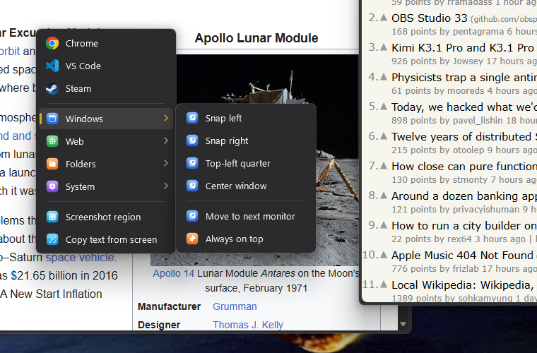
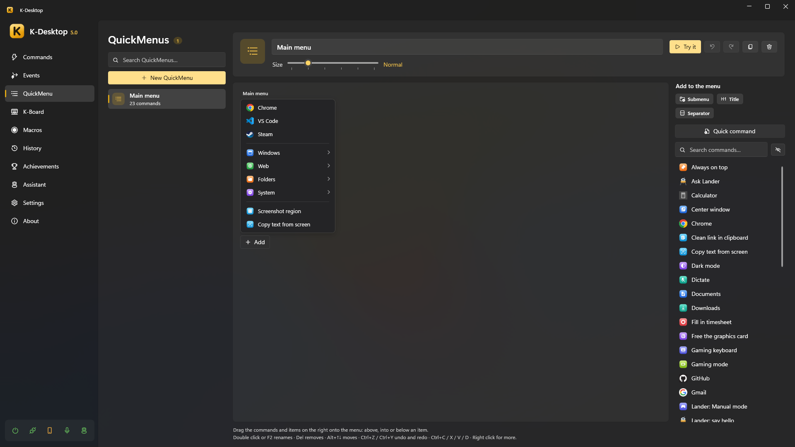

# QuickMenu and launcher

## QuickMenu

A QuickMenu is a menu with your commands that opens where the mouse is: cascading submenus, icons, an acrylic
background and keyboard navigation.

- **Open it** from a command with the action *Open QuickMenu* (give that command a hotkey such as `Mouse 4 + Mouse 1`),
  from the phone or with `KDesktop.exe --menu "Name"`.
- **Use it**: left click runs and closes, right click runs and keeps the menu open, middle click edits that item. With
  the keyboard: arrows, Enter and Esc.
- **Close it** with Esc or a click outside (K-Desktop's window too). Its hotkey again closes it if the mouse is over the
  menu; if not, it opens it again where the mouse is.
- **Size**: from *Compact* to *Huge*, per menu.

### Editing

In *QuickMenu*, drag commands from the list on the right onto the menu: above, into or below an item. Items can be
commands, submenus and separators, each with its own name and icon if you want.

- **Quick command** creates a command from a program, a file, a folder or a web page and adds it in one go; you can
  refine it later in *Commands*.
- Double click or F2 renames, Del removes, Alt+↑↓ moves, Ctrl+Z / Ctrl+Y undo and redo, Ctrl+C / X / V / D copy, cut,
  paste and duplicate; right click for more.
- **Try it** opens the menu as it will look, and the lightning button creates a command that opens it (to give it a
  hotkey or a voice phrase).
- The button next to *Add to the menu* hides that panel for more room. The mouse wheel moves the menu sideways; if it is
  also taller than the space, the wheel moves it up and down, and Ctrl + wheel sideways.

### AI menu

**Create AI menu** (under *New QuickMenu*) creates the QuickMenu «AI» with seven commands for whatever you have selected:
**Translate** and **Correct** paste the answer over the selection; **Summarize**, **Explain** and **Reply** show it on a
sheet. Each one is an *Assistant: ask* action with `{selection}` that K-Desktop answers. **Read aloud** is an
*Assistant: say* with `{selection}`: K-Desktop reads it with its voice. **Translate the screen** needs no
selection: you pick an area with the mouse, *Copy text from the screen* reads its text and *Assistant: ask* translates
it on a sheet (with `{result}`). In each command you can change
the text, the answer or choose another assistant. It also creates the command «AI menu», which opens it: give it a
hotkey. It needs the Assistant module on and a brain.

## Launcher

The launcher is a search box with its own hotkey (*Settings → Launcher*). Type part of a name —initials or loose letters
work: «cmfy» finds ComfyUI— choose with ↑ ↓ and press Enter. Esc, or the same hotkey, closes it.

It finds:

- **Your commands**, hidden ones too if you want.
- **Programs of the Start menu**, Store apps included.
- **Sums**: type `12*3.5` and Enter copies the result.

  
- **What you copied** (*Clipboard history*): what in the [history](clipboard.md) has what you typed; Enter pastes it where
  you were.
- **The web**: when nothing better matches, it offers to search the web (with the search engine you choose).

With *Most used first*, what you use most comes first and shows before you type anything.
