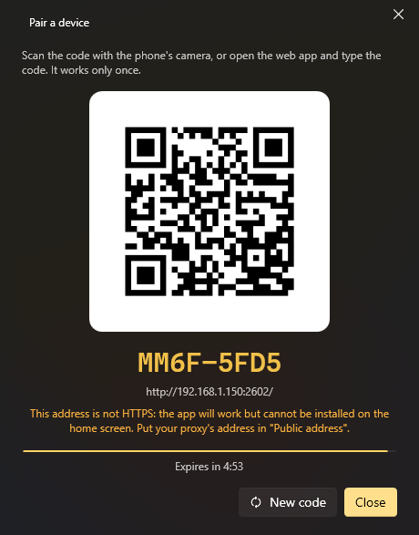

# Phone and remote control

## Web app (phone, tablet, any browser)

*Settings → Web app* turns on a small web server on your PC (port 2502 by default). From a phone on the same network you
get your commands and menus, the volume and the audio output, a touchpad and keyboard, voice orders and the assistants'
chat. It can be installed on the phone as an app (PWA).



1. Turn on **Web server**.
2. **Pair a device**: scan the QR code with the phone (or open the link it shows).
3. That is it: the device stays paired until you **revoke** it in *Paired devices*.

The tabs of the app:

| Tab | What it has |
|---|---|
| **Menus** | Your QuickMenus |
| **Commands** | Every command marked *Available for remote control* |
| **Audio** | Volume, mute, play/pause, next, previous, and the audio output |
| **Touchpad** | Move the mouse, click, scroll and type on the PC (only with *Touchpad and keyboard* on) |
| **Assistant** | The chat with the assistants, written or spoken |
| **Settings** | Theme, language, the app's options |

Notes:

- Nothing works until a device is paired, **even from the same PC**.
- Listening on the network needs K-Desktop to run as administrator (as it does by default); otherwise the server only
  answers this PC.
- *Internet address* is optional, only if you come in from outside through a reverse proxy.
- *Accept orders from* says where it can be reached from: *This PC only*, *Local network* or *Internet* (what comes
  through the proxy counts as internet). Pairing is always needed.

## Android app

The Android app is the same web app with a native microphone. *Settings → Android app → Save the APK…*, copy it to the
phone and open it (Android asks to allow installing apps from that source). It needs no store: when a phone with an older
version connects, the app offers to update itself from the PC.

## UDP

*Settings → Remote control → UDP server* (port 2501) accepts short orders, one per message. Home Assistant, a script,
another PC, netcat or a phone app can use it.

| Order | What it does |
|---|---|
| `list` | Answers with your remote commands, numbered |
| A number or a name (or `run <name>`) | Runs that remote command (capitals and accents don't matter) |
| `event <name>` | Fires the events with *Call from outside* and that name |
| `ask <assistant> <text>` | Asks an active assistant something or gives it an order |
| `assistants` | Answers with the active assistants |
| `keys <keys>` | Presses a key combination (`ctrl+c`, `alt+f4`, `enter`…) |
| `type <text>` | Types a text |
| `media play` / `next` / `previous` / `stop` | Media keys |
| `volume up` / `down` / `mute` | Volume |
| `show` | Shows K-Desktop's window |
| `help` | Answers with this list |

The reply starts with `OK` or `ERROR` and goes on in K-Desktop's language.

Options:

| Option | What it does |
|---|---|
| **Port (UDP)** | The port; if another program uses it, it says so below |
| **Accept orders from** | *This PC only*, *Local network* (VPNs included) or *Internet* (only with a key, and only signed orders) |
| **Key** | Optional. From another computer it goes in front of each order (`mykey list`) or orders are signed with it. Not needed from this PC. *Generate* makes one and copies it |
| **Keys and text** | Allows `keys` and `type` (off by default) |
| **Hidden commands** | Hidden remote commands also show in `list` and can be run |
| **Events** | Allows `event` |
| **Assistants** | Allows `ask` (off by default) |

What is not allowed gets no reply, and an address that gets the key wrong several times in a row is ignored for a few
minutes.

### JSON orders (for programs)

A program can send the order as JSON and gets the reply as JSON:

```
{"cmd": "run", "arg": "Open Chrome"}
{"ok": true, "message": "run: Open Chrome"}

{"cmd": "list"}
{"ok": true, "commands": ["Open Chrome", "Shut down"]}

{"cmd": "ask", "assistant": "lander", "arg": "what's the weather like?"}
{"ok": false, "error": "off", "message": "turned off in the remote control options"}
```

`cmd` is one of the orders in the table (`run`, `list`, `event`, `ask`, `keys`, `type`, `media`, `volume`…) and `arg`
what follows it. Errors carry a fixed code in `error` (`notFound`, `disabled`, `off`, `badRequest`, `noEvent`,
`noAssistant`, `assistantsOff`, `notRunning`, `disabledHere`).

**With a key**, the JSON is **signed**: the key never travels and a captured message can't be replayed. The message is
`<signature>.<json>`, where the signature is the HMAC-SHA256 of the JSON with the key, in hex, and the JSON carries `t`
(the time in Unix seconds; a minute off is fine) and an `id` that changes with every message:

```js
const json = JSON.stringify({ cmd: "run", arg: "Open Chrome", t: Math.floor(Date.now() / 1000), id: crypto.randomUUID() });
const signature = crypto.createHmac("sha256", key).update(json).digest("hex");
socket.send(signature + "." + json, 2501, "192.168.1.150");
```

```python
payload = json.dumps({"cmd": "list", "t": int(time.time()), "id": uuid.uuid4().hex})
signature = hmac.new(key.encode(), payload.encode(), hashlib.sha256).hexdigest()
sock.sendto(f"{signature}.{payload}".encode(), ("192.168.1.150", 2501))
```

From the internet only signed orders are accepted. For something fuller and paired there is the web API, below.

## Web API

Paired devices can also call the API directly, for instance to run an event:

```
POST http://<PC>:2502/api/event
X-KD: 1
Authorization: Bearer <token>

{"name": "door"}
```
