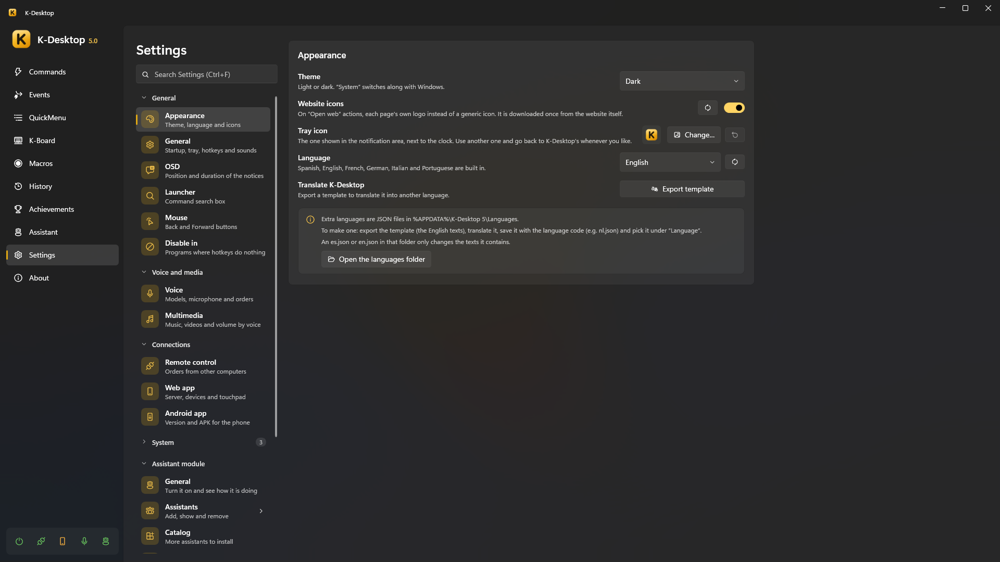
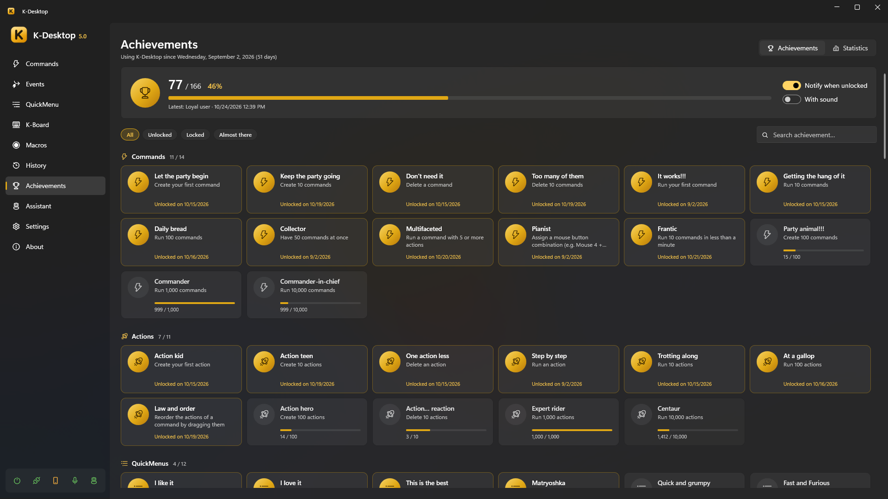

# Settings, data and privacy

*Settings* is organised in foldable groups, with a search box at the top (Ctrl+F): type «volume» or «backup» and it goes
there.

## General

| Section | What it has |
|---|---|
| **Appearance** | Light, dark or system theme; language (Windows', or one of the six built in); website icons; translating |
| **General** | Pause K-Desktop (with its hotkey and sounds); start with Windows, the tray icon and its picture; the hotkeys to show the window and to exit, sounds and startup message |
| **OSD** | K-Desktop's on-screen messages: where they show (clicking on a drawing of the screen), on which monitor, their size, how long they stay, what they do with a film or a game full screen and which groups show (actions, volume and brightness, voice, warnings). Below, the **notifications**: their **sound** (the one of all of them; *Show notification* can choose another or «Global»), whether the achievement ones show and with their sound, on which monitor and corner (also on a drawing), how long they stay and whether they wait until the full-screen thing ends |
| **Launcher** | Its hotkey, what it finds (programs, hidden commands, sums, the web) and its order |

## Voice and multimedia

| Section | What it has |
|---|---|
| **Voice** | Turning voice on or off (off, nothing listens), speech models, microphone, hotkeys to talk and to dictate, and what happens while listening. See [Voice](voice.md) |
| **Wake words** | Always-on listening and the words recorded with your voice, whose each one is and its sensitivity |
| **Multimedia** | Voice orders for music, videos and volume, and the volume step |

## Connections

| Section | What it has |
|---|---|
| **Remote control** | The UDP server: port, where from, key and what is allowed. See [Phone and remote control](remote.md) |
| **Web app** | The web server, pairing and paired devices, touchpad and keyboard |
| **Mobile app** | Its version and «Save the APK» |

## System

| Section | What it has |
|---|---|
| **Disable and block** | Programs where K-Desktop's hotkeys do nothing (games, remote desktops), with a hotkey to add or remove the one in front, and programs where Mouse 4 and Mouse 5 don't go back or forward |
| **Screenshots** | Folder (and **Open**), **file name** with date, time, program or window title, **format** (PNG, JPG with its quality, or WebP), **wait first** (to open a menu), **always copy**, **include the mouse pointer**, **camera sound** and a **flash** over what was taken |
| **Audio recording** | Folder (and **Open**), **format** (WAV, MP3 or Opus: converted when it ends), **microphone volume** (only in recordings), **split long recordings** every so many minutes, and **Save what just played**, which keeps the last seconds in memory so *Record audio → Save what just played* can save them (nothing is written to disk) |
| **Magnifier** | Zoom, shape (rectangular lens, round lens or full screen), size and «Try it»; **look**: border (none, thin, medium or thick) and its color, colors (normal, inverted or more contrast) and smoothing; **behavior**: follow the text while you type, **Ctrl + wheel** changes the zoom while it is on, and turn off by itself after a while without moving the mouse |
| **Data** | The data folder (a link that opens it), export, import and the log; **automatic backups** (every how many days, how many to keep, folder with **Browse** and **Open**, and **Back up now**) and resetting achievements and statistics |
| **Updates** | Version, **Check now**, what to do when there is a new one, **when to check** (when K-Desktop starts, every 6 hours, once a day or once a week) and the installed **assistants**, each with **Update…**. A new version is told with a notification; clicking it opens this page |

The **assistant module** has its own group: see [Assistants](../assistant/index.md).

## Backups

- **Export** saves everything of yours to a `.zip`: settings, commands, QuickMenus, macros, K-Board profiles, achievements
  and statistics, wake words, and your own icons, sounds and languages (and the assistants' data).
- **Automatic backups**: the same full backup every N days, keeping the last ones, in the folder you choose (safer on
  another disk, OneDrive or a NAS). Besides, the settings are copied every day.
- **Import** restores a backup. The current configuration is saved to the Backups folder first.

## Languages

Six are built in: English, Spanish, French, German, Italian and Portuguese. Extra languages are JSON files in
`%APPDATA%\K-Desktop 5\Languages`. Under *Translate*, **Export template** saves the current language: translate the
texts, save the file there with the language code (`nl.json`) and pick it under *Language*. A file with only some texts
(`en.json`) changes only those.

## Achievements and statistics

Over 100 achievements with animated notifications, and statistics of what you use most.

## Privacy

Speech recognition, wake words, voices and the assistants' AI all run **on your PC**. Nothing you say or write is sent
anywhere. K-Desktop only goes online for what you ask of it:

- web requests in your commands;
- the assistants' web, weather and currency tools, and the tools and MCP servers you add yourself;
- checking for updates, and downloading voices or models.

The phone remote talks to the PC over your local network and needs pairing, even from the same PC.
