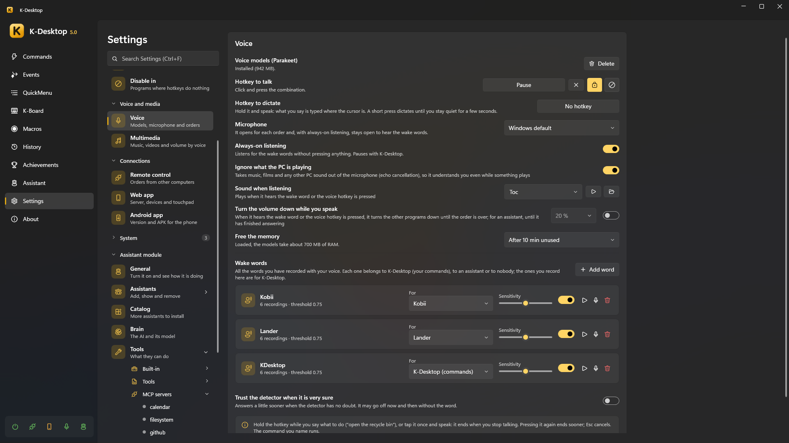
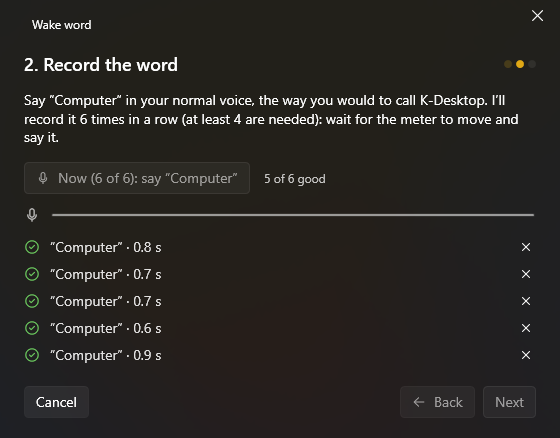

# Voice

K-Desktop understands spoken orders **on your PC**: neither the audio nor the text leaves it, and no internet is needed.

## Setting it up

1. *Settings → Voice → Voice models → Download*. They are downloaded once: **Parakeet** (speech to text, many languages),
   **Silero** (detects when you speak), the wake-word detector and **EmbeddingGemma** (finds the command by its meaning).
   Loaded, they take about 700 MB of RAM; they can be freed after some minutes unused (not Parakeet while a wake word is
   being listened for: that way it checks the word at once).
2. Choose the **microphone** (or the Windows default).
3. Record a **wake word** (*Settings → Wake words → Add word*) or set a **hotkey to talk**.

## Talking to it

- **Hotkey**: hold it while you say what to do («open the recycle bin»), or tap it once and speak: it ends when you stop
  talking. Pressing it again ends sooner; Esc cancels.
- **Wake word**: with *Always-on listening*, say the word and the order together («K-Desktop, open the browser»), or just
  the word and wait for «Listening…».

The command you name runs. It is found **by its name** (also when the recognition gets it a little wrong) or **by its
meaning** («put some music on» finds your «Spotify» command). You can teach a command more phrases.

## Wake words

In *Settings → Wake words* you record your own word with your voice, in a few seconds, with a small wizard: some silence, the word several times, and
a bit of normal speech so it learns what is *not* the word.

- Each word belongs to **K-Desktop** (your commands), to **an assistant**, or to nobody (not listened to).
- **Sensitivity**: further right catches it more easily, but it may also go off without you saying it. **Try** tells you
  how it does.
- *Answer faster*: when the detector has no doubt, it answers without checking with Parakeet.
- Nothing shows (no «Listening…», no sound, no music turned down) until it has checked it really was the word.
- Said in the middle of a sentence («I was showing my brother the Lander») it takes it you are talking *about* it, not
  *to* it, and does nothing.

## While you speak

- **Ignore what the PC is playing**: echo cancellation takes music and films out of the microphone, so it understands you
  even while something plays.
- **Turn the volume down while you speak**: the other programs go down until the order is over (for an assistant, until it
  has finished answering).
- **Sound when listening**.

## Music, videos and volume

*Settings → Multimedia*: orders like «play», «pause», «next», «turn the volume up», «volume to 30» work without creating any
command, in any of the installed languages. They use the media keys, so they work with any player that listens to them:
music, the browser, a film («pause the movie»).

## Dictation

The *Dictate* action (and its own hotkey in *Settings → Voice*) types what you say where the cursor is, without AI. Say
«new line», «new paragraph», «delete that» or «stop dictating»; it also ends after a few seconds of silence or with Esc.

With *Start dictation by voice* on (*Settings → Voice*, under the dictation hotkey), you can also start it as a voice
order: «start dictating», «dictation mode», «write what I say».
