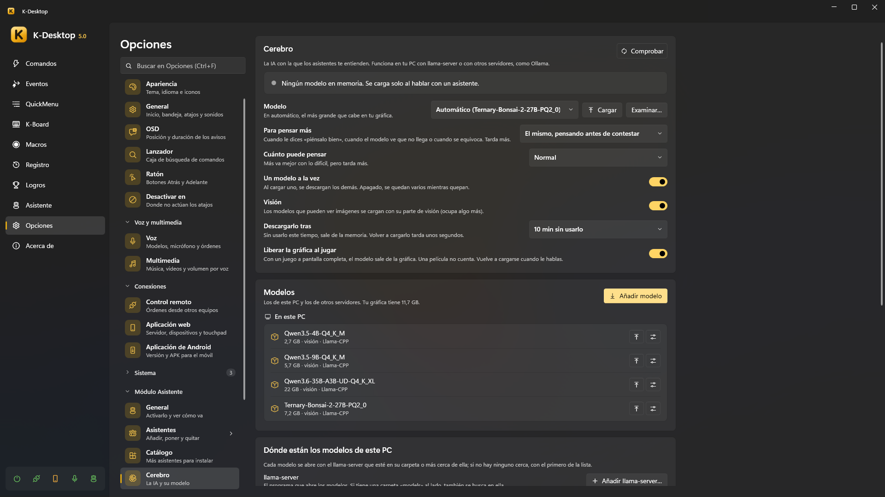

# Cerebro (la IA)

Los asistentes te entienden con un modelo de IA. Va **en tu PC** con `llama-server` (de llama.cpp), o en otro servidor que
ya tengas, como Ollama, llama-swap o LM Studio. *Opciones → Asistente → Cerebro*.

> [!NOTE]
> Sin ningún modelo los asistentes siguen funcionando: las frases fijas (la hora, los temporizadores, las notas,
> «recuerda que…»), tus comandos y las reglas de ventanas y programas no necesitan IA. Elige **Sin IA (solo reglas y tus
> comandos)** para dejarlo así.

## Dónde se piensa la respuesta

La página te dice adónde va lo que dices:

| | |
|---|---|
| **En este PC** | Lo que le dices no sale del ordenador |
| **En otro equipo de tu red** | Lo que le dices no sale de casa |
| **En internet** | Lo que le dices sale de tu red |

## Modelos de este PC

1. **Dónde están los modelos de este PC → llama-server → Añadir llama-server…**: el `llama-server.exe` que abre los
   modelos. Si tiene una carpeta `models` al lado, también se busca ahí. Con varios, cada modelo se abre con el de su
   carpeta o el más cercano; si no, con el normal (*Hacerlo el normal*).
2. **Carpetas con modelos**: se buscan los archivos `.gguf` que haya dentro. Una de ellas es donde van *los que descargas*
   (*Abrir*, o moverla a otro sitio).
3. **Añadir modelo**: pega el enlace de un modelo de Hugging Face o escribe su nombre (`unsloth/Qwen3.5-9B-GGUF`, o
   `unsloth/Qwen3.5-9B-GGUF:Q4_K_M` para una cuantización). Cada archivo dice si **cabe** en tu gráfica, va **justo** o **no
   cabe (irá lento)**; el más grande que cabe ya viene elegido. Los modelos que ven imágenes ofrecen también su parte de
   visión.

La lista **Modelos** enseña los de este PC y los de los otros servidores, el que está en memoria en verde, con *Cargar*,
*Liberar*, *Borrar* y **Opciones de llama-server** solo para ese modelo (por ejemplo `-c 32768` para más contexto).

## Otros servidores

*Otros servidores → Añadir*: Ollama, o cualquier servidor compatible con OpenAI (llama-swap, LM Studio…), en este PC o en
otro, con su dirección y, solo si la pide, una clave de API (se guarda cifrada para tu usuario). *Probar* dice cuántos
modelos tiene. Sus modelos salen en la misma lista.

## Elegir el modelo

| Ajuste | |
|---|---|
| **Modelo** | *Automático*: el más grande que cabe en tu gráfica. O uno concreto, o *Sin IA* |
| **Para pensar más** | El que usa cuando dices «piénsalo bien», cuando el modelo ve que no le basta o cuando le dices que se ha equivocado. *El mismo modelo* (razonando antes de contestar), otro modelo, o *Nunca*. Con otro modelo, **Razonar antes de contestar** decide si razona primero o contesta tal cual (tarda menos) |
| | Los dos tienen **Examinar…** (un `.gguf` de cualquier carpeta) y **Cargar** cuando el elegido no está en memoria |
| **Cuánto razona al pensar más** | Poco, normal, mucho (solo cuando razona). Más va mejor con lo difícil, pero tarda más |
| **Descargarlo tras** | Tanto tiempo sin usarlo, sale de la memoria (o *Nunca*: solo si se lo pides). Volver a cargarlo tarda unos segundos |
| **Un modelo a la vez** | Al cargar uno, se descargan los demás. Apagado, se quedan varios mientras quepan |
| **Visión** | Los modelos que ven imágenes se cargan con su parte de visión (ocupa un poco más) |
| **Liberar la gráfica al jugar** | Con un juego a pantalla completa, el modelo sale de la gráfica. Una película no cuenta. Se vuelve a cargar al hablarle |

Cada asistente puede pensar con **su propio modelo** (*su ficha → Básico → Piensa con*, y otro propio para pensar más: *Global*, *El mismo modelo* o uno de la lista, con
su casilla para razonar o no, y cuánto razona). El
paquete de un asistente puede sugerir un modelo: la ficha de instalación y su pestaña *Básico* ofrecen descargarlo (nunca
marcado de entrada), solo si cabe y no lo tienes.

## Liberar la gráfica

El modelo se carga solo al hablar con un asistente, ya mientras dices la orden. Para sacarlo de la memoria:

- **Liberar**, junto a él, arriba de la página;
- di o escribe «descarga el cerebro» / «descarga el modelo» (y «carga el cerebro» para tenerlo listo);
- la acción **Asistente: cerebro** en un comando o un evento (antes de un juego, un render…).

## Pensar más

Los modelos pequeños contestan al momento, pero pueden fallar una cuenta o un acertijo. Pídele «piénsalo bien»,
«piénsalo mejor» o «piénsalo otra vez» (antes o después de la pregunta), o dile «está mal»: lo piensa más y lo comprueba.
Un modelo grande también puede decidir solo pensarlo más. Tarda más: hasta medio minuto.

## Probar modelo

Al final de la página, **Probar modelo** le da al modelo una lista de órdenes de prueba y te dice cuántas acierta y cuánto
tarda de media. No se ejecuta nada de verdad. **Abrir el banco** abre `Assistant\bench.json`, para escribir tus propias
órdenes.
