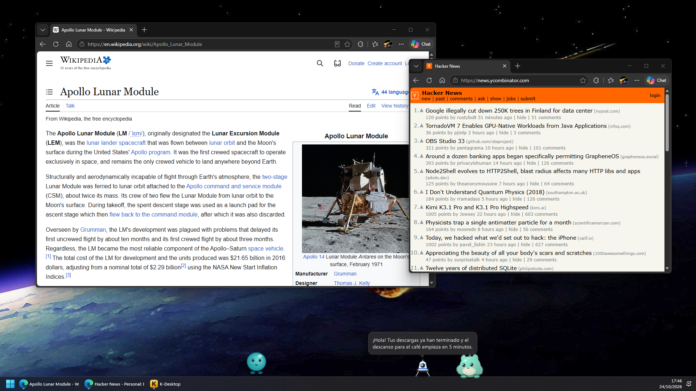
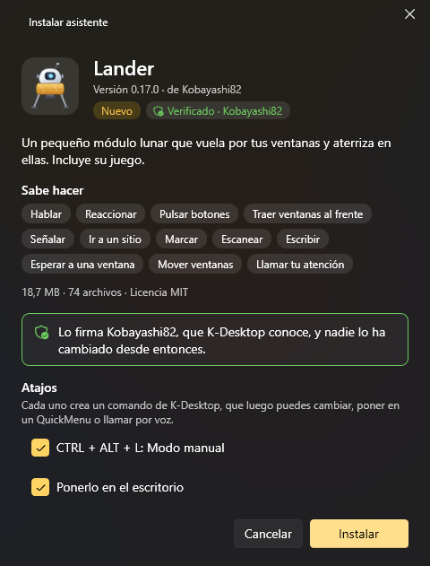
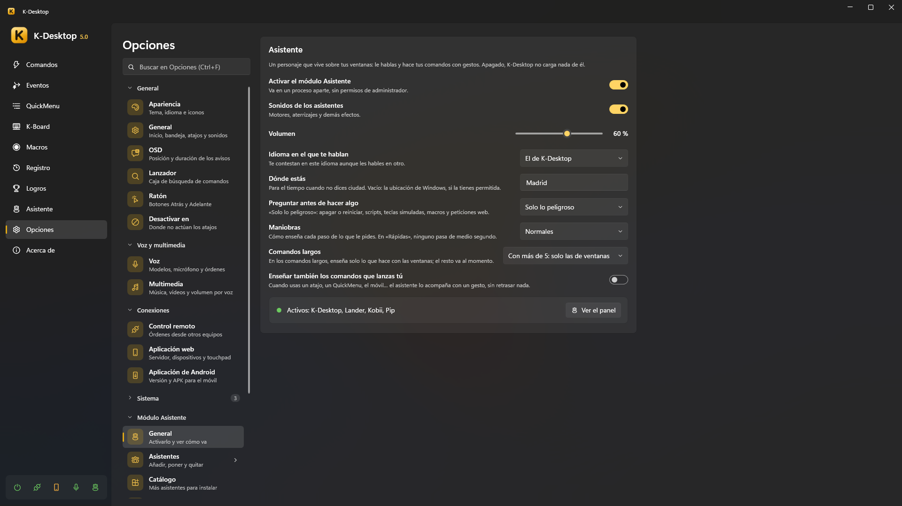
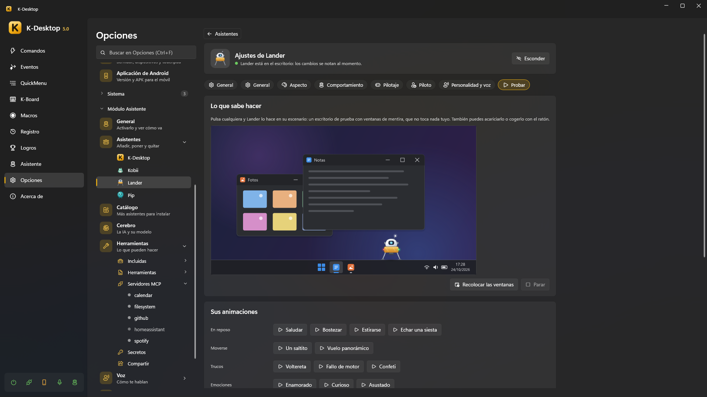

# Asistentes

Un asistente es un personaje que vive encima de tus ventanas. Anda o vuela, reacciona a lo que pasa en el PC y se le
puede hablar: «Lander, minimiza Chrome», «Kobii, ¿qué tiempo hará mañana?». Cuando ejecuta uno de tus comandos, cada paso
se ve: el Lander vuela hasta el botón de minimizar y le dispara, y la ventana se minimiza justo en el impacto.

> [!NOTE]
> El módulo Asistente es opcional. Mientras está apagado, K-Desktop no carga nada de él y funciona igual que sin él.

## Los asistentes

| Asistente | Qué es |
|---|---|
| **Lander** | Un pequeño módulo lunar que vuela entre tus ventanas, se posa en ellas, las remolca con un gancho y tiene su propio juego (modo manual, misiones, carreras) |
| **Kobii** | Una criaturita que anda, trepa por tus ventanas, juega, come, duerme y se deja acariciar, cepillar o chocar los cinco |
| **Kumo** | Una nube blandita que flota, envuelve las ventanas para llevarlas, llueve, hace arcoíris y baila con tu música |
| **K-Desktop** | El asistente incluido, sin personaje, para cuando quieres respuestas sin nadie en el escritorio |

Puede haber varios a la vez en el escritorio; cada uno tiene su palabra de activación, su tecla para hablarle, su idioma,
su personalidad, su voz y hasta su propio modelo de IA.

## Encenderlo e instalar uno

1. *Opciones → Módulo Asistente → General →* **Activar el módulo Asistente**.
2. *Opciones → Módulo Asistente → Catálogo*: cada asistente con sus vídeos, lo que sabe hacer e **Instalar…**. También
   puedes abrir un paquete `.kai` con doble clic, o usar *Asistentes → Añadir asistente*.
3. La **ficha de instalación** enseña qué es, qué sabe hacer y quién lo firma, y ofrece grabar su nombre como palabra de
   activación, crear comandos para sus atajos y descargar el modelo de IA que sugiere.

   
4. Pulsa **Instalar**.

Una versión nueva se instala encima de la anterior y se cambia en caliente, conservando los datos del asistente
(`%APPDATA%\K-Desktop 5\Assistants\Data\<id>`, incluidos en las copias de seguridad). Los asistentes instalados avisan
cuando hay una versión nueva (*Opciones → Actualizaciones*): siempre se ofrece, nunca se instala sin preguntar.

### Paquetes firmados

La ficha dice quién ha firmado un paquete:

| Enseña | Significa |
|---|---|
| **Verificado · nombre** | Firmado con una clave que K-Desktop conoce (los asistentes del propio K-Desktop) |
| **Firmado por «nombre»** | Firmado con otra clave: el nombre es solo lo que dice el paquete, pero las actualizaciones tienen que venir con la misma clave |
| **Sin firma** | Sin firma: se instala, con el aviso de siempre |
| *(no se instala)* | La firma no cuadra: algo del paquete ha cambiado después de firmarlo |

Si una actualización la firma otro distinto que la versión que tienes, la ficha avisa en rojo.

## Su ficha

En *Opciones → Módulo Asistente → Asistentes*, cada asistente tiene su página:

- **Poner en el escritorio / Esconder** (Activar / Desactivar en K-Desktop).
- **Básico**: su palabra de activación, su tecla para hablarle, el modelo con el que piensa (y con el que piensa más), y los
  ajustes que comparten todos los asistentes —**tamaño**, **volumen**, **lo movido que es** (cuánto se mueve por su cuenta) y
  si se puede **coger con el ratón**— además de «Usar siempre el bocadillo de K-Desktop».
- Sus propias páginas (de su paquete): las opciones del juego del Lander, el color de Kobii…
- **Personalidad y voz**: otra personalidad, otro idioma y otra voz para este asistente.
- **Probar**: el asistente en un pequeño escritorio de mentira para él solo, haciendo cada cosa que sabe enseñar (sus
  animaciones, entradas y salidas, estados, reacciones, gestos, lo que le hace a una ventana). Nada de eso toca tu
  escritorio.

  

*Panel → Asistente* enseña el estado de cada asistente, su panel (puntuaciones, logros, botones), su actividad (lo que ha
hecho, con deshacer) y el chat.

## Hablarle

| Cómo | |
|---|---|
| **Su palabra de activación** | «Lander, …». Se graba en su ficha; cada asistente tiene la suya |
| **Su tecla para hablarle** | Mantenla pulsada y habla (cada asistente puede tener una) |
| **Clic mantenido** | Mantén el botón izquierdo sobre él medio segundo y habla |
| **Por escrito** | Clic central sobre él, o *Escribir a …* en su menú del botón derecho, abre una caja; o el chat de *Panel → Asistente* |
| **Móvil** | La pestaña *Asistente* de la aplicación web, por escrito o hablando |
| **Comandos** | *Asistente: preguntar* le manda un texto (o abre la caja para escribirle) |

Su **menú del botón derecho** tiene *Escribir a …*, sus acciones propias (extras), su panel, sus ajustes y *Esconder*.

**Soltarle archivos** encima (desde el Explorador) abre una ventanita: «¿Qué hago con «archivo»?», con sugerencias según el
tipo (resumir o leer un documento, decir qué es una imagen o leer su texto, ver qué hay en una carpeta, abrirlo…) o lo que
le digas tú.

## Qué pasa cuando le pides algo

1. Primero las **frases fijas**, sin IA: «¿qué hora es?», «pon un temporizador de 10 minutos», «recuerda que…», «abre
   youtube.com», «¿qué suena?», «¿qué tiempo hará mañana?», «descarga el cerebro»… Contestan al momento.
2. **Tus comandos**: si lo que has dicho nombra claramente uno de tus comandos, se ejecuta (con sus gestos).
3. Si no, contesta **la IA**, eligiendo entre sus [herramientas](tools.md) las que vienen a cuento.

Lo arriesgado (cerrar programas, borrar archivos, apagar) pregunta antes con una ventanita, también de palabra («sí» /
«no» / «sí, y no vuelvas a preguntar»). *Opciones → Módulo Asistente → General → Preguntar antes de hacer algo* lo decide:
nunca, solo lo peligroso, o también la primera vez.

## Gestos y rapidez

*Opciones → Módulo Asistente → General*:

- **Maniobras**: *Vistosas*, *Normales* o *Rápidas* (menos de medio segundo).
- **Comandos largos**: en los comandos con muchas acciones, solo enseña lo que hace con las ventanas; lo demás pasa al
  momento.
- **Enseñar también los comandos que lanzas tú**: los comandos lanzados con un atajo, un QuickMenu, el móvil… también se
  enseñan con un gesto, de adorno, sin retrasar nada.
