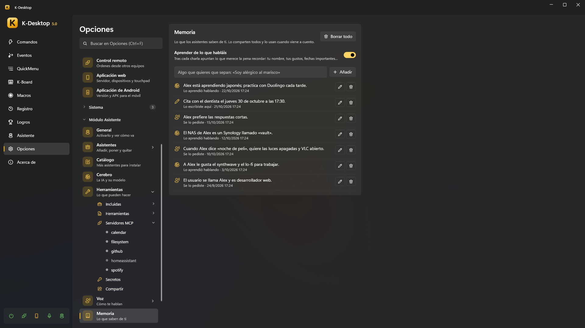
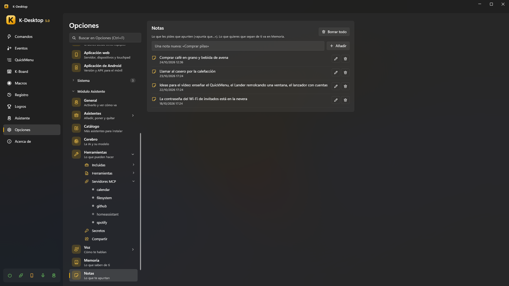
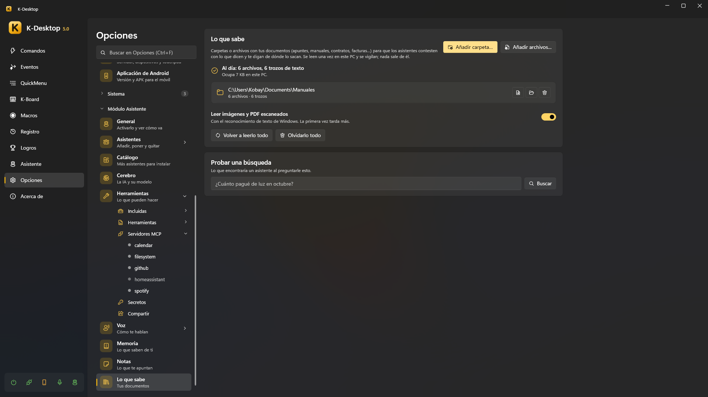

# Memoria, notas y documentos

Los asistentes guardan tres cosas distintas, cada una con su página en *Opciones → Módulo Asistente*:

| | Qué es | Dices |
|---|---|---|
| **Memoria** | Lo que saben de **ti**: tu nombre, lo que te gusta, fechas importantes | «recuerda que mi jefe se llama Luis» |
| **Notas** | Lo que les pides que te **apunten** | «apunta que tengo que comprar leche» |
| **Lo que sabe** | Tus **documentos**: carpetas y archivos que leen para contestarte con lo que dicen | «¿qué dice mi contrato sobre la fianza?» |

Todo se queda en tu PC, y lo comparten todos los asistentes.

## Memoria

- «Recuerda que…», «acuérdate de que…» lo guarda al momento, sin depender de la IA.
- «¿Qué tienes en la memoria?» te dice lo más importante.
- «Olvida que…» / «olvida lo de…» lo quita (y se puede deshacer).
- **Aprender de lo que habláis**: tras cada conversación apuntan lo que vale la pena recordar. Cada recuerdo dice de dónde
  sale: *Se lo pediste*, *Lo aprendió hablando* o *Lo escribiste aquí*.

En la página puedes **Añadir** algo que quieras que sepan, **Editar** o **Borrar** cada recuerdo, o **Borrar todo**. Cuando
una orden encaja con algo que recuerdan, lo usan: «cuando diga "lo de siempre", me refiero a mi comando *Trabajo*».

## Notas

«Apunta que…», «anota…», «apúntame…» guarda una nota; «¿qué tenía apuntado?» o «¿qué tenía que comprar?» las busca. En la
página se pueden añadir, editar y borrar. Una respuesta larga de la hoja de lectura se puede guardar como nota con *Guardar
como nota* (ver [Respuestas largas](voice.md#respuestas-largas)).

## Lo que sabe (tus documentos)

Añade **carpetas** (*Añadir carpeta…*) o **archivos** sueltos (*Añadir archivos…*) con tus documentos —apuntes, manuales,
contratos, facturas…— y los asistentes te contestan con lo que dicen y te dicen de dónde sale. Se leen una vez en este PC y
se vigilan: un archivo nuevo o cambiado se vuelve a leer solo. Nada sale del ordenador.

- **Qué se lee**: texto y Markdown, PDF, Word (`.docx`), PowerPoint (`.pptx`), páginas web, subtítulos y correos (`.eml`),
  y archivos de código o de datos que no sean muy grandes. Con **Leer imágenes y PDF escaneados**, también imágenes y
  páginas de PDF sin texto, con el reconocimiento de texto de Windows (la primera vez tarda más).
- **Qué no se puede**: un disco entero, ni carpetas de Windows o de los programas. Las carpetas ocultas se saltan.
- **Mientras lee**, la página enseña «Leyendo: 412 de 1.300 archivos» y el archivo por el que va. Lee sin agobiar al PC y
  **se pone en pausa** con un juego a pantalla completa, con K-Desktop en pausa y mientras un asistente contesta.
- Cada carpeta o archivo tiene **Ver lo leído** (cada archivo con sus trozos, páginas, o por qué no se ha podido leer),
  **Abrir la carpeta** y **Quitar**. Una carpeta de un disco que no está conectado conserva lo que ya leyó.
- **Probar una búsqueda**: lo que encontraría un asistente al preguntarle eso, y cuánto ha tardado.
- **Volver a leerlo todo** y **Olvidarlo todo** (tus archivos nunca se tocan).

Busca **por palabras y por significado**: «¿cuánto pagué de luz en octubre?» encuentra la factura de octubre aunque diga
«suministro eléctrico». La parte del significado usa EmbeddingGemma, que se descarga con los modelos de voz (*Opciones →
Voz*); sin él, solo encuentra lo que preguntas con las mismas palabras que el documento.

Cuando nada de tus documentos responde, el asistente lo dice en vez de inventárselo.

## Archivos que le das

Soltarle archivos a un asistente (o preguntarle por uno) es otra cosa: se leen solo para esa orden, sin añadirlos a *Lo que
sabe*. Ver [Soltarle archivos](index.md#hablarle).
