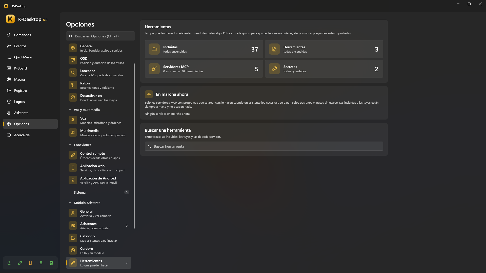
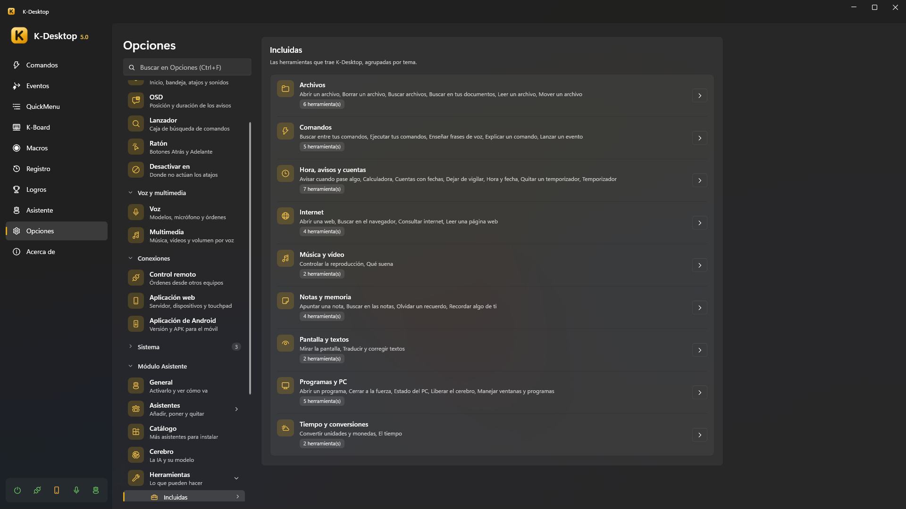
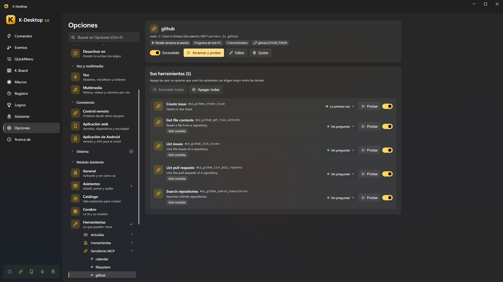

# Herramientas

Las herramientas son lo que los asistentes pueden *hacer* cuando les pides algo: poner un temporizador, buscar un archivo,
leer una web, cerrar un programa… En cada orden solo le llegan a la IA las pocas herramientas que vienen a cuento, así
elige bien aunque haya cientos.

*Opciones → Asistente → Herramientas* las enseña todas —las incluidas, las tuyas y las de cada servidor MCP— con un
buscador. Abre cada grupo para apagar las que no quieras, elegir **cuándo pregunta** antes de hacerlo (*Sin preguntar*,
*La primera vez*, *Siempre*) o **Probarla** con un pequeño formulario.



Todo lo que hace un asistente sale en *Panel → Asistente → Actividad*: qué, cómo (regla, comando, IA, memoria…) y si
funcionó. Lo que se puede deshacer tiene su botón **Deshacer** (o di «deshaz eso»).

## Las incluidas



| Tema | Herramientas | Por ejemplo |
|---|---|---|
| **Comandos** | Ejecutar tus comandos · Buscar entre tus comandos · Explicar un comando · Enseñar frases de voz · Lanzar un evento | «pon el modo juego», «¿qué hace el comando de las copias?», «cuando diga la peli abre el comando de películas» |
| **Hora, avisos y cuentas** | Hora y fecha · Temporizador · Quitar un temporizador · Avisar cuando pase algo · Dejar de vigilar · Cuentas con fechas · Calculadora | «avísame en media hora», «avísame cuando termine la descarga», «cuántos días faltan para navidad» |
| **Notas y memoria** | Apuntar una nota · Buscar en las notas · Recordar algo de ti · Olvidar un recuerdo | «apunta que tengo que comprar leche», «recuerda que mi jefe se llama Luis» |
| **Archivos** | Buscar archivos · Abrir un archivo · Leer un archivo · Borrar un archivo · Mover un archivo · Buscar en tus documentos | «búscame el pdf de la factura de la luz», «abre lo último que descargué» |
| **Internet** | Abrir una web · Buscar en el navegador · Consultar internet · Leer una página web | «cuánto cuesta una RTX 5080», «resúmeme esta página» |
| **Pantalla y textos** | Mirar la pantalla · Traducir y corregir textos | «qué error me sale», «tradúceme esto al inglés» |
| **Programas y PC** | Abrir un programa · Manejar ventanas y programas · Cerrar a la fuerza · Estado del PC · Liberar el cerebro | «minimiza Steam», «Chrome no responde, ciérralo a la fuerza», «por qué va lento el ordenador» |
| **Música y vídeo** | Qué suena · Controlar la reproducción | «qué canción es esta», «pausa el vídeo» |
| **Tiempo y conversiones** | El tiempo · Convertir unidades y monedas | «va a llover mañana», «cuánto son 50 dólares en euros» |

Algunos detalles:

- **Avisar cuando pase algo** vigila que se cierre un programa o aparezca una ventana, que se calmen el procesador o la
  gráfica, que acabe una descarga o que una carpeta deje de cambiar. Cuando pasa, lo dice el asistente que lo puso.
- **Mirar la pantalla** lee el texto con el reconocimiento de texto de Windows (también «copia el texto de esta ventana»);
  para entender una imagen hace falta un modelo con visión.
- **Traducir y corregir textos** trabaja con lo que tienes seleccionado o copiado (traducir, corregir, resumir, más formal,
  en lista, más corto…) y lo vuelve a pegar en la misma ventana o lo deja copiado. Tu portapapeles queda como estaba.
- **Consultar internet** busca en la web y lee el primer resultado útil; **Buscar en el navegador** solo abre la búsqueda
  en tu navegador.
- **El tiempo** usa Open-Meteo y las **monedas**, los tipos del Banco Central Europeo (sin cuenta). Sin ciudad, usa
  *Opciones → Asistente → General → Dónde estás*, o la ubicación de Windows si la permites.
- **Borrar un archivo** lo manda a la papelera; esta y **Mover un archivo** preguntan siempre antes (mover se puede deshacer).

## Tus herramientas (JSON)

Una herramienta JSON le da a los asistentes algo nuevo que hacer sin compilar nada: encender una luz de Home Assistant,
mandarte un Telegram, ejecutar uno de tus comandos con frases propias, encadenar varios pasos o lanzar un script.

- Están en `%APPDATA%\K-Desktop 5\Assistant\Tools\`, un `.json` por herramienta (*Herramientas → Personalizadas → Abrir
  carpeta*, o **Nueva** a partir de una plantilla). Se recargan un momento después de guardar, añadir o quitar una.
- Esquema: [`tool.schema.json`](https://github.com/Kobayashi82/K-Desktop/blob/main/docs/assistant/schemas/tool.schema.json).
  Con `"$schema"` apuntando a él, tu editor te enseña los errores mientras escribes. Un archivo con errores no se carga y
  K-Desktop te dice por qué.
- [Ejemplos](https://github.com/Kobayashi82/K-Desktop/tree/main/docs/assistant/herramientas) de cada tipo.

```jsonc
{
  "name": "luz_salon",                       // minúsculas, números y _ (mcp_ está reservado)
  "type": "http",                            // http · kdesktop · routine · script
  "description": "Turns the living room light on or off.",   // para el modelo
  "examples": ["enciende la luz del salón", "apaga el salón"],
  "parameters": {
    "estado": { "type": "string", "enum": ["on", "off"], "description": "on or off" }
  },
  "intent": "poner la luz del salón en {{estado}}",          // lo que verás en la actividad y al preguntar
  "say": { "ok": "Luz del salón: {{estado}}.", "error": "La base no responde." },
  "risk": "safe",                            // safe · askOnce · askAlways
  "readsOnly": false,
  "gesture": "waitForWindow",                // opcional: waitForWindow · tray · clock · typing
  "timeout": 15,
  "request": {
    "method": "POST",
    "url": "http://homeassistant.local:8123/api/services/light/turn_{{estado}}",
    "headers": { "Authorization": "Bearer {{secret:ha_token}}" },
    "body": { "entity_id": "light.salon" }
  }
}
```

- **`description`** es para el modelo: qué hace y cuándo usarla. En inglés los modelos la siguen mejor, pero vale cualquier
  idioma.
- **`examples`**: frases que la piden. Con ellas se elige qué herramientas le llegan al modelo en cada orden. Si dices
  **exactamente** una y la herramienta no necesita nada del modelo, se hace al momento sin IA («buenas noches» → una rutina).
- **`parameters`**: lo que el modelo tiene que darle (`string`, `number`, `integer`, `boolean`, con `enum`, `default`,
  `minimum`, `maximum`). Los que no tienen `default` son obligatorios, salvo que `required` diga otra cosa. Si el modelo da
  un valor que no vale, se le explica y puede corregirlo.
- **`say`**: lo que dice el asistente al acabar. Sin él, lo dice el modelo con sus palabras.
- **`readsOnly`**: solo consulta algo (una temperatura, un estado); el modelo contesta con lo que devuelve.
- **`risk`**: `safe` no pregunta nunca; `askOnce` pregunta hasta que dices «Sí, y no vuelvas a preguntar»; `askAlways`
  pregunta siempre.
- **`gesture`** (opcional): lo que hace el personaje mientras tanto —esperar la ventana que abre, ir a la bandeja, dejar una
  marca junto al reloj, teclear en la ventana de delante—. Solo es adorno: la herramienta no lo espera.

### Huecos

| Hueco | Qué es | Dónde |
|---|---|---|
| `{{parámetro}}` | El valor que dio el modelo | En todas partes |
| `{{secret:nombre}}` | Un secreto (ver abajo) | URL, cabeceras, cuerpo, argumentos y entorno de un script |
| `{{result}}` | La respuesta (o la parte elegida con `pick`) | `say` |
| `{{result.campo}}` | Un campo de la respuesta JSON (`attributes.temperature`, `items.0.name`) | `say` |
| `{{status}}` | El código HTTP o el de salida del script | `say` |

En un `body` JSON, un texto que es **solo** `"{{parámetro}}"` conserva su tipo: un número sigue siendo número.

### Tipos

| Tipo | Qué hace |
|---|---|
| **`http`** | Cualquier API web: `request` con `method` (GET por defecto), `url`, `headers`, `query`, `body` (o `bodyText` con `contentType`) y `pick` (la parte de la respuesta que se le da al modelo). Un código de error (4xx, 5xx) es un fallo |
| **`kdesktop`** | Uno de tus comandos con frases propias: `"command": "Modo cine"`, por su nombre exacto (nunca uno parecido). Los comandos arriesgados preguntan como siempre |
| **`routine`** | Varios `steps`: otra herramienta (incluida o JSON, nunca otra rutina) con sus `arguments`, uno de tus comandos (`"command"`) o una espera (`"wait": 1`, hasta 30 s). Un paso que falla para la rutina, salvo con `continueOnError` |
| **`script`** | Uno de tus scripts: `"script": { "file": "comprobar.ps1", "args": ["{{host}}"], "env": { "API_KEY": "{{secret:mi_clave}}" } }`. `.ps1` (Windows PowerShell), `.bat`/`.cmd`, `.py` (con `uv run --script` si tienes uv; si no, `py` o `python`), `.js` (Node.js) o `.exe`. Van como tu usuario normal (nunca como administrador), sin ventana, 30 s como mucho; lo que escriben es la respuesta y un código de salida distinto de 0 es un fallo |

> [!IMPORTANT]
> Un script **siempre pregunta antes de su primera ejecución**, aunque tengas *Preguntar antes de hacer algo* en *Nunca*.
> Con «Sí, y no vuelvas a preguntar» queda aprobado; si cambia el script o su `.json`, vuelve a preguntar. Un script que
> aparezca en la carpeta sin que lo sepas nunca se ejecuta sin que lo veas.

## Secretos

Contraseñas, tokens y claves que usan tus herramientas y servidores: *Herramientas → Secretos*, o en
`%APPDATA%\K-Desktop 5\Assistant\secrets.json`. Si los escribes ahí en claro, cada valor se cifra con tu usuario de Windows
la primera vez que se lee. **El modelo nunca ve un secreto**: solo se pone al mandar la petición, y si una respuesta lo
contiene se tapa con `•••`. Una copia de seguridad restaurada en otro PC no puede leerlos: hay que volver a escribirlos.

## Servidores MCP

Un servidor MCP es un programa (o una dirección) que da varias herramientas de golpe: los mismos que usan Claude Desktop,
VS Code u Open WebUI con mcpo. *Herramientas → Servidores MCP*:



- **Importar…** lee el archivo de otro programa (el `config.json` de mcpo, el de Claude Desktop) y te deja elegir. **Pegar**
  coge el bloque JSON que has copiado de las instrucciones de un servidor. Las variables que parecen secretas (`*_TOKEN`,
  `*_KEY`, `*_SECRET`, `*PASSWORD*`, `CHAT_ID`…) pasan a secretos cifrados. Los servidores de cosas que los asistentes ya
  hacen (archivos, pantalla, portapapeles, memoria, hora, internet) salen desmarcados, con el motivo.
- **Añadir servidor**: un programa (`node`, `npx`, `uvx`, un `.exe`…, sus argumentos y su carpeta) o una dirección HTTP;
  sus variables o cabeceras, cada una normal o secreta; cuánto puede tardar una llamada y tras cuánto tiempo sin usarse se
  para.
- Cada servidor tiene su página con su estado, **Arrancar y probar**, y sus herramientas para encender o apagar (los
  asistentes eligen mejor entre menos).

Los arranca el proceso de los asistentes, **como tu usuario normal**, solo cuando hace falta una de sus herramientas, y se
paran solos tras unos minutos sin usarse; *Herramientas → En marcha ahora* enseña cuáles están en marcha. Sus herramientas
se recuerdan, así que elegir entre ellas nunca arranca un servidor. Por defecto preguntan la primera vez, salvo las que el
servidor dice que solo leen. Lo que un servidor escribe en stderr va a `Logs\mcp-<servidor>.log`.

## Compartir con otros programas

Al revés: *Herramientas → Compartir* hace de los asistentes un servidor MCP para Claude Desktop, VS Code, Open WebUI o
cualquier programa con MCP. Enciende **Compartir las herramientas** y **Copiar la configuración**, y pégala en los ajustes
MCP del programa (`claude_desktop_config.json`, el `mcp.json` de VS Code, el `config.json` de mcpo):

```json
{
  "mcpServers": {
    "k-desktop": {
      "command": "C:\\…\\KDesktop.exe",
      "args": ["--mcp"],
      "env": { "KDESKTOP_MCP_KEY": "…" }
    }
  }
}
```

- **Qué pueden usar**: *Solo lo que consulta* (la hora, cuentas, el tiempo, buscar archivos o en internet, leer la
  pantalla… nada que cambie nada), *Todo, preguntándote antes*: lo que cambia algo pregunta **en este PC** con la ventanita
  de siempre, aunque hayas puesto que los asistentes no pregunten, o *Todo, sin preguntar*: solo pregunta lo que tengas en
  *Siempre* (y un script nuevo, la primera vez).
- Con **Pedir la clave** (de serie) solo entran los programas con la clave; **Cambiar la clave** deja fuera a los que
  tenían la anterior. Apagado, entra cualquier programa tuyo en este PC (nunca desde otro PC ni de otro usuario) y la
  configuración copiada no lleva clave.
- K-Desktop tiene que estar abierto con el módulo Asistente encendido. Cada llamada sale en la actividad con el nombre del
  programa, y la página enseña quién está conectado. Las herramientas que has apagado y las de tus propios servidores MCP no
  se comparten.
