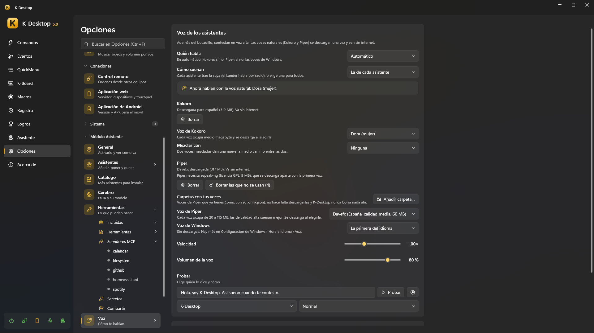

# Voz y conversación

Además del bocadillo, los asistentes contestan **en voz alta**, cada uno con su voz. Las voces naturales se descargan una
vez y van sin internet. *Opciones → Asistente → Voz*.

Para *hablarles* se usa el reconocimiento de voz de K-Desktop (palabras de activación, una tecla para hablar…): ver
[Voz](../k-desktop/voice.md) y [Hablarle](index.md#hablarle).

## Quién habla

**Idioma en el que te hablan**: te contestan en ese idioma aunque les hables en otro, y las voces que se ofrecen son de
ese idioma (*El de K-Desktop*, o uno de los seis).

| Motor | |
|---|---|
| **Automático** | Kokoro; si no, Piper; si no, las voces de Windows |
| **Voz natural (Kokoro)** | La más natural. Español, inglés, francés, italiano y portugués (alemán todavía no). Unos 325 MB, más medio megabyte por voz |
| **Voz natural (Piper)** | Voces en todos los idiomas, de 20 a 115 MB cada una; las de calidad alta suenan mejor (las de calidad baja no se ofrecen) |
| **Voces de Windows** | Sin descargas. Hay más en *Configuración de Windows → Hora e idioma → Voz* |
| **Solo pitidos** | |
| **No hablar (solo el bocadillo)** | |

**Velocidad** y **Volumen de la voz** van en la misma página. Las voces de cada motor (descargarlas y elegirlas) están en
*Voz → Voces*:

- **Carpetas con tus voces** de Kokoro: voces que ya tienes (`.pt` o `.bin`, con su nombre de Kokoro, como `af_bella`; el
  idioma sale de la primera letra) se usan desde ahí sin descargarlas, marcadas como *tuya*. Una que también está en la
  lista sale una sola vez. K-Desktop nunca borra nada ahí.
- **Voz de Kokoro** y **Mezclar con**: dos voces mezcladas dan una nueva, a medio camino entre las dos (*Cuánto de …*).
- **Voz de Piper** y su **Variante** (algunas voces tienen varias personas o formas de hablar). **Carpetas con tus voces**:
  las voces de Piper que ya tienes (`.onnx` con su `.onnx.json`) se usan desde ahí sin descargarlas, y K-Desktop nunca
  borra nada de ahí. **Borrar las que no se usan** libera sitio.
- Para algunos idiomas Kokoro, y Piper siempre, necesitan **espeak-ng** (licencia GPL, 9 MB), que se descarga aparte con
  la voz.
- **Voz de Windows**: cuál de las que tiene Windows.
- **Probar esta voz**, debajo de cada una: la frase de prueba con esa voz, tal cual (sin efectos).

## Cómo suenan

**Cómo suenan**: cada asistente trae su perfil (el Lander habla por radio, desde la Luna), o elige uno para todos:
*Natural*, *Robot clásico*, *Marciano*, *Control de misión*, *8 bits*, *Pitidos*, o uno tuyo.

**Probar**: elige *quién lo dice* y *cómo lo dice* (normal, contento, tras un fallo) y pulsa *Probar*.

### Perfiles de voz

*Voz → Perfiles de voz* es la lista: los de serie y los tuyos, con **Nuevo al azar** e **Importar…**. Al pulsar uno se abre su
editor en la misma página (**← Perfiles de voz** vuelve a la lista), con **Duplicar**, **Exportar** y, si es tuyo, **Borrar**.
Los de serie se quedan como están: **Duplica** uno para hacer el tuyo. El icono de **Usar para todos** (en la lista y en el editor) pone ese perfil en
*Cómo suenan* (resaltado mientras lo usan todos; pulsado otra vez, o si lo borras, cada asistente vuelve al suyo). La **Voz** del perfil solo cuenta si *Quién habla* está
en *Automático*. Un perfil
tiene una voz (el motor), velocidad y volumen, y una cadena de **efectos** por la que pasa siempre su voz, en orden
(arrástralos por los puntos para cambiarlo):

| Efecto | |
|---|---|
| **Tono** | Más agudo o más grave |
| **Formantes** | El tamaño de la boca, sin cambiar el tono |
| **Modulador en anillo** | Robot clásico |
| **Vocoder** | Robot de sintetizador, en una nota |
| **Reducción de bits** | Robot de 8 bits |
| **Radio** | Banda estrecha y estática, con un pitido al final y un chasquido al abrir y cerrar |
| **Coro** | Voz metálica y temblorosa (marciano) |
| **Flanger** | Como el coro, más rápido y más hondo: un avión a reacción |
| **Eco** | De una cabina (corto) al espacio (largo) |
| **Fallo** | Cortes y repeticiones, como si estuviera roto |

Además de *Siempre*, un perfil puede añadir efectos para algunos momentos, como cuando el asistente está **contento** o
**tras un fallo**. *Probar al cambiar algo* te deja oír cada cambio según lo haces. Los perfiles se pueden **exportar** e
**importar** (`.json`).

## Cuándo hablan en voz alta

- **Callar con algo a pantalla completa**: con una película o un juego a pantalla completa, solo el bocadillo.
- **Más bajito de noche**: de 22:00 a 8:00, la voz a la mitad del volumen.
- **Suenan desde donde están**: suena más por el altavoz del lado en el que está el asistente.

Mientras un asistente piensa y contesta, el volumen de los demás programas sigue bajado (con *Bajar el volumen mientras
hablas*), y no toma su propia voz por una orden.

## Cada asistente, lo suyo

En la ficha de cada asistente, **Personalidad** y **Voz**:

- **Idioma**: en el que contesta y habla. Por defecto, el de *Opciones → Asistente → General → Idioma en el que te
  hablan* (te contestan en él aunque les hables en otro).
- **Personalidad**: lo que le dice a la IA quién es y cómo habla. Cámbiala a tu gusto (*Restablecer* vuelve a la de su
  paquete).
- **Voz**: motor, voz (solo la del motor elegido), perfil, y velocidad y volumen propios, o «Global». *Probar su voz*.

El propio K-Desktop (el asistente sin personaje) tiene las mismas páginas.

## La conversación

- **Frases fijas**, sin IA: «para» / «cancela» corta lo que está haciendo; «repite»; «deshaz eso»; «repite el último
  comando».
- **Preguntas de vuelta**: si te pregunta algo («¿Chrome o Edge?») tras una orden hablada, escucha unos segundos tu
  respuesta, sin la palabra de activación.
- **Permiso de palabra**: cuando algo pregunta antes, contesta «sí», «no» o «sí, y no vuelvas a preguntar».
- **«Piénsalo bien»** hace que lo piense más; **«está mal»** hace que lo vuelva a comprobar (ver
  [Cerebro](brain.md#pensar-más)).
- **Mientras piensa** puede decir «Un momento» si la respuesta tarda un poco.
- **«Escribe lo que te diga»** empieza un dictado: lo que digas después se escribe donde está el cursor.
- **Todo queda en el chat** de *Panel → Asistente*, lo hayas dicho como lo hayas dicho, con un botón *Parar*.

## Respuestas largas

Cuando le pides algo largo («explícamelo bien», «hazme una lista», «escríbeme un correo», «resúmeme…») o la respuesta no
cabe en un bocadillo, **dice solo un resumen corto** y escribe el texto entero en una **hoja de lectura** a su lado. Ahí
puedes **Copiar**, **Guardar como nota** o que te lo lea (*Léemela* / *Parar*). En el chat, *Leer entero* la vuelve a
abrir.

## La acción «Asistente: decir»

En un comando o un evento, **Asistente: decir** hace que un asistente diga algo en su bocadillo y en voz alta, sin la IA
(«Ha terminado la copia»). Antes de decir algo por su cuenta —un temporizador, un «avísame cuando»— el asistente primero te
llama la atención (el Lander vuela hasta el ratón, Kobii se acerca andando); con esta acción, solo si está marcado **Ir hacia
el ratón antes de decirlo**. Con **Callar con algo a pantalla completa** en su voz, mientras algo está a pantalla completa en
cualquier monitor solo sale el bocadillo.
