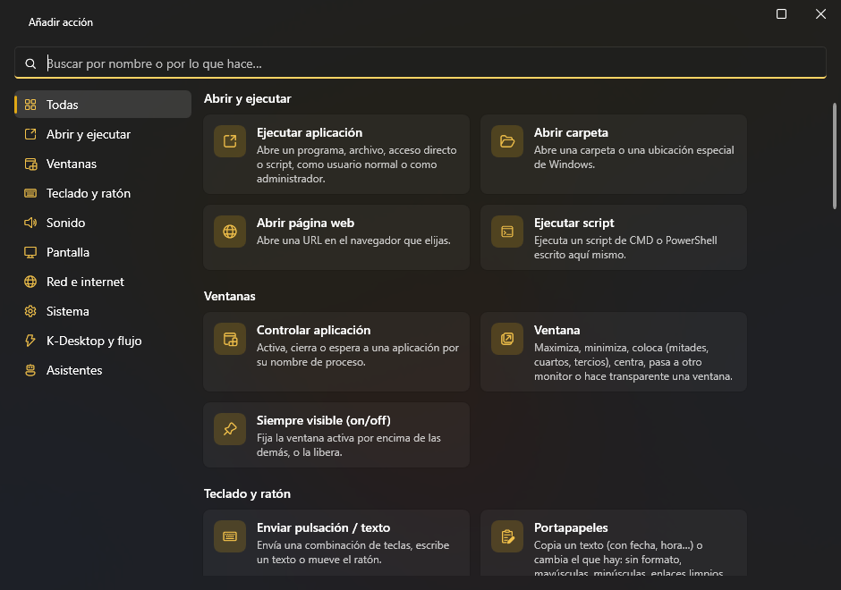
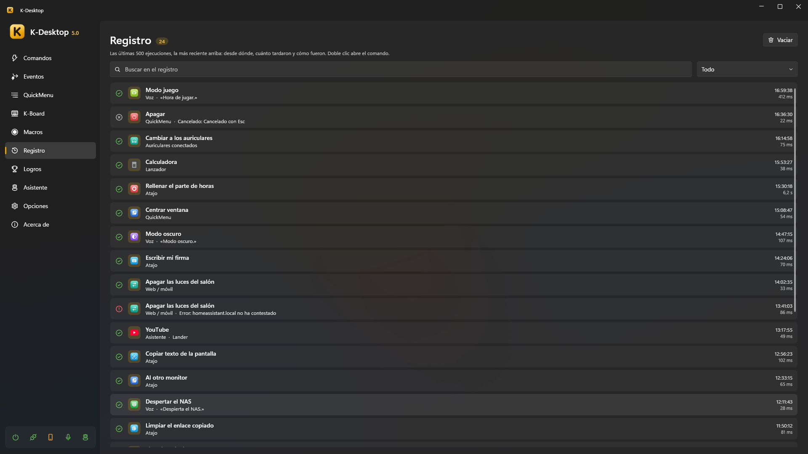

# Comandos

Un **comando** es una lista de acciones con un nombre. Se lanza con un atajo, desde un QuickMenu, el lanzador, la voz, el
móvil, la red, un evento, otro comando o un asistente.

## Atajos

Un atajo es cualquier combinación de teclas, botones del ratón y la rueda: `CTRL + ALT + O`, `F13`, `Mouse 5`,
`Mouse 4 + Mouse 1`, `CTRL + Wheel Up`… Para grabarlo, haz clic en la casilla del atajo y púlsalo. Un comando puede tener
varios.

- **Solo para un programa**: limita el comando a algunos programas (por el nombre de su proceso). Si el mismo atajo existe
  en general y para un programa, dentro de ese programa gana el específico y en todos los demás el general.
- **Desactivar en**: en *Opciones → Desactivar en* pones los programas (juegos, escritorios remotos…) donde los atajos de
  K-Desktop no hacen nada. La acción *Desactivar en la app actual* lo cambia para el programa que está delante.
- K-Desktop avisa cuando un atajo ya lo usa otro comando, el propio K-Desktop o un asistente.

### Esquinas y gestos del ratón

Junto a **Añadir atajo** hay dos botones más:

- **Esquina de la pantalla**: eliges una de las cuatro (↖ ↗ ↙ ↘) y el comando se ejecuta al dejar el ratón en ella un
  momento. Vale cualquier esquina donde el cursor se queda parado, también la que deja suelta una pantalla más alta o
  desplazada; donde se tocan dos pantallas no hay esquina. Nunca salta con un botón pulsado ni a pantalla completa.
- **Gesto del ratón**: un dibujo de un solo trazo (←, →, ↑, ↓, C, L, N, S, U, V, Λ, W, M, Z o un círculo) que haces
  manteniendo pulsado el botón derecho (o el central, Mouse 4 o Mouse 5). Si haces clic sin moverte, o lo mantienes quieto, el botón funciona
  como siempre; con Esc mientras dibujas no pasa nada. En la ventana del gesto hay un recuadro para probar los dibujos con
  el botón izquierdo, y **Dibujar el tuyo**: le das un nombre y lo dibujas tres veces.

La espera en la esquina, el botón de los gestos, ver el trazo y los programas sin gestos están en *Opciones → Ratón*.

## Acciones

Cada comando tiene una lista de acciones que se ejecutan en orden: abrir un programa, colocar una ventana, enviar teclas,
cambiar el volumen, esperar, ejecutar otro comando… Ver la [lista completa de acciones](actions.md).

- Cada acción se puede apagar sin borrarla, y su orden se cambia arrastrando.
- **Ejecutar** en el editor prueba el comando al momento.
- Un comando que tarda (espera, macro, script que se espera…) lleva un ▶ en la lista mientras está en marcha, y junto al
  número de comandos sale cuántos hay en marcha: haz clic para verlos o **detenerlos todos**. **Ejecutar** pasa a
  **Detener** mientras ese comando sigue en marcha.
- No puede haber dos comandos con el mismo nombre (tampoco dos eventos, QuickMenus, macros o perfiles de K-Board): si
  escribes uno que ya existe, se queda el de antes.
- Una acción que abre algo elige si va **como administrador o como usuario normal**.

## Si… (condiciones)

La acción **Si…** comprueba algo y, si no se cumple, para el comando, se salta las acciones siguientes o **ejecuta otro comando en su lugar** (elegido en la lista; usa las mismas [variables](actions.md#variables-pasar-datos-de-una-acción-a-otra)). Puede mirar:

| Condición | Ejemplo |
|---|---|
| Un programa está abierto / está delante | «Si Steam está abierto» |
| Una hora y unos días | «Si es de lunes a viernes de 9:00 a 18:00» |
| Un dispositivo está conectado | «Si el mando de Xbox está conectado» |
| El sonido sale por un dispositivo / algo está sonando | «Si el sonido sale por los auriculares» |
| Una red | «Si está conectado a WiFiCasa», «Si no hay red» |
| Batería o corriente | «Si funciona con batería» |
| Un equipo responde | «Si 192.168.1.10 responde» |
| Un archivo existe | «Si existe D:\copia.lock» |
| El portapapeles | «Si el portapapeles contiene «http»» |
| Uso del procesador, la gráfica o la memoria | «Si el procesador pasa del 80 %» |
| Batería por debajo de un % | «Si la batería está por debajo del 20 %» |
| Pantallas conectadas | «Si hay 2 pantallas o más» |
| Es de día | «Si es de día», «Si es de noche» (entre el amanecer y el atardecer donde estás) |
| Un texto o variable: tiene algo, contiene, es igual a, es mayor o menor que | «Si {resultado} contiene «error»», «Si {resultado} es mayor que 80» |

Todas las condiciones se pueden poner **Al revés** («no está», «no responde»…). Al comparar, los números se comparan como números
(«7» es menor que «10»; «2,5» y «2.5» son lo mismo) y el texto sin mirar mayúsculas.

## Registro

*Registro* enseña todo lo que se ha ejecutado: qué comando, cuándo, desde dónde (atajo, menú, lanzador, voz, móvil, red,
evento, asistente, servidor MCP, línea de comandos…) y si fue bien.

## Organizar

- **Busca** por nombre, atajo o acción, y **filtra** la lista: todos los comandos, los que están fuera de los QuickMenus o
  los de un QuickMenu.
- **Habilita o deshabilita** un comando, **ocúltalo** en la lista (sigue funcionando), **duplícalo** o bórralo (sale
  también de los QuickMenus en los que estaba).
- **Disponible por control remoto**: si el móvil y la red lo pueden ver y ejecutar.
- **Icono**: automático (el de su primera acción), un icono vectorial incluido en cualquier color, una biblioteca de iconos
  de Windows, cualquier imagen o el favicon de una web.
- En el editor, **Probar solo esta acción** ejecuta una acción sola.

### Exportar e importar

Un comando, una macro, un perfil de K-Board, un evento o un QuickMenu se pueden pasar sueltos a otro PC (o guardar aparte)
con **Exportar…**, desde el clic derecho de la lista o con el botón del disco en la cabecera del editor. Se guarda un
archivo `.kdx` con todo lo que necesita: los comandos que ejecuta un evento, las macros, QuickMenus, perfiles de K-Board,
disposiciones y eventos que usa un comando, los comandos de un menú o de un perfil… y tus propios iconos, sonidos y gestos.

Para traerlo: **Importar…** en el clic derecho de cualquiera de esas listas (también en el hueco bajo las filas), o
suelta el `.kdx` en la ventana de K-Desktop. Nunca pisa nada:

- Lo que ya tienes igual se usa tal cual.
- Si algo ya lo tienes pero con cambios, pregunta: **Añadir como copia** (entra aparte, y también lo que lo usa, para que
  funcione como se exportó) o **Usar lo mío**.
- Un nombre que ya existe recibe un número («Saludo 2») y un atajo que ya usas se queda fuera.

Al acabar abre lo importado. Desde fuera: `KDesktop.exe --import "archivo.kdx"`.
