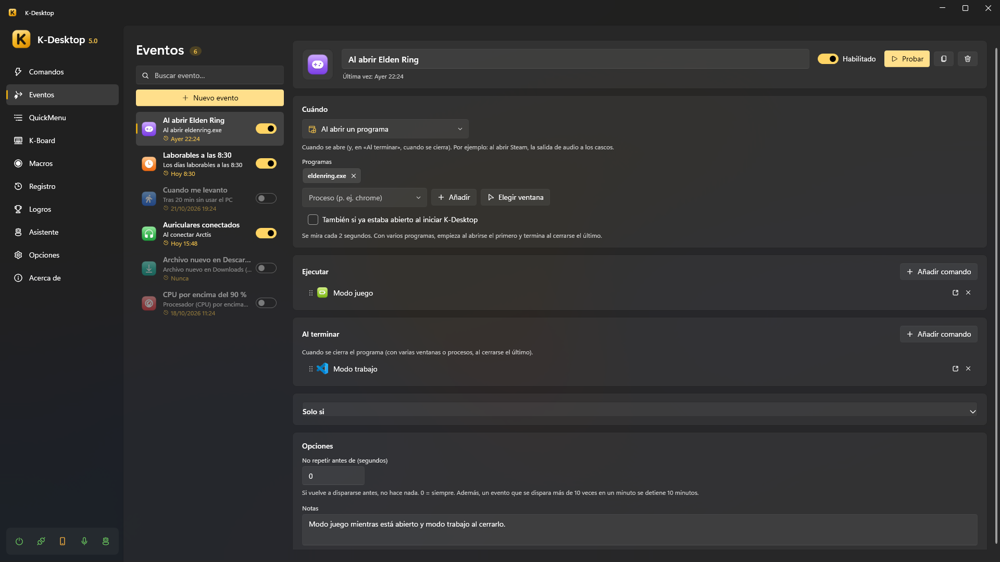

# Eventos

Un evento es «cuando pase esto, ejecuta estos comandos». Cada evento tiene un disparador, condiciones si quieres y los
comandos que ejecuta; muchos disparadores tienen además una parte **«Al terminar»** (el programa se cierra, vuelves al PC,
se quita el dispositivo…) con sus propios comandos.



## Disparadores

| Disparador | Cuándo |
|---|---|
| Al iniciar K-Desktop / Al salir de K-Desktop | Lo que antes era «Ejecutar al iniciar / al salir» en cada comando |
| A una hora | Todos los días o algunos días de la semana, a la hora que digas |
| Cada cierto tiempo | Cada N minutos mientras K-Desktop está abierto |
| Al abrir un programa | Cuando se abre; «Al terminar», cuando se cierra. *Al abrir Steam, el sonido a los auriculares* |
| Programa en primer plano | Cuando su ventana pasa a primer plano, y cuando deja de estarlo |
| Sin usar el PC | Tras unos minutos sin teclado ni ratón; «Al terminar», cuando vuelves |
| Bloquear, suspender… | Cuando la sesión se bloquea o desbloquea, o el PC se suspende o se despierta |
| Batería o corriente | Cuando un portátil pasa a batería o vuelve a la corriente |
| Archivo nuevo en una carpeta | Cuando aparece un archivo (creado, copiado, descargado…), en cuanto deja de crecer |
| Llamada desde fuera | Cuando otro equipo, Home Assistant o un script lo pide por su nombre, por UDP o por la web |
| Unidad conectada | Cuando se conecta un USB, un disco o una tarjeta (y cuando se retira) |
| Red | Al conectarse a una red (o a cualquiera), o al quedarse sin red |
| Dispositivo conectado | Cuando se conecta un mando, teclado, auriculares o un aparato USB (y cuando se desconecta) |
| Uso del equipo | Cuando el procesador, la gráfica o la memoria pasan (o bajan) de un % durante un rato |
| Dispositivo de audio | Cuando se conectan unos auriculares o un altavoz, o uno pasa a ser la salida predeterminada |

## Opciones

- **Condiciones** (*Solo si*): las mismas que la [acción Si…](commands.md#si-condiciones): el evento solo se ejecuta si se
  cumplen.
- **No repetir antes de**: si vuelve a dispararse antes (en segundos), no hace nada.
- **Protección contra bucles**: un evento que se dispara más de 10 veces en un minuto se detiene 10 minutos, y K-Desktop te
  avisa.
- Cada evento se puede apagar, y ejecutar a mano para probarlo (*Ejecutar*, o `KDesktop.exe --event "Nombre"`).

## Lanzar un evento desde fuera

El disparador *Llamada desde fuera* salta cuando llega una llamada con su nombre. No importan las mayúsculas ni los
acentos.

```
UDP:   event puerta                    (puerto 2501, «Control remoto» encendido)
HTTP:  POST http://<PC>:2502/api/event
       X-KD: 1
       Authorization: Bearer <token>
       {"name": "puerta"}
```

Por UDP necesita *Opciones → Control remoto* encendido con *Eventos* permitido (y la clave, si tiene, desde otro
equipo); por la web, el dispositivo tiene que estar emparejado (ver [Móvil y control remoto](remote.md)).
