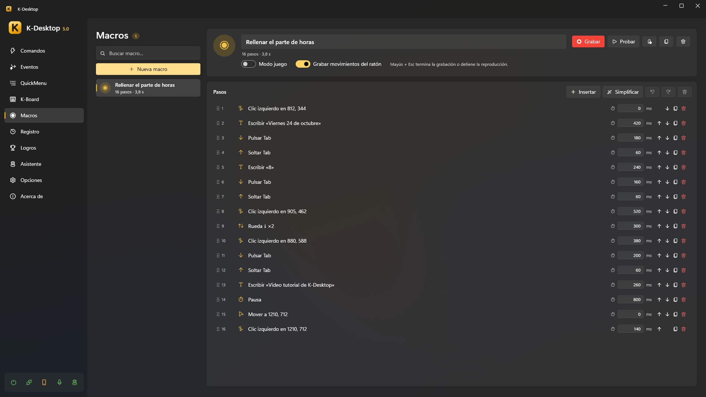
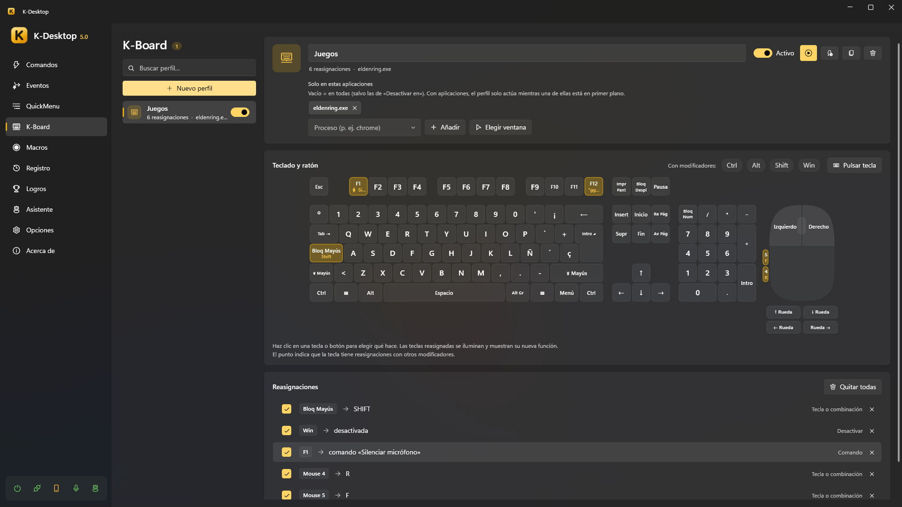

# Macros y K-Board

## Macros

Una macro guarda lo que haces con el teclado y el ratón, con sus tiempos, para repetirlo.

1. *Macros → Nueva macro* y luego **Grabar**.
2. Haz lo que quieras repetir. **Mayús + Esc** acaba la grabación (y para una reproducción).
3. Cambia los pasos si quieres: pulsar o soltar una tecla, escribir un texto, un clic, mover el ratón, girar la rueda, una
   pausa… cada uno con su tiempo.
4. **Probar** la reproduce una vez a los 3 segundos. **Crear un comando que la reproduzca** te deja un comando listo para
   darle un atajo.

Opciones:

- **Grabar movimientos del ratón**: apagado, solo se graban los clics (con su posición), la rueda y el teclado.
- **Modo juego**: para juegos. Los clics no mueven el puntero, el ratón se graba como movimiento relativo (lo que leen los
  juegos aunque bloqueen el puntero) y las teclas y clics se mantienen un momento para que el juego los vea. Los juegos
  con antitrampas pueden ignorar cualquier pulsación simulada.
- La acción *Reproducir macro* la reproduce una vez o varias, en bucle o a otra velocidad.

## K-Board

K-Board cambia lo que hacen las teclas, los botones del ratón y la rueda, en todas partes o solo en los programas que
elijas: Bloq Mayús como Ctrl, la tecla de Windows apagada en los juegos, botones laterales que copian y pegan…

- Un **perfil** es un conjunto de cambios. Puede haber varios encendidos a la vez.
- Haz clic en una tecla o un botón del teclado y el ratón dibujados (o **Pulsar tecla** para elegirla) y elige qué hace:
  - **otra tecla, botón o la rueda**, mantenida mientras mantienes la original (vale para modificadores y en juegos);
  - **un texto** que escribir, con cualquier distribución de teclado (los saltos de línea pulsan Intro);
  - **un comando** (la tecla ya no llega al programa);
  - **nada** (la tecla queda apagada mientras el perfil está encendido).
- **Con modificadores**: marca Ctrl, Alt, Mayús o Win para cambiar una combinación (Ctrl + J) en vez de la tecla sola.
- **Solo en estas aplicaciones**: vacío = en todas partes; con programas, el perfil solo actúa con uno de ellos delante.
- **Ejecutar siempre**: también en los programas de *Desactivar en* (un juego), donde los atajos de los comandos siguen
  apagados pero las teclas se siguen cambiando.
- Enciende y apaga un perfil aquí, desde la bandeja o desde un comando con la acción *K-Board* (**Crear un comando que
  active y desactive este perfil**).
