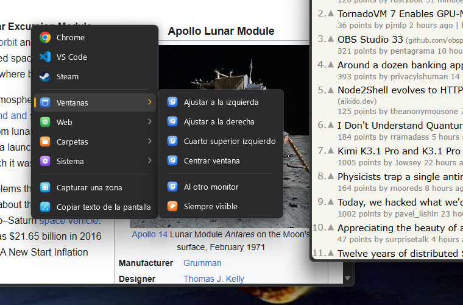
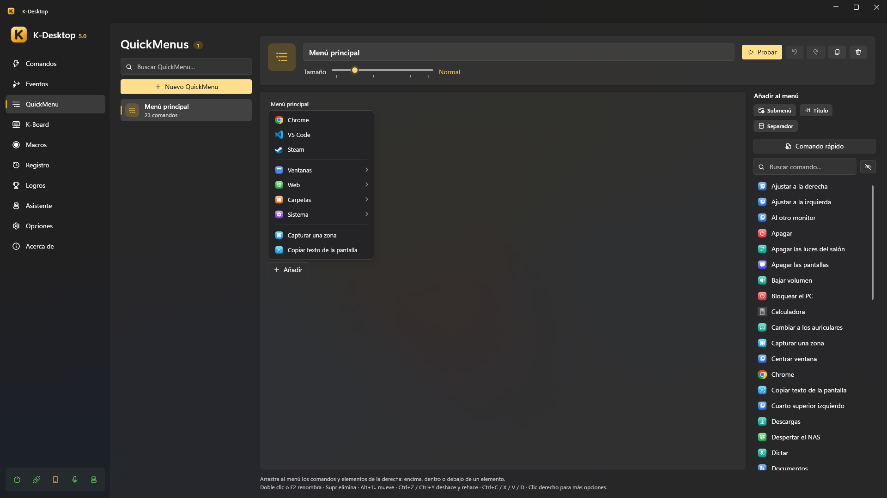
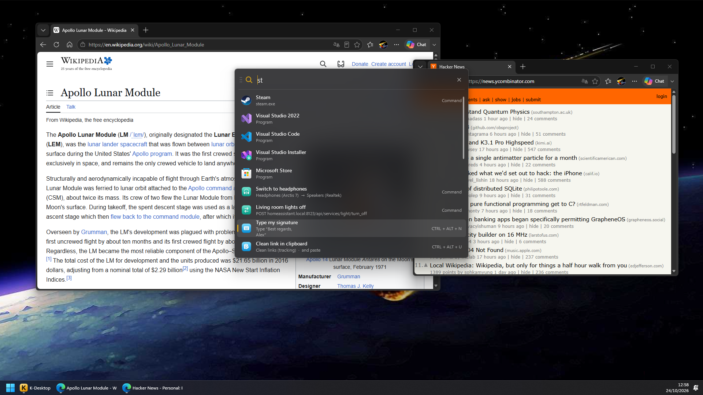
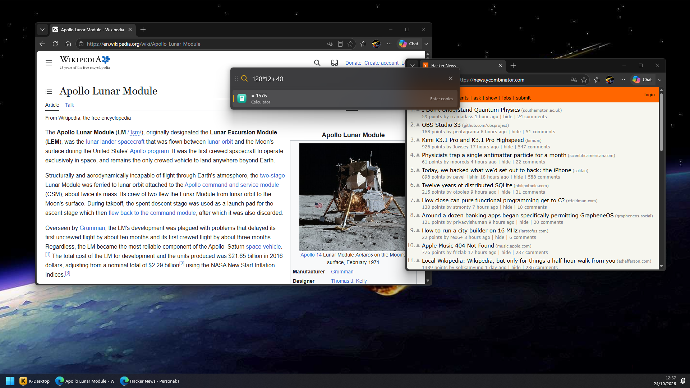

# QuickMenu y lanzador

## QuickMenu

Un QuickMenu es un menú con tus comandos que se abre donde está el ratón: submenús en cascada, iconos, fondo acrílico y
manejo con el teclado.

- **Ábrelo** desde un comando con la acción *Abrir QuickMenu* (dale a ese comando un atajo como `Mouse 4 + Mouse 1`),
  desde el móvil o con `KDesktop.exe --menu "Nombre"`.
- **Úsalo**: el clic izquierdo ejecuta y cierra, el derecho ejecuta y deja el menú abierto, y el central edita ese
  elemento. Con el teclado: flechas, Intro y Esc.
- **Ciérralo** con Esc o con un clic fuera (también en la ventana de K-Desktop). Su atajo otra vez lo cierra si el ratón
  está encima del menú; si no, lo vuelve a abrir donde está el ratón.
- **Tamaño**: de *Compacto* a *Enorme*, en cada menú.

### Editarlo

En *QuickMenu*, arrastra comandos de la lista de la derecha al menú: encima, dentro o debajo de un elemento. Los
elementos pueden ser comandos, submenús y separadores, cada uno con su nombre y su icono si quieres.

- **Comando rápido** crea un comando a partir de un programa, un archivo, una carpeta o una web y lo añade de una vez;
  luego puedes afinarlo en *Comandos*.
- Doble clic o F2 cambia el nombre, Supr lo quita, Alt+↑↓ lo mueve, Ctrl+Z / Ctrl+Y deshacen y rehacen, Ctrl+C / X / V / D
  copian, cortan, pegan y duplican; con el botón derecho hay más.
- **Probar** abre el menú tal como se verá, y el botón del rayo crea un comando que lo abre (para darle un atajo o una
  frase de voz).
- El botón junto a *Añadir al menú* oculta ese panel para tener más sitio. La rueda del ratón mueve el menú hacia los
  lados; si también es más alto que el espacio, la rueda lo mueve arriba y abajo, y Ctrl + rueda hacia los lados.

### Menú de IA

**Crear menú de IA** (debajo de *Nuevo QuickMenu*) crea el QuickMenu «IA» con siete comandos para lo que tengas
seleccionado: **Traducir** y **Corregir** pegan la respuesta en lugar de la selección; **Resumir**, **Explicar** y
**Responder** la enseñan en una hoja. Cada uno es una acción *Asistente: preguntar* con `{seleccion}` que contesta
K-Desktop. **Leer en voz alta** es una *Asistente: decir* con `{seleccion}`: K-Desktop lo lee con su voz. **Traducir la pantalla** no necesita
selección: eliges una zona con el ratón, *Copiar texto de la pantalla* lee su texto y *Asistente: preguntar* lo traduce
en una hoja (con `{resultado}`). En cada comando puedes cambiar el texto, la respuesta o elegir otro asistente. También crea el comando
«Menú de IA», que lo abre: ponle un atajo. Necesita el módulo Asistente encendido y un cerebro.

## Lanzador

El lanzador es una caja de búsqueda con su propio atajo (*Opciones → Lanzador*). Escribe parte de un nombre —valen las
iniciales o letras sueltas: «cmfy» encuentra ComfyUI—, elige con ↑ ↓ y pulsa Intro. Esc, o el mismo atajo, lo cierra.

Encuentra:

- **Tus comandos**, también los ocultos si quieres.
- **Los programas del menú Inicio**, con las aplicaciones de la Tienda.
- **Cuentas**: escribe `12*3.5` e Intro copia el resultado.

  
- **Lo que has copiado** (*Historial del portapapeles*): lo del [historial](clipboard.md) que tenga lo escrito; Intro lo
  pega donde estabas.
- **Archivos y carpetas**: los que se llaman como lo escrito, del índice de búsqueda de Windows y de tus carpetas
  (Escritorio, Documentos, Descargas…). Salen un momento después, al final. Empieza por `?` para buscar solo archivos
  (`?factura luz`). Intro lo abre y Ctrl+Intro abre la carpeta donde está.
- **La web**: cuando no hay nada mejor, ofrece buscarlo en internet (con el buscador que elijas).

Con *Los más usados primero*, lo que más usas sale antes, incluso antes de escribir nada.
