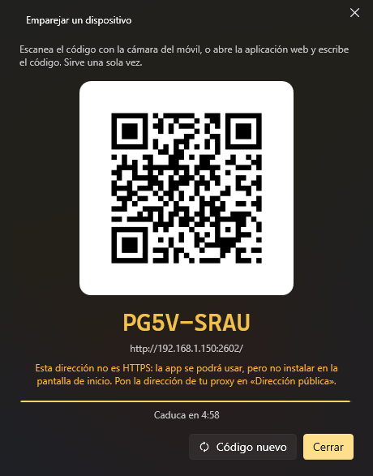

# Móvil y control remoto

## Aplicación web (móvil, tableta, cualquier navegador)

*Opciones → Aplicación web* enciende un pequeño servidor web en tu PC (el puerto 2502 por defecto). Desde un móvil en la
misma red tienes tus comandos y menús, el volumen y la salida de audio, un touchpad y un teclado, órdenes de voz y el chat
de los asistentes. Se puede instalar en el móvil como aplicación (PWA).



1. Enciende **Servidor web**.
2. **Emparejar dispositivo**: escanea el código QR con el móvil (o abre el enlace que enseña).
3. Ya está: el dispositivo queda emparejado hasta que lo **revoques** en *Dispositivos emparejados*.

Las pestañas de la aplicación:

| Pestaña | Qué tiene |
|---|---|
| **Menús** | Tus QuickMenus |
| **Comandos** | Todos los comandos marcados como *Disponible por control remoto* |
| **Audio** | Volumen, silencio, reproducir/pausa, siguiente, anterior y la salida de audio |
| **Touchpad** | Mover el ratón, hacer clic, desplazar y escribir en el PC (solo con *Touchpad y teclado* encendido) |
| **Asistente** | El chat con los asistentes, por escrito o hablando |
| **Ajustes** | Tema, idioma y las opciones de la aplicación |

A tener en cuenta:

- Nada funciona hasta emparejar un dispositivo, **también desde el mismo PC**.
- Para escuchar en la red, K-Desktop tiene que ir como administrador (como va por defecto); si no, el servidor solo
  contesta a este PC.
- *Dirección de internet* es opcional, solo si entras desde fuera a través de un proxy inverso.
- *Aceptar órdenes de* dice desde dónde se puede entrar: *Solo este PC*, *Red local* o *Internet* (lo que llega por el
  proxy cuenta como internet). Emparejar hace falta siempre.

## Aplicación de Android

La aplicación de Android es la misma aplicación web con micrófono propio. *Opciones → Aplicación de Android → Guardar la
APK…*, cópiala al móvil y ábrela (Android pide permitir instalar aplicaciones de ese origen). No necesita tienda: cuando se
conecta un móvil con una versión más antigua, la aplicación ofrece actualizarse desde el PC.

## UDP

*Opciones → Control remoto → Servidor UDP* (puerto 2501) acepta órdenes cortas, una por mensaje. Lo puede usar Home
Assistant, un script, otro PC, netcat o una aplicación del móvil.

| Orden | Qué hace |
|---|---|
| `list` | Contesta con tus comandos remotos, numerados |
| Un número o un nombre (o `run <nombre>`) | Ejecuta ese comando remoto (no importan las mayúsculas ni los acentos) |
| `event <nombre>` | Lanza los eventos con *Llamada desde fuera* y ese nombre |
| `ask <asistente> <texto>` | Le hace una pregunta o le da una orden a un asistente activo |
| `assistants` | Contesta con los asistentes activos |
| `keys <teclas>` | Pulsa una combinación de teclas (`ctrl+c`, `alt+f4`, `enter`…) |
| `type <texto>` | Escribe un texto |
| `media play` / `next` / `previous` / `stop` | Teclas multimedia |
| `volume up` / `down` / `mute` | Volumen |
| `show` | Enseña la ventana de K-Desktop |
| `help` | Contesta con esta lista |

La respuesta empieza por `OK` o `ERROR` y sigue en el idioma de K-Desktop.

Opciones:

| Opción | Qué hace |
|---|---|
| **Puerto (UDP)** | El puerto; si otro programa lo usa, lo dice debajo |
| **Aceptar órdenes de** | *Solo este PC*, *Red local* (incluye las VPN) o *Internet* (solo con clave, y solo órdenes firmadas) |
| **Clave** | Opcional. Desde otro equipo se pone delante de cada orden (`miclave list`) o se firma con ella. Desde este PC no hace falta. *Generar* crea una y la copia |
| **Teclas y texto** | Permite `keys` y `type` (apagado por defecto) |
| **Comandos ocultos** | Los comandos remotos ocultos también salen en `list` y se pueden ejecutar |
| **Eventos** | Permite `event` |
| **Asistentes** | Permite `ask` (apagado por defecto) |

Lo que no está permitido no recibe respuesta, y una dirección que falla la clave varias veces seguidas se ignora unos
minutos.

### Órdenes en JSON (para programas)

Un programa puede mandar la orden en JSON y recibe la respuesta en JSON:

```
{"cmd": "run", "arg": "Abrir Chrome"}
{"ok": true, "message": "ejecutado: Abrir Chrome"}

{"cmd": "list"}
{"ok": true, "commands": ["Abrir Chrome", "Apagar"]}

{"cmd": "ask", "assistant": "lander", "arg": "¿qué tiempo hace?"}
{"ok": false, "error": "off", "message": "desactivado en las opciones del control remoto"}
```

`cmd` es una de las órdenes de la tabla (`run`, `list`, `event`, `ask`, `keys`, `type`, `media`, `volume`…) y `arg`
lo que va detrás. Los errores llevan un código fijo en `error` (`notFound`, `disabled`, `off`, `badRequest`,
`noEvent`, `noAssistant`, `assistantsOff`, `notRunning`, `disabledHere`).

**Con clave**, el JSON va **firmado**: la clave nunca viaja y un mensaje capturado no se puede repetir. El mensaje es
`<firma>.<json>`, donde la firma es el HMAC-SHA256 del JSON con la clave, en hexadecimal, y el JSON lleva `t` (la hora en
segundos Unix; vale con un minuto de diferencia) y un `id` distinto en cada mensaje:

```js
const json = JSON.stringify({ cmd: "run", arg: "Abrir Chrome", t: Math.floor(Date.now() / 1000), id: crypto.randomUUID() });
const firma = crypto.createHmac("sha256", clave).update(json).digest("hex");
socket.send(firma + "." + json, 2501, "192.168.1.150");
```

```python
payload = json.dumps({"cmd": "list", "t": int(time.time()), "id": uuid.uuid4().hex})
firma = hmac.new(clave.encode(), payload.encode(), hashlib.sha256).hexdigest()
sock.sendto(f"{firma}.{payload}".encode(), ("192.168.1.150", 2501))
```

Desde internet solo se aceptan órdenes firmadas. Para algo más completo y emparejado está la API web, abajo.

## API web

Los dispositivos emparejados también pueden llamar directamente a la API, por ejemplo para lanzar un evento:

```
POST http://<PC>:2502/api/event
X-KD: 1
Authorization: Bearer <token>

{"name": "puerta"}
```
