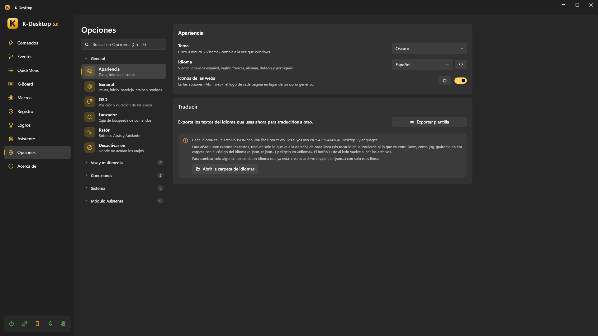
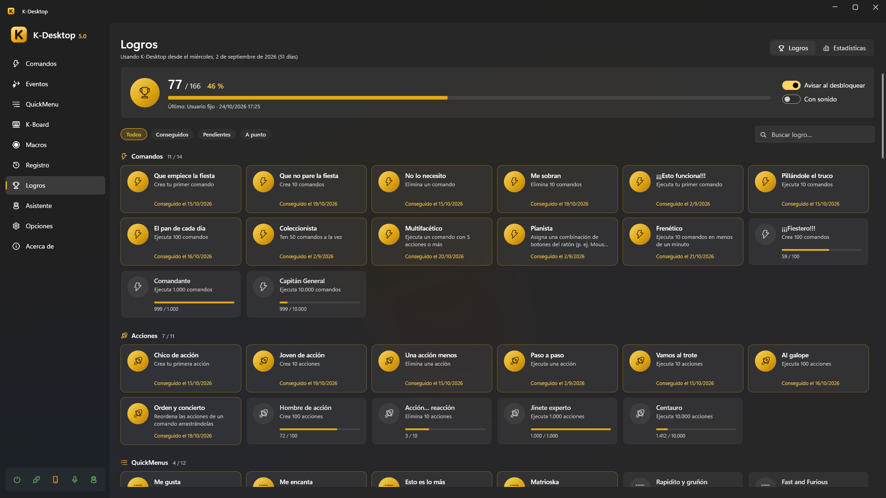

# Opciones, datos y privacidad

*Opciones* está organizada en grupos plegables, con un buscador arriba (Ctrl+F): escribe «volumen» o «copia» y te lleva
allí.

## General

| Sección | Qué tiene |
|---|---|
| **Apariencia** | Tema claro, oscuro o el del sistema; idioma (el de Windows, o uno de los seis incluidos); iconos de las webs; traducir |
| **General** | Pausar K-Desktop (con su atajo y sus sonidos); iniciar con Windows, el icono de la bandeja y su imagen; los atajos para enseñar la ventana y para salir, los sonidos y el mensaje al arrancar |
| **Mensajes y notificaciones** | Los mensajes en pantalla (OSD) de K-Desktop: si salen (apagados no sale ninguno, salvo las cuentas atrás y el progreso de lo que se puede parar), si las cuentas atrás salen en un **círculo** en el centro de la pantalla, un poco más abajo (con un botón para probarlo), qué sonido suena al cancelar una cuenta atrás con Esc, dónde salen (pulsando en un dibujo de la pantalla), en qué monitor, su tamaño, cuánto duran, qué hacen con una película o un juego a pantalla completa y qué grupos salen (acciones, volumen y brillo, voz, avisos). Debajo, las **notificaciones**: su **sonido** (el de todas; *Mostrar notificación* puede elegir otro o «Global»), si salen las de los logros y con su sonido, en qué monitor y esquina (también en un dibujo), cuánto duran y si esperan a que acabe lo que está a pantalla completa |
| **Lanzador** | Su atajo, qué encuentra (programas, comandos ocultos, cuentas, archivos, la web) y en qué orden |
| **Ratón** | **Esquinas activas**: cuánto hay que dejar el ratón en una esquina para que se ejecute su comando. **Gestos del ratón**: encenderlos o apagarlos, el botón para dibujar (derecho, central, Mouse 4 o Mouse 5), **ver el trazo** (la línea en la pantalla y el comando que se va a ejecutar) y los programas **sin gestos** (juegos, programas de dibujo o 3D). **Bloquear Atrás / Adelante del ratón**: programas donde Mouse 4 y Mouse 5 no van atrás ni adelante. Las esquinas y los gestos se eligen en los atajos de cada [comando](commands.md) |

## Voz

| Sección | Qué tiene |
|---|---|
| **Voz** | Encender o apagar la voz (apagada, nada escucha), los modelos, el micrófono, los atajos para hablar y para dictar, y qué pasa al escuchar. Ver [Voz](voice.md) |
| **Palabras de activación** | La escucha continua y las palabras grabadas con tu voz, de quién es cada una y su sensibilidad |

## Multimedia

| Sección | Qué tiene |
|---|---|
| **Multimedia** | Órdenes de voz para la música, los vídeos y el volumen, y cuánto sube o baja cada vez |
| **Capturas de pantalla** | Carpeta (y **Abrir**), **nombre del archivo** con fecha, hora, programa o título de la ventana, **formato** (PNG, JPG con su calidad o WebP), **esperar antes** de capturar (para abrir un menú), **copiar siempre**, **incluir el puntero del ratón**, **sonido de cámara** y **destello** sobre lo capturado |
| **Grabación de pantalla** | Carpeta (y **Abrir**), **nombre del archivo** (como en las capturas), **fotogramas por segundo** (30 o 60), **calidad** (baja, normal o alta) y **grabar el puntero del ratón**; se codifica en MP4 (H.264) con la tarjeta gráfica (ver *Grabar vídeo* en [Acciones](actions.md)) |
| **Grabación de audio** | Carpeta (y **Abrir**), **nombre del archivo** (como en las capturas), **formato** (WAV, MP3 u Opus: se convierte al acabar), **volumen del micrófono** (solo en las grabaciones), **partir las grabaciones largas** cada tantos minutos, y **Guardar lo que acaba de sonar**, que recuerda en memoria los últimos segundos para que *Grabar audio → Guardar lo que acaba de sonar* los guarde (no se escribe nada en el disco) |

## Conexiones

| Sección | Qué tiene |
|---|---|
| **Control remoto** | El servidor UDP: puerto, desde dónde, clave y qué se permite. Ver [Móvil y control remoto](remote.md) |
| **Aplicación web** | El servidor web, emparejar y los dispositivos emparejados, touchpad y teclado |
| **Aplicación móvil** | Su versión y «Guardar la APK» |

## Sistema

| Sección | Qué tiene |
|---|---|
| **Desactivar en** | Programas donde los atajos de K-Desktop no hacen nada (juegos, escritorios remotos), con un atajo para añadir o quitar el de delante |
| **Lupa** | Aumento, forma (lente rectangular, redonda o pantalla completa), tamaño y «Probar»; **aspecto**: borde (sin borde, fino, medio o grueso) y su color, colores (normales, invertidos o más contraste) y suavizar; **comportamiento**: seguir al texto mientras escribes, **Ctrl + rueda** cambia el aumento mientras está encendida, y apagarla sola tras un rato sin mover el ratón |
| **Datos** | La carpeta de los datos (un enlace que la abre), exportar, importar y el registro; **copias automáticas** (cada cuántos días, cuántas guardar, carpeta con **Examinar** y **Abrir**, y **Hacer copia ahora**) y reiniciar logros y estadísticas |
| **Actualizaciones** | La versión, **Buscar ahora**, qué hacer cuando hay una nueva, **cuándo comprobar** (al iniciar K-Desktop, cada 6 horas, una vez al día o una vez a la semana) y los **asistentes** instalados, cada uno con **Actualizar…**. Una versión nueva se avisa con una notificación; al pulsarla se abre esta página |

El **módulo Asistente** tiene su propio grupo: ver [Asistentes](../assistant/index.md).

## Copias de seguridad

- **Exportar** guarda todo lo tuyo en un `.zip`: opciones, comandos, QuickMenus, macros, perfiles de K-Board, logros y
  estadísticas, palabras de activación, y tus propios iconos, sonidos e idiomas (y los datos de los asistentes).
- **Copias automáticas**: la misma copia completa cada N días, guardando las últimas, en la carpeta que elijas (mejor en
  otro disco, OneDrive o un NAS). Además, las opciones se copian cada día.
- **Importar** restaura una copia. Antes se guarda la configuración actual en la carpeta de copias.
- Para pasar **una sola cosa** (un comando, una macro, un perfil, un evento, un QuickMenu, una disposición o un texto) con lo que usa, sin tocar lo
  demás: [exportar e importar sueltos](commands.md#exportar-e-importar).

## Idiomas

Hay seis incluidos: español, inglés, francés, alemán, italiano y portugués. Los idiomas de más son archivos JSON en
`%APPDATA%\K-Desktop 5\Languages`. En *Traducir*, **Exportar plantilla** saca el idioma actual: traduce los textos,
guarda el archivo ahí con el código del idioma (`nl.json`) y elígelo en *Idioma*. Un archivo con solo algunos textos
(`es.json`) cambia solo esos.

## Logros y estadísticas

Más de 100 logros con avisos animados, y estadísticas de lo que más usas.

## Privacidad

El reconocimiento de voz, las palabras de activación, las voces y la IA de los asistentes van **en tu PC**. Nada de lo que
dices o escribes se manda a ninguna parte. K-Desktop solo sale a internet para lo que le pides:

- las peticiones web de tus comandos;
- las herramientas de internet, del tiempo y de monedas de los asistentes, y las herramientas y servidores MCP que añadas
  tú;
- buscar actualizaciones, y descargar voces o modelos.

El móvil habla con el PC por tu red local y necesita emparejarse, también desde el mismo PC.
