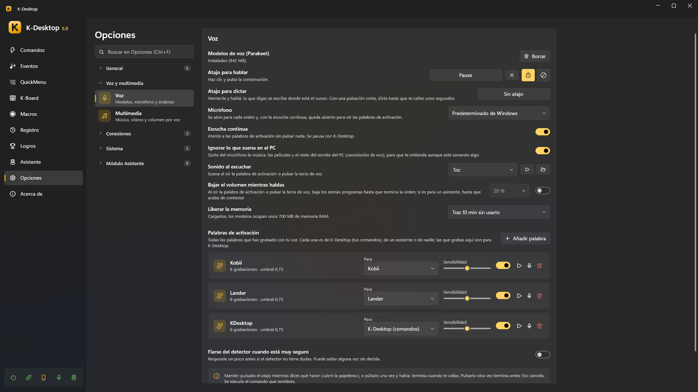

# Voz

K-Desktop entiende órdenes habladas **en tu PC**: ni el audio ni el texto salen de él, y no hace falta internet.

## Prepararla

1. *Opciones → Voz → Modelos de voz → Descargar*. Se descargan una vez: **Parakeet** (de voz a texto, muchos
   idiomas), **Silero** (detecta cuándo hablas), el detector de la palabra de activación y **EmbeddingGemma** (encuentra el
   comando por su significado). Cargados, ocupan unos 700 MB de RAM; se pueden liberar tras unos minutos sin usarlos
   (Parakeet no, mientras haya una palabra de activación escuchando: así la comprueba al momento).
2. Elige el **micrófono** (o el predeterminado de Windows).
3. Graba una **palabra de activación** (*Opciones → Palabras de activación → Añadir palabra*) o pon un **atajo para hablar**.

## Hablarle

- **Atajo**: mantenlo pulsado mientras dices qué hacer («abre la papelera»), o púlsalo una vez y habla: acaba cuando dejas
  de hablar. Pulsarlo otra vez acaba antes; Esc cancela.
- **Palabra de activación**: con *Escucha continua*, di la palabra y la orden seguidas («K-Desktop, abre el navegador»), o
  solo la palabra y espera a «Escuchando…».

Se ejecuta el comando que nombras. Se encuentra **por su nombre** (también cuando el reconocimiento se equivoca un poco) o
**por su significado** («pon algo de música» encuentra tu comando «Spotify»). A un comando le puedes enseñar más frases.

## Palabras de activación

En *Opciones → Palabras de activación* grabas tu propia palabra con tu voz, en unos segundos, con un pequeño asistente: un poco de silencio, la palabra varias
veces y un poco de habla normal para que aprenda lo que *no* es la palabra.

- Cada palabra es de **K-Desktop** (tus comandos), de **un asistente**, o de nadie (no se escucha).
- **Sensibilidad**: más a la derecha la pilla con más facilidad, pero también puede saltar sin que la digas. **Probar** te
  dice qué tal va.
- *Responder más rápido*: si el detector no tiene dudas, contesta sin comprobarlo con Parakeet.
- No sale nada (ni «Escuchando…», ni el sonido, ni baja la música) hasta que comprueba que de verdad era la palabra.
- Dicha a mitad de frase («le estaba enseñando a mi hermano el Lander») entiende que hablas *de* él, no *con* él, y no
  hace nada.

## Mientras hablas

- **Ignorar lo que suena en el PC**: la cancelación de eco quita del micrófono la música y las películas, para que te
  entienda aunque suene algo.
- **Bajar el volumen mientras hablas**: los demás programas bajan hasta que acaba la orden (con un asistente, hasta que
  termina de contestar).
- **Sonido al escuchar**.

## Música, vídeos y volumen

*Opciones → Multimedia*: órdenes como «reproduce», «pausa», «siguiente», «sube el volumen», «volumen al 30» funcionan sin
crear ningún comando, en cualquiera de los idiomas instalados.

## Dictado

La acción *Dictar* (y su propio atajo en *Opciones → Voz*) escribe lo que dices donde está el cursor, sin IA. Di «nueva
línea», «punto y aparte», «borra eso» o «deja de dictar»; también acaba tras unos segundos de silencio o con Esc.
