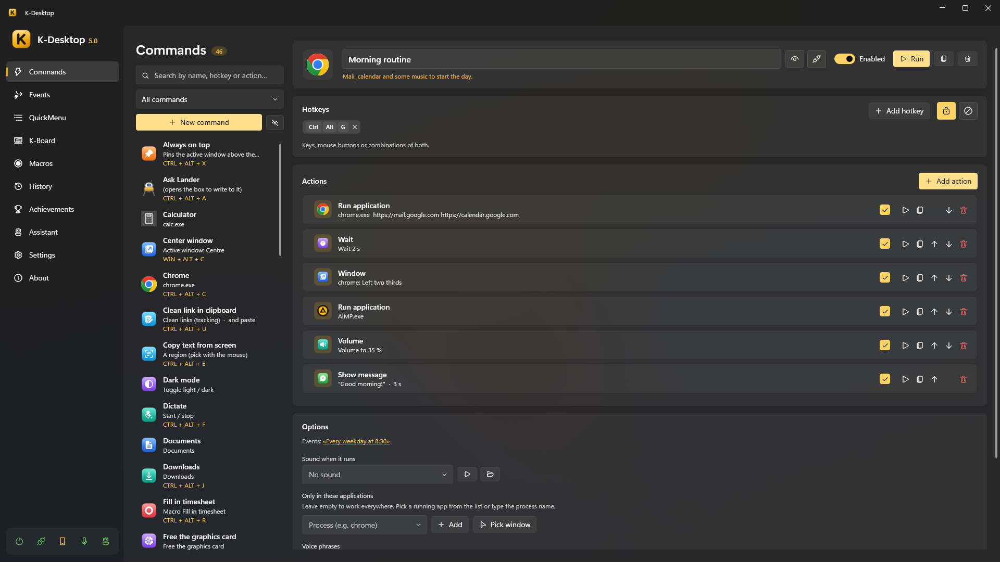

# K-Desktop

Keyboard and mouse shortcuts, QuickMenus, macros, events, voice control and a phone remote for Windows,
with optional desktop assistants powered by local AI.

> [!WARNING]
> K-Desktop 5 is still under active development. Things change from one version to the next, and the assistant module
> and its SDK are being finished.

| | |
|---|---|
| **[English documentation](en/index.md)** | Using K-Desktop, the assistant module, and making your own assistants |
| **[Documentación en español](es/index.md)** | Cómo usar K-Desktop, el módulo Asistente y cómo hacer tus propios asistentes |
| **[SDK API reference](api/KDesktop.Assistant.Sdk.yml)** | Every type of the assistant SDK (in English) |

[Source code](https://github.com/Kobayashi82/K-Desktop) ·
[Assistants](https://github.com/Kobayashi82/K-Desktop-Assistants) ·
[Releases](https://github.com/Kobayashi82/K-Desktop/releases)
